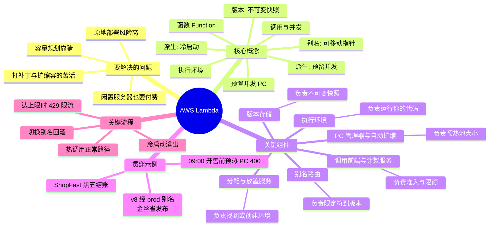

# AWS Lambda —— 思维模型学习指南

> **你在这里：** 本指南包的入口。
> **读完本文你将知道：** 整个知识版图的全貌、指南包的组织方式，以及下一步该读哪个文件。

本指南包从第一性原理讲解 AWS（Amazon Web Services，亚马逊云服务）Lambda：它为什么存在、一次调用在服务内部究竟如何流转，以及**版本（Version）**、**别名（Alias）**和**预置并发（Provisioned Concurrency）**如何嵌入这幅图景。全篇沿一条主线展开：**Why（为什么）→ What（是什么）→ 概念地图 → 贯穿示例 → 组件深入 → 完整走查**，并由一个贯穿始终的示例串联：网店 **ShopFast** 的 `checkout`（结账）函数在黑色星期五那一周的经历。

---

## 缩写对照表

| 缩写 | 英文全称 | 中文 | 在本指南中的含义 |
|---|---|---|---|
| AWS | Amazon Web Services | 亚马逊云服务 | 亚马逊的云平台 |
| API | Application Programming Interface | 应用程序编程接口 | 如 Lambda `Invoke` API、Runtime API |
| ARN | Amazon Resource Name | 亚马逊资源名称 | AWS 资源的全局唯一标识 |
| PC | Provisioned Concurrency | 预置并发 | 预先初始化好的 Lambda 执行环境 |
| RC | Reserved Concurrency | 预留并发 | 函数级并发的下限兼上限 |
| VM | Virtual Machine | 虚拟机 | 隔离的客户机操作系统 |
| microVM | micro Virtual Machine | 微虚拟机 | 极简、快速启动的虚拟机（Firecracker） |
| VMM | Virtual Machine Monitor | 虚拟机监视器 | 管理虚拟机的程序（Firecracker 本身） |
| KVM | Kernel-based Virtual Machine | 基于内核的虚拟机 | Firecracker 使用的 Linux 内核虚拟化 |
| AZ | Availability Zone | 可用区 | Region 内彼此隔离的数据中心组 |
| RPS | Requests Per Second | 每秒请求数 | 请求速率 |
| GB-s | Gigabyte-second | GB 秒 | 计费单位 = 内存（GB）× 时长（秒） |
| IAM | Identity and Access Management | 身份与访问管理 | AWS 权限体系 |
| SQS | Simple Queue Service | 简单队列服务 | AWS 消息队列 |
| SNS | Simple Notification Service | 简单通知服务 | AWS 发布/订阅服务 |
| S3 | Simple Storage Service | 简单存储服务 | AWS 对象存储 |
| ECR | Elastic Container Registry | 弹性容器镜像仓库 | AWS 容器镜像仓库 |
| EC2 | Elastic Compute Cloud | 弹性计算云 | AWS 虚拟服务器 |
| ECS | Elastic Container Service | 弹性容器服务 | AWS 容器编排服务 |
| CLI | Command Line Interface | 命令行接口 | `aws` 命令 |
| SDK | Software Development Kit | 软件开发工具包 | 各语言的 AWS 客户端库 |
| SAM | Serverless Application Model | 无服务器应用模型 | AWS 的 CloudFormation 无服务器扩展 |
| CDK | Cloud Development Kit | 云开发工具包 | 用通用编程语言写基础设施即代码 |
| CI/CD | Continuous Integration / Continuous Delivery | 持续集成/持续交付 | 自动化构建与部署流水线 |
| ESM | Event Source Mapping | 事件源映射 | Lambda 托管的队列/流轮询器 |
| VPC | Virtual Private Cloud | 虚拟私有云 | AWS 中的私有网络 |
| CPU | Central Processing Unit | 中央处理器 | 算力 |
| HTTP | Hypertext Transfer Protocol | 超文本传输协议 | Web 通信协议 |
| SigV4 | Signature Version 4 | 签名版本 4 | AWS 请求签名算法 |
| PaaS | Platform as a Service | 平台即服务 | 如 Heroku、Elastic Beanstalk |
| p99 | 99th percentile | 第 99 百分位 | 99% 的请求都快于该延迟 |

---

## 一图看全貌（必备思维导图）

*本图回答：Lambda 有哪些组成部分，它们如何分组？*

---

## 指南包的组织方式

*图注：阅读顺序——先广度（01–04），再按示例中出场顺序对每个关键组件深入（05.x），最后完整重放（06）。*

| # | 文件 | 阶段 | 你将获得 |
|---|---|---|---|
| 01 | [01-why.md](01-why.md) | 为什么 | 服务器、容量规划与原地部署之痛 |
| 02 | [02-what.md](02-what.md) | 是什么 | 一句话定义、边界、生态位置 |
| 03 | [03-concept-map.md](03-concept-map.md) | 概念地图 | 6 个核心概念、6 个关键组件、协作总图 |
| 04 | [04-running-example.md](04-running-example.md) | 贯穿示例 | ShopFast `checkout` 黑五一周，浅层追踪 |
| 05.1 | [05-deep-dives/01-versions.md](05-deep-dives/01-versions.md) | 深入 | 不可变快照、`$LATEST`、限定 ARN |
| 05.2 | [05-deep-dives/02-aliases.md](05-deep-dives/02-aliases.md) | 深入 | 指针、加权路由、金丝雀与回滚 |
| 05.3 | [05-deep-dives/03-provisioned-concurrency.md](05-deep-dives/03-provisioned-concurrency.md) | 深入 | 预热池、溢出、自动扩缩、成本 |
| 05.4 | [05-deep-dives/04-invoke-frontend-and-concurrency.md](05-deep-dives/04-invoke-frontend-and-concurrency.md) | 深入 | 准入、并发计算、预留并发、限流 |
| 05.5 | [05-deep-dives/05-assignment-and-placement.md](05-deep-dives/05-assignment-and-placement.md) | 深入 | 找到热环境或新建环境 |
| 05.6 | [05-deep-dives/06-execution-environment.md](05-deep-dives/06-execution-environment.md) | 深入 | Firecracker 微虚拟机、Init/Invoke/Shutdown、冻结/解冻 |
| 06 | [06-walkthrough.md](06-walkthrough.md) | 走查 | 示例端到端的完整深度重放 |
| 07 | [07-next-steps.md](07-next-steps.md) | 练习 | 自测题、动手实验脚本、延伸阅读 |

配套图源：[diagrams/lambda-architecture.drawio](diagrams/lambda-architecture.drawio) —— 包含控制面与数据面的泳道全景图（用 draw.io / diagrams.net 打开）。

> **关于内部实现的说明。** *Frontend Invoke service（调用前端）*、*Counting service（计数服务）*、*Assignment service（分配服务）*、*Placement service（放置服务）*等名称来自 AWS 公开的架构演讲（re:Invent "A closer look at AWS Lambda" 系列）和 Firecracker 论文。它们是可靠的心智模型，但不是公开的 API 契约，AWS 会持续演进。你能配置的一切（版本、别名、PC（Provisioned Concurrency，预置并发）、预留并发）都是公开且有文档的 API。

---

**下一篇 →** [01-why.md](01-why.md)
