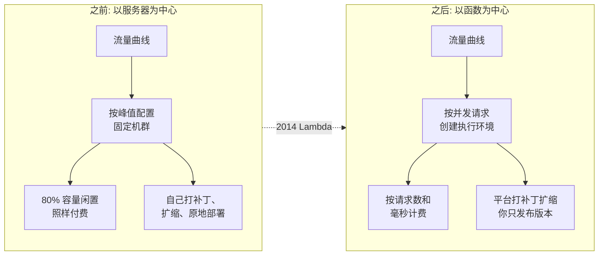

# 01 —— 为什么：Lambda 要解决的问题

> **你在这里：** 第 1 阶段 / 共 6 阶段（Why）。
> **读完本文你将知道：** Lambda 出现之前痛在哪里、为什么虚拟机和容器没能根治，以及哪些约束塑造了 Lambda 的设计——包括版本、别名和预置并发为什么必须存在。

---

## 1. 之前的世界：租下服务器，就要背负它的一切问题

想象 2012 年的 ShopFast。它的结账服务跑在负载均衡器后面的四台 EC2（Elastic Compute Cloud，弹性计算云）虚拟机上。

| 痛点 | 具体表现 |
|---|---|
| **为闲置付费** | 凌晨 3 点的流量只有峰值的 2%，但四台 VM（Virtual Machine，虚拟机）全天候计费。典型利用率：10–20%。 |
| **容量靠猜** | 黑五需要 20 倍容量、持续 6 小时。备少了 → 结账崩溃；备多了 → 提前几周就开始烧钱。 |
| **弹性迟缓** | 自动扩缩组启动一台新 VM 需要*数分钟*。30 秒内冲到顶峰的流量尖刺，援兵还没到就已结束。 |
| **无差别苦活** | 内核补丁、OS（Operating System，操作系统）升级、日志代理、凌晨两点的磁盘写满告警——没有一件是结账业务逻辑。 |
| **部署风险高** | 部署 = SSH（Secure Shell，安全外壳协议）登录或在运行中的服务器上*原地*滚动更新。回滚意味着重新部署旧制品，并祈祷它还能构建。 |

*图注：Lambda 带来的转变——从"给机群定规模"变成"让容量跟随并发请求"。*

## 2. 为什么已有方案不够

| 前辈方案 | 解决了什么 | 留下了什么问题 |
|---|---|---|
| **物理服务器** | —— | 上述全部问题，外加数周的采购周期。 |
| **VM（EC2）+ 自动扩缩** | 从数周缩短到数分钟；按小时/秒计费 | 仍为闲置付费；仍要给 OS 打补丁；扩容需数分钟；扩缩单位是整台 VM。 |
| **容器（ECS（Elastic Container Service，弹性容器服务）/Kubernetes）** | 启动更快、装箱更密、镜像不可变 | 仍要运维集群（节点、控制面、扩缩器）；原生不支持缩到零；容量规划转移到节点池。 |
| **PaaS（Platform as a Service，平台即服务，如 Heroku/Elastic Beanstalk）** | 无需给 OS 打补丁 | 仍以长期运行的实例（"dyno"）为单位；闲置实例照样计费。 |

共同的局限：**容量单位是一台长期运行的服务器**，所以必须有人在需求到来*之前*决定保持多少台在运行。

## 3. 塑造 Lambda 的约束

要实现"事件发生时才运行代码"，设计必须同时满足若干约束——每条约束都解释了你后面会遇到的一块 Lambda 设计：

| 约束 | 在 Lambda 设计中的结果 | 在哪里遇到 |
|---|---|---|
| **按请求从零扩到数千** | 容量单位 = 一个*执行环境*，**一次只服务一个请求**；并发是扩缩指标。 | [05.4](05-deep-dives/04-invoke-frontend-and-concurrency.md) |
| **高密度下的强多租户隔离** | 每个环境是一个 Firecracker microVM（micro Virtual Machine，微虚拟机）——虚拟机级隔离，容器级启动速度。 | [05.6](05-deep-dives/06-execution-environment.md) |
| **按需创建环境要付出延迟** | 于是有了*冷启动*。有些负载无法容忍 → **预置并发**（预热的环境）。 | [05.3](05-deep-dives/03-provisioned-concurrency.md) |
| **代码由平台代为运行，必须可复现** | 部署变成**不可变版本**：代码 + 配置的精确冻结快照。 | [05.1](05-deep-dives/01-versions.md) |
| **调用方不能每次部署都跟着改** | 一个可以重新指向的稳定名字 → **别名**，同时支撑金丝雀流量切换和秒级回滚。 | [05.2](05-deep-dives/02-aliases.md) |
| **失控的函数不能拖垮邻居** | 账号级和函数级**并发限额**，以 HTTP（Hypertext Transfer Protocol，超文本传输协议）429 限流。 | [05.4](05-deep-dives/04-invoke-frontend-and-concurrency.md) |
| **只为实际运行付费** | 以 GB-s（Gigabyte-second，GB 秒）按 1 毫秒粒度计费，外加按请求数计费。 | [02-what.md](02-what.md) |

## 4. "不存在就得有人发明它"测试

如果 Lambda 不存在，而你要构建"每个事件都运行我的代码、闲置时零成本"，你将被迫发明：

1. 一个**路由器**：接收事件并决定是否允许运行（限额）；
2. 一个**隔离沙箱池**：沙箱可以被找到（热）或被创建（冷）；
3. 一种**冻结"运行哪份代码"的方式**，让平台随时能创建出一模一样的沙箱（版本）；
4. 一个**稳定名字**，调用方一直用它，而背后的代码可以变化（别名）；
5. 一个**预先创建沙箱的旋钮**，用于延迟敏感的路径（预置并发）。

这份清单*就是* [03-concept-map.md](03-concept-map.md) 的概念地图。

## 结论

痛点从来不是抽象的"服务器很难"，而是**容量必须在需求到来之前决定**，以及**部署会修改正在运行的服务器**。Lambda 用基于并发、按请求扩缩的微虚拟机回答第一点，用"可移动别名背后的不可变版本"回答第二点。冷启动是第一个答案的代价；预置并发是逃生通道。

---

**下一篇 →** [02-what.md](02-what.md) · **返回** [00-overview.md](00-overview.md)
