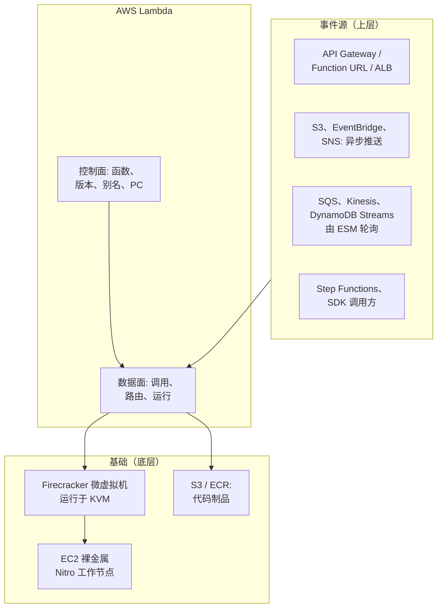

# 02 —— 是什么：定义、边界与生态位置

> **你在这里：** 第 2 阶段 / 共 6 阶段（What）。
> **读完本文你将知道：** Lambda 的精确一句话定义、它刻意*不*做什么，以及它在 AWS（Amazon Web Services，亚马逊云服务）计算选项中的位置。

---

## 1. 一句话定义

> **AWS Lambda 是一种事件驱动的计算服务：它只在事件到达时运行你的代码，无需你配置或管理服务器；其做法是把每个并发请求路由到一个隔离、可复用的*执行环境*，由 Lambda 负责创建、扩缩和回收——其中*版本*冻结"运行的到底是哪份代码"，*别名*决定"调用方拿到哪个版本"，*预置并发*则在需求到来前保持环境预热。**

白板简化版：*"Lambda 把'需要几台服务器？'变成'此刻有多少请求在途？'，并自动回答它。"*

## 2. 校准直觉的关键数字

| 维度 | 取值（当前文档默认值） |
|---|---|
| 内存 | 128 MB – 10,240 MB；CPU（Central Processing Unit，中央处理器）按比例分配（约每 1,769 MB 一个 vCPU，最多 6 个） |
| 单次调用最长时长 | 900 秒（15 分钟） |
| 临时存储 `/tmp` | 512 MB – 10,240 MB |
| 同步负载 | 请求 6 MB / 响应 6 MB（流式响应可更大） |
| 账号默认并发 | 每个 Region 1,000（软限额，可申请提高；新账号可能更低） |
| 扩缩速率 | 每个函数：每 10 秒最多新增 1,000 个执行环境 |
| Init 阶段时限 | 按需 10 秒；预置并发 / SnapStart 最长 15 分钟 |
| 计费 | 按请求数 + 按 GB-s（Gigabyte-second，GB 秒）以 1 毫秒粒度；Init 阶段也计费 |

## 3. 边界——Lambda **不是**什么

| Lambda 不是…… | 为什么重要 | 替代方案 |
|---|---|---|
| 长期运行的服务器 | 15 分钟上限；请求之间环境被冻结，数小时后被回收 | ECS（Elastic Container Service，弹性容器服务）/Fargate、EC2（Elastic Compute Cloud，弹性计算云） |
| 存放状态的地方 | 内存和 `/tmp` 只在环境存活期间有效，且你无法控制拿到哪个环境 | DynamoDB、S3（Simple Storage Service，简单存储服务）、ElastiCache |
| 单沙箱多请求（标准模式） | 一个环境 = 一个在途请求。100 个并发请求 ⇒ 100 个环境。 | （2025 年推出的 Lambda Managed Instances 放宽了这一点——超出本文范围） |
| 默认零延迟 | 新环境要付出冷启动（约 100 毫秒到数秒） | 预置并发、SnapStart |
| 无限且瞬时弹性 | 受账号并发限额和函数级扩缩速率约束 | 预留/提高限额，用 PC（Provisioned Concurrency，预置并发）预热 |
| 部署流水线 | 版本和别名只是*原语*；编排（金丝雀时长、告警）由 CodeDeploy、SAM（Serverless Application Model，无服务器应用模型）、CDK（Cloud Development Kit，云开发工具包）或你的 CI/CD（Continuous Integration / Continuous Delivery，持续集成/持续交付）完成 | CodeDeploy、SAM `DeploymentPreference` |

## 4. 生态位置

*本图回答：Lambda 底下是什么，上面是什么，邻居是谁？*

*图注：Lambda = 一个路由器 + 一支微虚拟机舰队，由众多事件源驱动，构建在 EC2 裸金属之上。*

图中缩写：ALB（Application Load Balancer，应用负载均衡器）、SNS（Simple Notification Service，简单通知服务）、SQS（Simple Queue Service，简单队列服务）、ESM（Event Source Mapping，事件源映射）、SDK（Software Development Kit，软件开发工具包）、KVM（Kernel-based Virtual Machine，基于内核的虚拟机）、ECR（Elastic Container Registry，弹性容器镜像仓库）。

邻居，各一句话：

| 邻居 | 与 Lambda 的区别 |
|---|---|
| **AWS Fargate / ECS** | 你定义长期运行的任务/容器；适合稳定流量、长任务或单进程多并发请求；没有 15 分钟上限。 |
| **EC2** | 完全掌控机器；补丁和扩缩都归你。 |
| **App Runner** | 长期运行的 Web 容器 + 基于请求的自动扩缩；最小实例数保持常热。 |
| **Cloudflare Workers / Lambda@Edge** | V8 隔离或边缘部署的函数——冷启动更低，运行时限制更严。 |
| **Google Cloud Run functions / Azure Functions** | 同类产品；并发模型不同（Cloud Run 允许单实例处理多个请求）。 |

## 结论

Lambda 属于*事件驱动、按请求扩缩的计算*。只要工作以离散事件到达、且闲置成本或扩缩苦活比单请求延迟保证更重要，它就值得考虑——而当延迟确实重要时，PC 可以把延迟买回来。下一篇把问题映射到 Lambda 的概念上。

---

**下一篇 →** [03-concept-map.md](03-concept-map.md) · **返回** [00-overview.md](00-overview.md)
