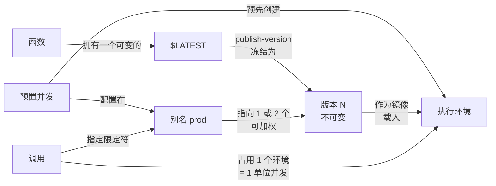
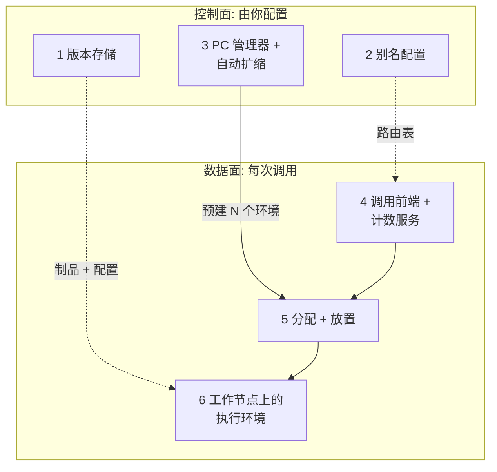
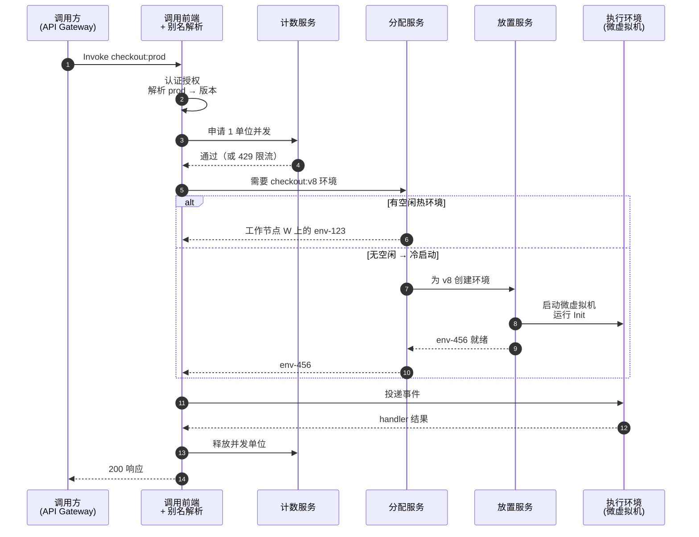

# 03 —— 概念地图：先看全貌，广度优先

> **你在这里：** 第 3 阶段 / 共 6 阶段（概念地图）。
> **读完本文你将知道：** Lambda 的 6 个核心概念（按依赖顺序）、6 个关键组件（负责 / 掌握 / 不做），以及它们如何在一张图上协作。暂不涉及内部细节——那是深入篇的内容。

---

## 3.1 领域映射——从问题到概念

按依赖顺序引入：每个概念只依赖它上面的概念。

| # | 现实问题要素 | Lambda 概念 | 一句话定义 | 为何如此抽象 |
|---|---|---|---|---|
| 1 | "一段由事件触发的业务逻辑" | **函数（Function）** | 一个命名的代码 + 配置单元（运行时、handler、内存、超时、环境变量、IAM（Identity and Access Management，身份与访问管理）角色）。 | 你部署和付费的单位——抽象中没有服务器。 |
| 2 | "运行这段逻辑的服务器" | **执行环境（Execution environment）** | 一个隔离的 Firecracker microVM（micro Virtual Machine，微虚拟机），装载函数的一份副本，**一次只服务一个请求**，跨请求复用，最终被回收。 | 用一次性、按请求规模的沙箱取代长期运行的服务器。 |
| 3 | "此刻有多大负载" | **调用与并发（Invocation & concurrency）** | *调用*是 handler 的一次执行；*并发*是在途调用数 = 忙碌环境数 ≈ RPS（Requests Per Second，每秒请求数）× 平均时长。 | 把容量规划变成一个平台可度量、可限制的数字。 |
| 4 | "一次发布" | **版本（Version）** | 函数代码 + 配置的**不可变**、带编号的快照（`1`、`2`……）。`$LATEST` 是唯一可变的草稿。 | Lambda 必须能随时重建相同的环境，因此需要一个冻结的制品。 |
| 5 | "生产环境正在用的那次发布" | **别名（Alias）** | 一个**可变的命名指针**（`prod`、`staging`），指向一个版本，或带流量权重指向两个版本。 | 调用方绑定稳定名字；部署和回滚变成指针切换。 |
| 6 | "高峰前就已开好的服务器" | **预置并发（PC）** | Lambda 为某个版本或别名**提前初始化**并保持就绪的执行环境数量。 | 把冷启动移出延迟敏感代码的请求路径。 |

**派生概念**（由核心六概念构成，在深入篇中定义）：

- **冷启动（Cold start）** = 必须创建并初始化环境的那次调用（概念 2 + 3）。→ [05.6](05-deep-dives/06-execution-environment.md)
- **预留并发（Reserved concurrency）** = 从账号并发池中划给某函数的下限*兼*上限（概念 3）。→ [05.4](05-deep-dives/04-invoke-frontend-and-concurrency.md)
- **限定符 / 限定 ARN（Amazon Resource Name，亚马逊资源名称）** = `function:checkout:7` 或 `function:checkout:prod`（概念 4 + 5）。→ [05.1](05-deep-dives/01-versions.md)
- **溢出（Spillover）** = 超出 PC 而以按需方式运行的调用（概念 3 + 6）。→ [05.3](05-deep-dives/03-provisioned-concurrency.md)

概念之间的关系：

*图注：请求如何抵达运行中的代码——调用 → 别名 → 版本 → 环境，PC 负责预先创建环境。*

## 3.2 关键组件——从概念到组件

其中两类是你管理的**控制面**对象（版本、别名、PC 配置）；其余是服务每次调用的**数据面**服务。本表即第 5 阶段的目录。

| # | 关键组件 | 负责（Owns） | 掌握（Knows） | **不做**（Does not do） |
|---|---|---|---|---|
| 1 | **版本存储**（`PublishVersion`） | 把 `$LATEST` 冻结为不可变、带编号的快照 | 代码哈希（`CodeSha256`）、每个版本的完整配置、单调递增的版本计数器 | 绝不允许编辑已发布版本；绝不复用编号；不决定哪个版本接流量 |
| 2 | **别名路由** | 每次请求把稳定名字解析为具体版本（含加权掷骰） | 别名 → 主版本 + 可选的第二版本及权重 | 不存代码、不运行任何东西、不做健康检查（由 CodeDeploy/告警负责） |
| 3 | **PC 管理器**（+ Application Auto Scaling） | 为某版本/别名保持 *N* 个已初始化环境就绪 | 请求值与已分配 PC、状态（`IN_PROGRESS`/`READY`/`FAILED`）、利用率 | 不限制流量（超出部分溢出到按需）；自身不自动扩缩——那是 Application Auto Scaling 的事 |
| 4 | **调用前端 + 计数服务** | 准入每个请求：认证、授权、解析限定符、检查并发限额 | 函数元数据缓存、函数/账号当前并发、预留并发 | 不运行代码；不选择具体环境 |
| 5 | **分配 + 放置服务** | 为请求匹配一个空闲的热环境——或在工作节点上创建新环境 | 每个环境的状态（空闲/忙碌/初始化中）与租约；工作节点容量 | 不决定限额（计数服务已决定）；不执行代码 |
| 6 | **执行环境**（工作节点上的 Firecracker 微虚拟机） | 运行一次 Init，然后逐个运行 handler | 你的进程内存、`/tmp`、运行时、扩展 | 不会同时处理两个请求；不会在自身生命周期之外持久化任何东西 |

*架构分层——本图回答：每个组件位于哪一面？*

## 3.3 协作总览

*本图回答：一个同步请求如何端到端变成响应？*

*图注：正常路径——准入、解析、找到或创建环境、运行、释放。*

重要的非正常流程（机制见深入篇）：

- **限流（Throttle）**——计数服务拒绝：账号或预留并发耗尽，或超过扩缩速率 → `429 TooManyRequestsException`。→ [05.4](05-deep-dives/04-invoke-frontend-and-concurrency.md)
- **溢出冷启动**——PC 池全部忙碌 → 经放置服务创建按需环境。→ [05.3](05-deep-dives/03-provisioned-concurrency.md)、[05.5](05-deep-dives/05-assignment-and-placement.md)
- **金丝雀回滚**——把问题版本的别名权重设回 0。→ [05.2](05-deep-dives/02-aliases.md)

## 结论

六个概念——函数、环境、并发、版本、别名、PC——加上六个组件，就是完整的地图。控制面组件决定*运行什么*（版本）、*以什么名字*（别名）、*预热多少*（PC）；数据面组件决定请求*能否运行*（计数）、*在哪里运行*（分配/放置），并*真正运行它*（环境）。

---

**下一篇 →** [04-running-example.md](04-running-example.md) · **返回** [00-overview.md](00-overview.md)
