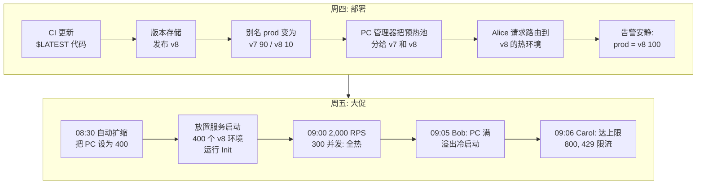

# 04 —— 贯穿示例：ShopFast `checkout` 的黑五一周

> **你在这里：** 第 4 阶段 / 共 6 阶段（贯穿示例）。
> **读完本文你将知道：** 后续每个文件都会回指的那个场景，以及每一步由哪个组件登场——仍不涉及内部细节。

---

## 三句话讲完场景

1. **2026-11-26（周四）**，ShopFast 团队把优惠券功能作为 `checkout` 函数的**版本 8** 上线，通过金丝雀方式把 `prod` **别名**从 v7 切到 v8（先 10% 持续 10 分钟，然后 100%）。
2. **周五 09:00** 开售前，他们把 `prod` 上的**预置并发**从 50 提到 400，让第一波顾客完全不会遇到冷启动。
3. 09:05 一篇爆款帖子把流量推到预热池之外：多出的请求**溢出**到冷的按需环境；在最顶峰，少数请求被函数的预留并发上限**限流**。

## 角色设定（全篇统一使用的事实）

| 项目 | 取值 |
|---|---|
| 账号 / Region | `111122223333` / `us-east-1` |
| 函数 | `checkout`，Node.js 22 运行时，1,024 MB 内存，10 秒超时 |
| 调用方 | API（Application Programming Interface，应用程序编程接口）Gateway REST API，集成 ARN（Amazon Resource Name，亚马逊资源名称）为 `arn:aws:lambda:us-east-1:111122223333:function:checkout:prod` |
| 版本 | v7（当前）、v8（新，含优惠券） |
| 别名 | `prod` → v7，PC（Provisioned Concurrency，预置并发）= 50 |
| 预留并发 | 800（`checkout` 既不会饿死其他函数，也不会被饿死） |
| 平均时长 | 热调用 150 毫秒；冷启动 Init 约 600 毫秒 |
| 账号并发限额 | 3,000 |

我们跟踪三个具名请求：

| 请求 | 时间 | 结局 |
|---|---|---|
| **Alice 的结账** | 周四 14:05，金丝雀期间 | 落到 v8（那 10%），由一个热的 PC 环境服务 |
| **Bob 的结账** | 周五 09:05，爆款尖峰 | PC 池满 → 溢出 → 在新的 v8 环境上冷启动 |
| **Carol 的结账** | 周五 09:06，最顶峰 | 达到预留并发 800 → `429` 限流；API Gateway 返回错误，客户端重试 |

## 浅层追踪整个场景

*本图回答：一周之内各组件按什么顺序登场？*

*图注：一周十步——每篇深入都锚定在这条主干上。*

### 周四——部署 v8

1. **（T1–T2）** CI/CD（Continuous Integration / Continuous Delivery，持续集成/持续交付）流水线把新 zip 上传到**函数**的 `$LATEST`，然后调用 `PublishVersion`。**版本存储**把代码 + 配置冻结为**版本 8**。
2. **（T3）** CodeDeploy 更新**别名** `prod`：主版本 v7，附加版本 v8 权重 0.10。API Gateway 的集成仍写着 `checkout:prod`——调用方毫无变化。
3. **（T4）** 由于 `prod` 上配置了**预置并发**，**PC 管理器**现在大致按权重比例同时为*两个*版本保持热环境。
4. **（T5）** **Alice** 点击"支付"。API Gateway 调用 `checkout:prod`。**调用前端**认证请求，**别名路由**掷加权骰子 → v8。**计数服务**确认 `checkout` 未超限。**分配服务**找到一个空闲、已预初始化的 v8 **执行环境**，handler 约 150 毫秒完成。没有冷启动。
5. **（T6）** 安静的十分钟后，CodeDeploy 把 `prod` 设为 v8 100%。（若错误飙升，它会把权重设回 0——秒级回滚。）

### 周五——大促

6. **（F1–F2）** 08:30，**Application Auto Scaling** 中的计划任务把 `prod` 的 PC 提到 400。**PC 管理器**请**放置服务**创建 400 个 v8 环境；每个环境*现在*就运行 **Init** 阶段，而不是在请求中运行。
7. **（F3）** 09:00，2,000 RPS（Requests Per Second，每秒请求数）× 0.15 秒 ≈ **300 并发**。每一个都落在热的 PC 环境上。
8. **（F4）** 09:05，流量跳到约 4,500 RPS → 需要约 675 并发。400 个 PC 环境全忙；**Bob** 的请求被计数服务准入（675 < 800），但分配服务没有空闲环境，于是**放置服务**新建一个按需 v8 环境。Bob 多等约 600 毫秒：一次**冷启动**（一次*溢出*调用）。
9. **（F5）** 09:06，需求瞬间达到约 850。**Carol** 的请求是第 801 个并发；**计数服务**以 **429** 拒绝它。

## 每一步涉及的概念/组件

| 概念 / 组件 | 步骤 |
|---|---|
| 函数 / `$LATEST` | 1 |
| 版本（版本存储） | 1，以及之后所有"运行 v8"的步骤 |
| 别名（别名路由） | 2、4、5 |
| 预置并发（PC 管理器 + 自动扩缩） | 3、6、7、8 |
| 调用与并发（前端 + 计数） | 4、7、8、9 |
| 分配 + 放置 | 4、6、8 |
| 执行环境 | 4、6、7、8 |

**自测：** 不往上翻，是谁拒绝了 Carol？为什么这不是 PC 管理器的职责？（答案：计数服务；因为 PC 从不限制流量——它只负责预热。）

---

**下一篇 →** [05-deep-dives/01-versions.md](05-deep-dives/01-versions.md) · **返回** [03-concept-map.md](03-concept-map.md)
