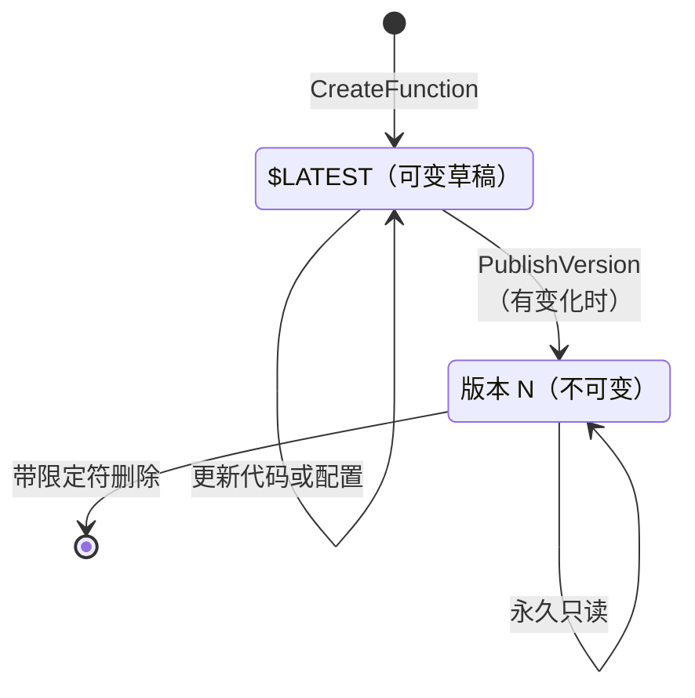

# 05.1 —— 深入：版本（版本存储）

> **你在这里：** 第 5 阶段，深入 1 / 7。示例第 **1** 步（发布 v8），以及之后所有"运行 v8"的步骤。
> **读完本文你将知道：** 版本到底冻结了什么、`$LATEST` 有何不同、限定 ARN（Amazon Resource Name，亚马逊资源名称）如何工作，以及版本相关的失败方式。

---

## 1. 角色回顾

**负责：** 把可变草稿 `$LATEST` 变成不可变、带编号的快照。**出场于：** 示例第 1 步（`PublishVersion` → v8）；之后创建的每个环境都从这个快照启动。

## 2. 内部设计

### 2.1 `$LATEST` 与已发布版本


*图注：生命周期——只有 `$LATEST` 会变；发布就是把它复制成一个冻结的版本。*

| | `$LATEST` | 版本 `N` |
|---|---|---|
| 可变？ | 是——每次代码/配置更新都落在这里 | 否——发布后永不改变 |
| 标识 | `checkout:$LATEST` 或非限定 ARN | `checkout:8` |
| 能承载预置并发？ | **不能** | 能 |
| 能作为加权别名的目标？ | 不能 | 能 |
| 适合生产调用方？ | 不适合——部署会在他们脚下改变它 | 适合 |

### 2.2 版本冻结了什么

版本是创建执行环境的完整配方：

- **代码**：位于内部 S3（Simple Storage Service，简单存储服务）的 zip，或 ECR（Elastic Container Registry，弹性容器镜像仓库）中容器镜像的*摘要（digest）*——是摘要而非标签，所以镜像不会漂移。
- **配置**：运行时、handler、内存、超时、环境变量、层（按版本 ARN）、执行角色、VPC（Virtual Private Cloud，虚拟私有云）配置、架构（x86_64/arm64）、临时存储、SnapStart 设置。

不被冻结——这些是函数级或按限定符的设置，仍可修改：预留并发（函数级）、预置并发（按别名/版本）、基于资源的策略语句、事件源映射、异步调用配置。

### 2.3 编号与幂等

- 编号从 1 开始单调递增。**已删除的编号永不复用**：删掉 v3 后下次发布仍是 v9 而不是 v3。这让"v8"在日志和仪表盘中成为永久、无歧义的名字。
- `PublishVersion` 只在 `$LATEST` 自上次发布以来有变化时（比较 `CodeSha256` + 配置）才创建新版本，否则返回现有的最新版本——流水线里调用两次也安全。
- 乐观并发控制：传入 `--code-sha256` 或 `--revision-id`，如果期间有人改了 `$LATEST`，发布就会失败。

### 2.4 ARN 的几种形式

```
arn:aws:lambda:us-east-1:111122223333:function:checkout          # 非限定 → $LATEST
arn:aws:lambda:us-east-1:111122223333:function:checkout:$LATEST  # 显式草稿
arn:aws:lambda:us-east-1:111122223333:function:checkout:8        # 版本限定
arn:aws:lambda:us-east-1:111122223333:function:checkout:prod     # 别名限定（见 05.2）
```

末尾部分称为**限定符（qualifier）**。每次调用在运行前都会被解析为恰好一个版本。

## 3. 交互

| 邻居 | 契约 |
|---|---|
| CI/CD（Continuous Integration / Continuous Delivery，持续集成/持续交付）流水线 | 调用 `UpdateFunctionCode` → 等待 `LastUpdateStatus=Successful` → `PublishVersion`。 |
| 别名路由（05.2） | 别名引用版本号；被别名引用的版本不能删除。 |
| PC 管理器（05.3） | PC 挂在某个版本上（直接或经由别名）；`$LATEST` 会被拒绝。 |
| 放置服务 / 环境（05.5、05.6） | 每个环境都由恰好一个版本的制品 + 配置构建。v7 和 v8 的环境从不混用。 |

## 4. ⚓ 回到示例——第 1 步，周四 14:00

流水线执行：

```bash
# 1. 更新草稿
aws lambda update-function-code \
  --function-name checkout \
  --zip-file fileb://checkout-v8.zip

aws lambda wait function-updated-v2 --function-name checkout

# 2. 冻结。--code-sha256 防止期间有人并发修改 $LATEST
aws lambda publish-version \
  --function-name checkout \
  --description "coupons (git a1b2c3d)" \
  --code-sha256 "Y2hlY2tvdXQtdjgtc2hhMjU2LWV4YW1wbGU="
```

响应（节选）：

```json
{
  "FunctionArn": "arn:aws:lambda:us-east-1:111122223333:function:checkout:8",
  "Version": "8",
  "CodeSha256": "Y2hlY2tvdXQtdjgtc2hhMjU2LWV4YW1wbGU=",
  "Runtime": "nodejs22.x",
  "MemorySize": 1024,
  "Timeout": 10,
  "State": "Active"
}
```

从这一刻起，"v8"就固定了。周五放置服务启动 400 个环境时（第 6 步），以及 Bob 冷启动时（第 8 步），每个环境都由这份 zip、这套 1,024 MB / 10 秒配置构建——即便周五早上有人改了 `$LATEST` 也不受影响。代码中 `process.env.AWS_LAMBDA_FUNCTION_VERSION` 读到的是 `"8"`。

## 5. 失败行为

| 失败 | 会发生什么 | 设计应对 |
|---|---|---|
| 更新进行中时发布 | `ResourceConflictException` | 先等待 `function-updated-v2`。 |
| 有缺陷的代码被发布为 v8 | v8 永久存在，但只有别名指向它时才接流量 | 别名保持在 v7；发布修复后的 v9。版本很便宜；修改在设计上就不可能。 |
| 旧版本过多 | 所有版本都计入每个 Region 的代码存储限额（默认 75 GB） | 清理未被别名引用的版本（例如保留最近 10 个）。 |
| 有人在生产中调用 `$LATEST` | 拿到未经测试的草稿代码 | 只授权调用方访问别名 ARN（基于资源的策略带 `Qualifier`）。 |

---

**下一篇 →** [02-aliases.md](02-aliases.md) · **返回** [../03-concept-map.md](../03-concept-map.md)
