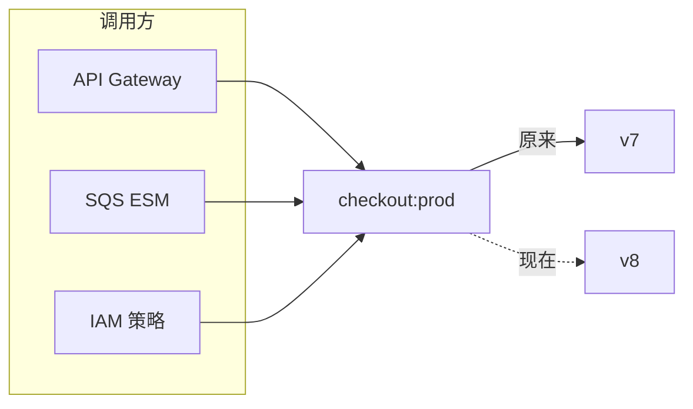
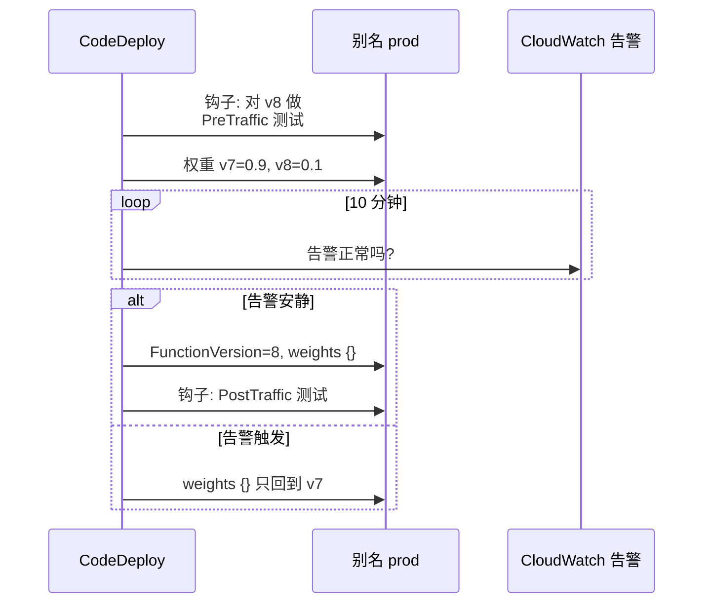

# 05.2 —— 深入：别名（别名路由）

> **你在这里：** 第 5 阶段，深入 2 / 7。示例第 **2** 步（金丝雀 90/10）、第 **4** 步（Alice 的请求路由到 v8）、第 **5** 步（提升到 100%）。
> **读完本文你将知道：** 别名是什么、加权路由如何为每个请求选版本、金丝雀/线性部署与回滚如何构建在它之上，以及它的限制。

---

## 1. 角色回顾

**负责：** 每次调用时把稳定名字（`prod`）映射到具体版本。**出场于：** 第 2 步（CodeDeploy 设置权重）、第 4 步（Alice 的掷骰落在 v8）、第 5 步（提升到 v8 100%）。

## 2. 内部设计

### 2.1 别名是一条很小的可变记录

```json
{
  "Name": "prod",
  "AliasArn": "arn:aws:lambda:us-east-1:111122223333:function:checkout:prod",
  "FunctionVersion": "7",
  "RoutingConfig": { "AdditionalVersionWeights": { "8": 0.10 } },
  "RevisionId": "4f1d..."
}
```

- `FunctionVersion` = **主版本**，获得 `1 − Σ权重` 的流量。
- `AdditionalVersionWeights` = **至多一个**附加版本，权重取值 `[0, 1)`。
- 别名有**自己的 ARN（Amazon Resource Name，亚马逊资源名称）**——因此可以有自己的基于资源的策略、事件源映射、异步调用配置，以及自己的**预置并发**。

### 2.2 间接层就是全部意义所在


*图注：调用方只针对别名配置一次；部署只改变别名的指向。*

没有别名，每次部署都要重写 API Gateway 集成、ESM（Event Source Mapping，事件源映射）目标、IAM（Identity and Access Management，身份与访问管理）权限和仪表盘——回滚时还得再全部重写一遍。

### 2.3 加权路由：每个请求掷一次硬币

每次调用 `checkout:prod`，数据面抽一个随机数，以 0.10 的概率选中 v8。这个简单、无状态的设计带来以下性质：

- **没有粘性。** 同一用户可能先命中 v7 再命中 v8。如果 v8 改变了数据格式，v7 必须能容忍（扩展/收缩式迁移）。
- **低流量下方差大。** 20 个请求里，"10%"可能是 0 也可能是 5。AWS 文档明确说明了这一点；要在足够流量下评判金丝雀。
- **按版本可观测。** CloudWatch 为别名指标提供 `ExecutedVersion` 维度，handler 也能读取 `AWS_LAMBDA_FUNCTION_VERSION`，所以你能在同一别名内比较 v7 与 v8 的错误率。

加权别名的规则：两个版本都必须是**已发布**的（不能是 `$LATEST`），且必须使用相同的执行角色、相同的死信队列配置（或都没有）。

### 2.4 部署策略不过是权重时间表


*图注：金丝雀部署（`Canary10Percent10Minutes`）就是一串受告警守护的、定时的别名更新。*

| CodeDeploy 预设族 | 权重时间表 |
|---|---|
| `Canary10Percent5Minutes` / `…10Minutes` / `…15Minutes` / `…30Minutes` | 10% → 等待 → 100% |
| `Linear10PercentEvery1Minute` / `…2Minutes` / `…3Minutes` / `…10Minutes` | 每个间隔 +10% |
| `AllAtOnce` | 立即 100% |

### 2.5 别名与预置并发

配置在别名上的 PC（Provisioned Concurrency，预置并发）跟随别名的目标。对加权别名，Lambda 把 PC 分配给两个版本，*已分配*值随权重变化而波动。由于路由是概率性的，某个版本可能短时收到超过其份额的流量而溢出——AWS 的建议是在加权切换期间调高 PC。详见 [05.3](03-provisioned-concurrency.md)。

约束：指向 `$LATEST` 的别名不能配置 PC；也不能同时在别名*和*它指向的版本上配置 PC。

## 3. 交互

| 邻居 | 契约 |
|---|---|
| 版本存储（05.1） | 引用已发布的版本号；被引用的版本不能删除。 |
| 调用前端（05.4） | 每次请求都用别名记录的缓存副本把 `checkout:prod` 解析为版本（别名更新在数秒内传播）。 |
| PC 管理器（05.3） | 别名的目标或权重变化时重新分配热环境。 |
| CodeDeploy / SAM（Serverless Application Model，无服务器应用模型）/ CDK（Cloud Development Kit，云开发工具包） | 驱动权重时间表；Lambda 自己从不决定切流量。 |

## 4. ⚓ 回到示例——第 2、4、5 步

**第 2 步——周四 14:01**，CodeDeploy（或你手动）开始金丝雀：

```bash
aws lambda update-alias \
  --function-name checkout --name prod \
  --function-version 7 \
  --routing-config 'AdditionalVersionWeights={"8"=0.10}'
```

API Gateway 的集成 URI 仍以 `function:checkout:prod/invocations` 结尾。调用方一侧什么都没动。

**第 4 步——周四 14:05，Alice 点击"支付"。** 调用前端收到 `Invoke(checkout:prod)`，查到 `prod` → `{主版本: 7, 附加: {8: 0.10}}`，抽到 `0.07 < 0.10` → **v8**。从这一刻起，对其他所有组件而言这都是一个"v8 请求"：计数服务把它计入 `checkout`，分配服务寻找空闲的 **v8** 环境。她在 CloudWatch 中的日志行：

```
START RequestId: 6f0c... Version: 8
```

别名的 `Invocations` 指标把它记在 `ExecutedVersion=8` 之下。

**第 5 步——周四 14:11**，针对 `ExecutedVersion=8` 的 `Errors` 和 `Duration p99`（99th percentile，第 99 百分位）告警保持安静，CodeDeploy 执行提升：

```bash
aws lambda update-alias --function-name checkout --name prod \
  --function-version 8 --routing-config '{}'
```

如果 v8 出错，回滚就是 `--function-version 7` 加 `--routing-config '{}'`——数秒生效，无需重新部署或重新构建，因为 v7 从未被改动过（05.1）。

## 5. 失败行为

| 失败 | 会发生什么 | 设计应对 |
|---|---|---|
| 问题版本拿到了权重 | 只有加权份额的流量失败 | 按 `ExecutedVersion` 设告警；CodeDeploy 自动回滚。 |
| v7/v8 行为不兼容 | 用户在版本间来回跳（无粘性） | 向后兼容的改动；需要按用户粘性灰度时用功能开关。 |
| 低流量金丝雀 | 权重噪声；金丝雀可能碰巧零错误 | 延长金丝雀窗口，或用 `PreTraffic` 钩子做合成测试。 |
| 切换期间的 PC | 新版本预置不足 → 溢出冷启动 | 切换窗口内超额预置 PC；提升前确认 `Status=READY`。 |
| 两条流水线同时更新别名 | 最后写入者胜出 | 传 `--revision-id` 做乐观锁。 |

---

**下一篇 →** [03-provisioned-concurrency.md](03-provisioned-concurrency.md) · **返回** [../03-concept-map.md](../03-concept-map.md)
