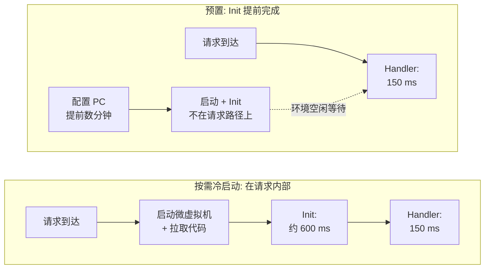
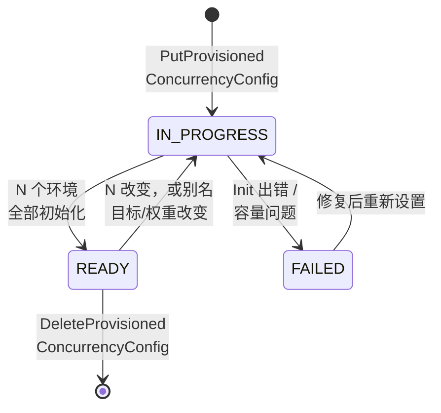

# 05.3 —— 深入：预置并发（PC 管理器 + Application Auto Scaling）

> **你在这里：** 第 5 阶段，深入 3 / 7。示例第 **3** 步（金丝雀期间预热池拆分）、第 **6** 步（PC 扩到 400）、第 **7** 步（09:00 全热的第一波）、第 **8** 步（Bob 溢出）。
> **读完本文你将知道：** PC（Provisioned Concurrency，预置并发）究竟预先创建了什么、它的生命周期、溢出如何发生、如何扩缩、成本几何，以及它如何失败。

---

## 1. 角色回顾

**负责：** 为某个版本或别名保持 *N* 个已初始化的执行环境就绪。**出场于：** 第 3 步（预热池跟随加权别名）、第 6 步（08:30 扩到 400）、第 7 步（09:00 第一波全部热服务）、第 8 步（池耗尽 → Bob 溢出）。

## 2. 内部设计

### 2.1 "预置"的精确含义

按需环境在第一个请求*内部*运行 **Init** 阶段（启动扩展、引导运行时、执行你的顶层代码）。PC 把 Init **提前**：


*图注：PC 不会让代码变快——它把启动 + Init 移出请求的延迟。*

关键推论：

- **Init 时机不同。** 对 PC 而言，Init 可能在首次调用前数分钟甚至数小时运行，且 10 秒 Init 限制被放宽（最长 15 分钟）。不要在 Init 中假设请求马上到来，比如计算"请求开始时间"或拉取短期令牌。
- **代码可以分辨。** `AWS_LAMBDA_INITIALIZATION_TYPE` 的值为 `provisioned-concurrency`（对应还有 `on-demand`、`snap-start`）。
- **环境仍会被回收。** Lambda 会定期替换 PC 环境（与其他环境一样），并在淘汰旧环境*之前*预初始化替代者，所以 Init 会再次运行——保持它幂等。
- **一个环境一个请求** 依然成立：PC = 400 意味着 400 个*同时*的热调用，而不是 400 RPS（Requests Per Second，每秒请求数）。

### 2.2 PC 可以挂在哪里

| 目标 | 允许？ |
|---|---|
| 已发布版本（`checkout:8`） | 是 |
| 别名（`checkout:prod`） | 是——跟随别名；若加权则拆分到 2 个版本 |
| `$LATEST`，或指向 `$LATEST` 的别名 | 否 |
| 同时挂在别名*和*它指向的版本上 | 否（冲突） |

PC 从并发限额中划出：它计入函数的**预留并发**（若设置了 RC（Reserved Concurrency，预留并发），则 PC ≤ RC），也计入账号限额（始终保留 100 未预留）。

### 2.3 生命周期


*图注：PC 是异步的——你请求 N，Lambda 报告 `Allocated` 逐步逼近 N，然后变为 `READY`。*

数百个环境的分配通常需要一到几分钟；它同样受函数级扩缩速率约束（每 10 秒新增 1,000 个环境）。

### 2.4 溢出：PC 是下限，绝不是上限


*图注：PC 耗尽时请求溢出到按需而不是失败——限流是计数服务更早做出的另一项决策（05.4）。*

需要关注的指标（使用 `Maximum` 统计）：

| 指标 | 含义 |
|---|---|
| `ProvisionedConcurrentExecutions` | 此刻忙碌的 PC 环境数 |
| `ProvisionedConcurrencyUtilization` | 忙碌数 ÷ 已分配数（0–1） |
| `ProvisionedConcurrencyInvocations` | 由 PC 服务的调用数 |
| `ProvisionedConcurrencySpilloverInvocations` | **没有**拿到 PC 环境的调用数 |

### 2.5 用 Application Auto Scaling 扩缩 PC

PC 本身是一个静态数字。**Application Auto Scaling** 替你改变这个数字：

- **计划扩缩（Scheduled scaling）**——用于已知事件（黑五、09:00 开市）。可靠，因为它在需求之前行动。
- **目标跟踪（Target tracking）**，基于 `LambdaProvisionedConcurrencyUtilization`（如目标 0.7）。被动式：依赖 CloudWatch 告警对若干个 1 分钟数据点的评估（约 3 分钟后扩容，缩容慢得多），所以它**抓不住** 30 秒的尖峰。要与计划的最小值搭配使用。

### 2.6 成本模型

只要 PC 处于配置状态，无论忙闲都要付费；运行时则按*更低*的时长单价计费。`us-east-1` x86 的示意价格（请以定价页为准，价格会变）：

| 收费项 | 按需 | 使用 PC |
|---|---|---|
| 保持环境预热（每配置 GB-s（Gigabyte-second，GB 秒）） | —— | ≈ $0.0000041667 |
| 时长（每执行 GB-s） | ≈ $0.0000166667 | ≈ $0.0000097222 |
| 请求 | 每百万 $0.20 | 相同 |

经验法则：利用率持续高于约 60% 时，PC 比按需更便宜；低于此值时，你是在花钱买延迟，而不是省钱。**SnapStart**（Java、Python、.NET）是没有闲置成本的替代方案：它在发布时给已初始化的环境打快照，冷启动时从快照恢复——冷启动更快，但不是零。

## 3. 交互

| 邻居 | 契约 |
|---|---|
| 别名路由（05.2） | 别名上的 PC 跟随其版本；权重变化触发重新分配。 |
| 计数服务（05.4） | PC 计入预留/账号并发；PC 不准入也不拒绝请求。 |
| 分配 + 放置（05.5） | PC 管理器请放置服务创建 N 个环境，并向分配服务登记为"预置、空闲"。 |
| 执行环境（05.6） | Init 在分配时运行；handler 在请求时运行。 |
| Application Auto Scaling | 负责随时间改变 N；Lambda 只执行最新的 N。 |

## 4. ⚓ 回到示例——第 3、6、7、8 步

**周四之前，** `prod` 有 PC 50，全部在 v7 上：

```bash
aws lambda put-provisioned-concurrency-config \
  --function-name checkout --qualifier prod \
  --provisioned-concurrent-executions 50
```

**第 3 步——周四 14:01**，别名变为 v7 90% / v8 10%。PC 管理器重新分配，约 45 个热环境服务 v7、5 个服务 v8（切换期间 `AllocatedProvisionedConcurrentExecutions` 会波动）。Alice 的请求（第 4 步）找到了 5 个热 v8 环境之一。周四下午流量约 20 并发，5 个绰绰有余；若是更忙的日子，团队会在金丝雀窗口调高 PC。

**第 6 步——周五 08:30**，周一注册的计划任务触发：

```bash
aws application-autoscaling register-scalable-target \
  --service-namespace lambda \
  --resource-id function:checkout:prod \
  --scalable-dimension lambda:function:ProvisionedConcurrency \
  --min-capacity 50 --max-capacity 600

aws application-autoscaling put-scheduled-action \
  --service-namespace lambda \
  --resource-id function:checkout:prod \
  --scalable-dimension lambda:function:ProvisionedConcurrency \
  --scheduled-action-name black-friday-open \
  --schedule "at(2026-11-27T08:30:00)" \
  --scalable-target-action MinCapacity=400,MaxCapacity=600

aws application-autoscaling put-scaling-policy \
  --service-namespace lambda \
  --resource-id function:checkout:prod \
  --scalable-dimension lambda:function:ProvisionedConcurrency \
  --policy-name pc-utilization-70 --policy-type TargetTrackingScaling \
  --target-tracking-scaling-policy-configuration \
   '{"TargetValue":0.7,"PredefinedMetricSpecification":{"PredefinedMetricType":"LambdaProvisionedConcurrencyUtilization"}}'
```

`prod` 的 PC 变为 `IN_PROGRESS`；放置服务再创建 350 个 v8 环境，每个都以 `AWS_LAMBDA_INITIALIZATION_TYPE=provisioned-concurrency` 记录一次 Init。到约 08:33：

```bash
aws lambda get-provisioned-concurrency-config --function-name checkout --qualifier prod
# { "RequestedProvisionedConcurrentExecutions": 400,
#   "AllocatedProvisionedConcurrentExecutions": 400,
#   "AvailableProvisionedConcurrentExecutions": 400, "Status": "READY" }
```

**第 7 步——09:00**：2,000 RPS × 0.15 秒 ≈ 300 并发。利用率 = 300/400 = 0.75；溢出 = 0。每位顾客都在约 150 毫秒内完成。

**第 8 步——09:05**：需求约 675 并发。400 个跑在 PC 上；约 275 个计入 `ProvisionedConcurrencySpilloverInvocations`。**Bob** 的请求就是其中之一 → 冷的按需环境，多出约 600 毫秒。目标跟踪看到利用率 1.0，开始把 PC 推向 600——但它的告警需要数分钟，所以尖峰的第一波仍要付出冷启动。明年的经验教训：计划值设为 700。

## 5. 失败行为

| 失败 | 症状 | 应对 |
|---|---|---|
| PC 环境中 Init 抛异常 | 状态 `FAILED`；部署报错 "Invalid alias configuration for provisioned concurrency" | 把别名回滚到上一个正常版本；修复 Init；发布新版本。 |
| PC 耗尽 | 溢出 → 冷启动（而不是错误） | 在已知高峰前计划扩容；对溢出设告警。 |
| PC 大于预留并发或账号余量 | `put-provisioned-concurrency-config` 被拒 | 先提高 RC / 账号限额。 |
| 新版本 PC 未 `READY` 就切换别名 | 新版本冷启动 | 等待 `READY`；加权切换期间超额预置。 |
| 忘了缩容 | 整个周末为闲置的 600 个环境付费 | 计划缩容任务；预算告警。 |

---

**下一篇 →** [04-invoke-frontend-and-concurrency.md](04-invoke-frontend-and-concurrency.md) · **返回** [../03-concept-map.md](../03-concept-map.md)
