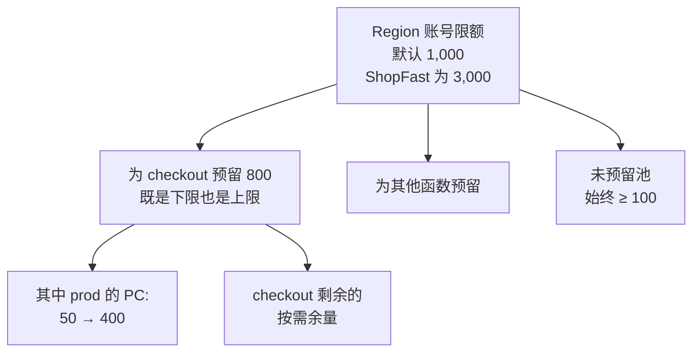
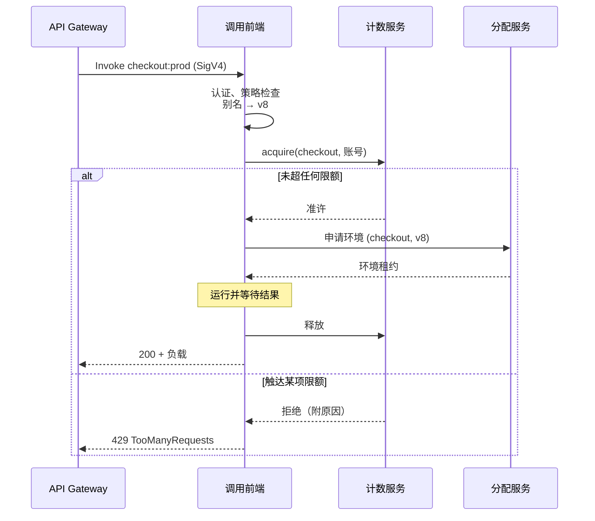

# 05.4 —— 深入：调用前端 + 计数服务（准入与并发）

> **你在这里：** 第 5 阶段，深入 4 / 7。示例第 **4** 步（Alice 被准入）、第 **7** 步（09:00 第一波）、第 **8** 步（PC 已满但 Bob 仍被准入）、第 **9** 步（Carol 被限流）。
> **读完本文你将知道：** 在任何代码运行之前请求经历了什么、并发如何计算、账号并发与预留并发以及扩缩速率限制如何工作，以及限流的真正含义。

---

## 1. 角色回顾

**负责：** 准入决策——调用方是否被允许、指的是哪个版本、是否还有并发余量？**出场于：** 第 4、7、8 步（准入）与第 9 步（以 429 拒绝）。

## 2. 内部设计

### 2.1 调用前端（Invoke Frontend）

位于 Region 级 Lambda 端点之后、跨多个 AZ（Availability Zone，可用区）的无状态请求处理集群。对每个 `Invoke`：

1. **认证** SigV4（Signature Version 4，签名版本 4）签名（API Gateway 以其服务主体签名）。
2. 依据函数的基于资源的策略**授权**（`lambda:InvokeFunction`，可限定到某个 `Qualifier`）。
3. 从缓存**加载**函数/限定符的元数据：把别名解析为版本（05.2）、内存大小、限额。
4. **向计数服务申请**一个并发单位。
5. **向分配服务申请**一个环境（05.5），把负载流式发送过去，等待结果。
6. **释放**并发单位并返回响应。

调用类型改变的是*谁在等待*，而不是核心路径：

| 类型 | 调用方体验 | 路径 |
|---|---|---|
| **同步**（`RequestResponse`）——API Gateway、Function URL、SDK（Software Development Kit，软件开发工具包） | 等待结果；限流时直接看到 429 | 前端 → 环境，如上所述 |
| **异步**（`Event`）——S3（Simple Storage Service，简单存储服务）、SNS（Simple Notification Service，简单通知服务）、EventBridge | 立即得到 `202` | 前端放入内部队列；内部轮询器稍后同步调用，失败重试（默认 2 次），遇到限流则退避 |
| **轮询式**（ESM（Event Source Mapping，事件源映射））——SQS（Simple Queue Service，简单队列服务）、Kinesis、DynamoDB Streams | 没有直接调用方 | Lambda 托管的轮询器批量读取并同步调用 |

### 2.2 并发——Lambda 唯一据以扩缩的数字

> **并发 = 在途调用数 = 忙碌环境数 ≈ RPS（Requests Per Second，每秒请求数）× 平均时长（秒）。**

| 流量 | 平均时长 | 并发 |
|---|---|---|
| 2,000 RPS | 150 ms | 300 |
| 4,500 RPS | 150 ms | 675 |
| 4,500 RPS | 600 ms（冷启动拉长时长） | 2,700 |

最后一行是陷阱：**慢代码或冷启动会成倍放大并发。** 缩短时长本身就是容量优化。

### 2.3 计数服务执行的限额


*图注：并发如何被切分——预留并发是一块私有切片；PC 位于其内。*

| 限额 | 作用范围 | 触达时的效果 |
|---|---|---|
| **账号并发限额** | Region 内所有函数 | 无预留并发的函数共享剩余部分；多出的请求 → 429 |
| **预留并发（RC（Reserved Concurrency，预留并发））** | 单个函数 | 为该函数提供保障*并设上限*。RC = 0 表示"始终限流"（紧急关闭开关）。 |
| **扩缩速率** | 单个函数 | 每 10 秒最多新增 1,000 个环境（连续补充，不累积） |
| **RPS 限额** | 单个函数 | 可用并发 × 10（防止极短调用压垮系统） |

计数服务是一个按函数、按账号的低延迟复制计数器：准入时加一，完成时减一。由于它必须在远低于一毫秒内回答 Region 内的每一次调用，它被分区并保存在内存中，以牺牲绝对的全局精确换取速度——限额会被紧密执行，但并非每一瞬间都精确到个位。

### 2.4 限流是什么（以及不是什么）

限流是计数服务在说**没有容量预算**——而不是"没有机器"。它表现为 `429 TooManyRequestsException`，带有 `ReservedFunctionConcurrentInvocationLimitExceeded` 或 `ConcurrentInvocationLimitExceeded` 等原因。它廉价且即时：没有触碰任何环境，也不计费。

## 3. 交互


*图注：准入握手——计数服务决定"能否运行"，分配服务决定"在哪里运行"。*

## 4. ⚓ 回到示例——第 4、7、8、9 步

**第 4 步（Alice，周四 14:05）。** 前端验证 API Gateway 的签名，找到允许 `apigateway.amazonaws.com` 调用 `checkout:prod` 的策略语句，把别名解析为 v8，并询问计数服务：`checkout` 为 20/800，账号为 140/3,000 → 准许。

**第 7 步（周五 09:00）。** 2,000 RPS，300 在途。计数：300/800 → 全部准许。这 300 个请求占用了 400 个 PC 环境中的 300 个。

**第 8 步（Bob，09:05）。** 675 在途。计数：675/800 → **准许**。注意计数服务既不知道也不关心 PC 已满；它只检查预算。Bob 拿到热环境还是冷环境是分配服务的事（05.5）。那 275 个溢出环境都是新建的按需环境——在扩缩速率（每 10 秒 +1,000）之内，所以没有因扩缩而被限流。

**第 9 步（Carol，09:06）。** 需求瞬间达到约 850。Bob 等人的冷启动拉长了平均时长，推高了并发。Carol 的请求到达时，`checkout` 已有 800 在途：

```json
{
  "Type": "User",
  "message": "Rate Exceeded.",
  "Reason": "ReservedFunctionConcurrentInvocationLimitExceeded"
}
```

API Gateway 把 Lambda 的 429 映射为返回给 Carol 浏览器的错误，客户端带抖动在 300 毫秒后重试并成功。CloudWatch 显示某一分钟 `Throttles` > 0。ShopFast 为什么接受这一点？因为 RC = 800 是刻意设置的护栏：它保护下游支付服务商（只允许约 800 个并行连接），并保证其他函数保有账号 3,000 中属于它们的份额。

## 5. 失败行为

| 失败 | 行为 | 设计应对 |
|---|---|---|
| 吵闹函数耗尽账号限额 | 所有未预留的函数都被限流 | 为关键函数设预留并发；为吵闹函数设 RC 上限。 |
| 突发速度超过扩缩速率 | 429，`ConcurrentExecutions` 图呈阶梯状 | 用 PC 应对突发；或用队列（SQS）削峰。 |
| 时长退化（依赖变慢） | 同样的 RPS 下并发暴涨 → 限流 | 下游调用设超时；对 `Duration` 和 `ConcurrentExecutions` 设告警。 |
| 前端主机在请求中途宕机 | 同步调用方看到错误/超时；异步事件从内部队列重试 | 让 handler 幂等（异步与 ESM 投递是至少一次）。 |

---

**下一篇 →** [05-assignment-and-placement.md](05-assignment-and-placement.md) · **返回** [../03-concept-map.md](../03-concept-map.md)
