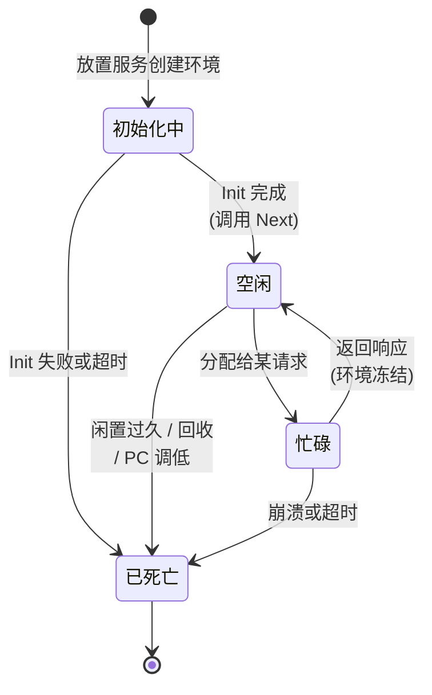
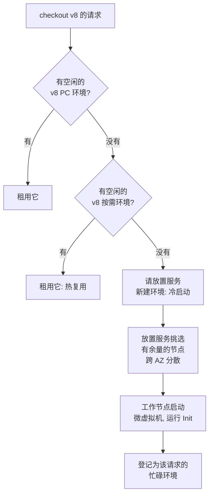

# 05.5 —— 深入：分配服务 + 放置服务（找到或创建环境）

> **你在这里：** 第 5 阶段，深入 5 / 6。示例第 **4** 步（Alice 拿到热 PC 环境）、第 **6** 步（创建 400 个 PC 环境）、第 **8** 步（为 Bob 按需创建环境）。
> **读完本文你将知道：** Lambda 如何决定由*哪个*环境服务请求、新环境如何落到某台机器上，以及为什么热复用是常态。

> 这些是内部服务，依据 AWS 公开的 re:Invent 架构演讲描述。请把它们当作心智模型；名称和细节会演进。

---

## 1. 角色回顾

**负责：** 为已准入的请求匹配一个对应版本的空闲环境——或在有余量的工作节点上创建新环境。**出场于：** 第 4 步（热匹配）、第 6 步（为 PC 批量创建）、第 8 步（为 Bob 冷创建）。

## 2. 内部设计

### 2.1 两个服务，两个问题

| 服务 | 回答的问题 | 持有的状态 |
|---|---|---|
| **分配服务（Assignment service）** | "这个请求该用哪个*已有*环境？" | 每个环境的：函数 + 版本、状态（初始化中/空闲/忙碌/已死亡）、工作节点地址、是 PC 还是按需、租约持有者 |
| **放置服务（Placement service）** | "*新*环境该建在*哪台工作节点*上？" | 工作节点集群容量、当前装箱情况、健康状态 |

把二者分开，热路径（分配服务，每次请求都调用）就能保持小而快，而缓慢的、感知容量的决策（放置服务，只在冷启动和 PC 分配时调用）则被挡在热路径之外。

### 2.2 分配服务眼中的环境状态

*图注：分配服务追踪的生命周期——"热"仅仅意味着存在对应版本的一条`空闲`记录。*

分配服务是分区、复制、跨 AZ（Availability Zone，可用区）部署的服务；每个分区负责一组函数的环境，并复制其状态，这样某台主机故障时不会忘记哪些环境存在。租约确保一个环境同一时刻只交给一个请求。

### 2.3 选择策略（简化版）

*图注：先热（PC，然后复用的按需环境），冷只是最后手段。*

为什么热复用是常态：响应返回后，环境被冻结而非销毁，并保持`空闲`一段时间（通常数分钟；不保证）。在稳定流量下，几乎每个请求都能找到一个。冷启动集中在扩容时刻、部署之后（新版本 = 还没有热环境）以及闲置期之后。

### 2.4 放置

放置服务选择工作节点（一台运行大量 Firecracker 微虚拟机的 EC2（Elastic Compute Cloud，弹性计算云）裸金属 Nitro 主机）时考虑：

- **容量**——为 1,024 MB 插槽预留的内存/CPU（Central Processing Unit，中央处理器）余量；
- **分散**——同一函数的环境分布在多个 AZ 和主机上，单台主机丢失影响很小；
- **装箱**——混合不同客户/函数的负载以高效利用主机（得益于微虚拟机隔离，这是安全的，见 05.6）；
- **代码局部性**——工作节点拉取版本制品（来自 S3（Simple Storage Service，简单存储服务）的 zip，或带缓存的容器镜像分块），所以热缓存有帮助。

## 3. 交互

| 邻居 | 契约 |
|---|---|
| 调用前端（05.4） | 调用 `acquire(function, version)`；获得环境租约和地址；完成后归还。 |
| PC 管理器（05.3） | 预先请求 N 个环境；它们登记为`空闲`并标记为预置，永远不会因闲置被回收。 |
| 版本存储（05.1） | 放置服务/工作节点拉取该版本的精确制品 + 配置。 |
| 执行环境（05.6） | 由工作节点应放置服务的请求创建；报告 Init 完成及每次调用完成。 |

## 4. ⚓ 回到示例——第 4、6、8 步

**第 4 步（Alice，周四 14:05）。** 前端请求 `acquire(checkout, v8)`。分配服务中负责 `checkout` 的分区列出 5 个预置的 v8 环境，其中 4 个空闲。它把工作节点 `w-1a-0419` 上的 `env-v8-pc-03` 租出并返回地址。前端发送 Alice 的事件；约 150 毫秒后该环境重新变为`空闲`。

**第 6 步（周五 08:30）。** PC 管理器再请求 350 个 v8 环境。放置服务把它们分散到三个 AZ（每个约 117 个）和众多工作节点；每个节点启动微虚拟机、拉取 `checkout` v8、运行 Init。每完成一个，分配服务就将其记为`空闲（预置）`。`Allocated` 从 50 升至 400。

**第 8 步（Bob，09:05）。** 前端请求 `acquire(checkout, v8)`。400 个预置条目全部`忙碌`；过去一分钟新建的少数按需 v8 环境也都在忙。分配服务向**放置服务**再要一个。放置服务选中工作节点 `w-1c-1172`；微虚拟机启动（数十毫秒），拉取代码，运行 Init（约 600 毫秒），分配服务直接把新环境交给 Bob 的请求。Bob 的响应约 750 毫秒到达，而不是约 150 毫秒。Bob 的请求完成后，这个按需环境保持`空闲`，下一位顾客就能热复用它。

## 5. 失败行为

| 失败 | 行为 | 设计应对 |
|---|---|---|
| 工作节点主机宕机 | 其上环境变为`已死亡`；在途同步请求失败；后续请求拿到其他或新建的环境 | 跨主机/AZ 分散；调用方重试；handler 幂等。 |
| 分配服务分区主机宕机 | 副本接管该分区状态 | 状态有复制，环境不会被"遗忘"（否则会引发一波冷启动）。 |
| 新环境 Init 失败 | 环境标记为`已死亡`；按需情况下该请求得到 `Init` 错误 | 修复 Init；对 PC 而言状态变为 `FAILED`（05.3）。 |
| 某 AZ 放置容量紧张 | 放置服务使用其他 AZ | 默认多 AZ；无需配置。 |

---

**下一篇 →** [06-execution-environment.md](06-execution-environment.md) · **返回** [../03-concept-map.md](../03-concept-map.md)
