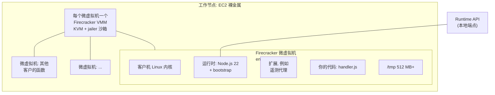
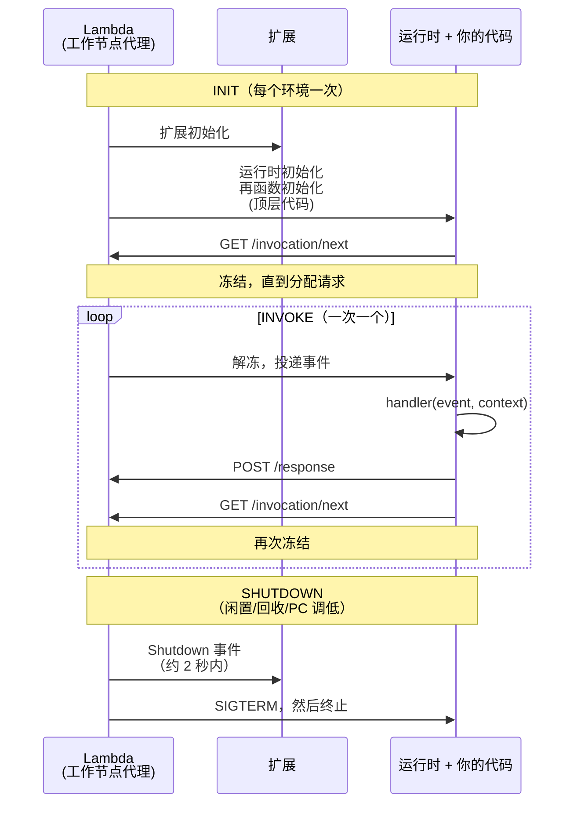

# 05.6 —— 深入：执行环境（Firecracker 微虚拟机）

> **你在这里：** 第 5 阶段，深入 6 / 6。示例第 **4** 步（Alice 的 handler 热运行）、第 **6** 步（提前完成 400 次 Init）、第 **7** 步（热的第一波）、第 **8** 步（Bob 的冷 Init）。
> **读完本文你将知道：** 环境在物理上是什么、它的 Init/Invoke/Shutdown 生命周期、冻结/解冻与复用，以及如何写出善用这些特性的代码。

---

## 1. 角色回顾

**负责：** 真正运行你的代码——Init 一次，然后一次一个调用，直到被回收。**出场于：** 第 4、6、7、8 步。

## 2. 内部设计

### 2.1 物理构造


*图注：一个环境 = 一个拥有独立内核的微虚拟机；成千上万个可以安全地共享一台主机。*

- **Firecracker** 是 AWS 基于 Linux KVM（Kernel-based Virtual Machine，基于内核的虚拟机）构建的开源 VMM（Virtual Machine Monitor，虚拟机监视器）。它约 125 毫秒即可启动一个极简微虚拟机，额外开销仅数 MB，提供**硬件虚拟化级别的隔离**和容器级的密度。正因如此，放置服务才能把不同客户的函数装到同一台主机上。
- 内部：客户机内核、语言运行时、可选扩展以及你的代码。内存即你配置的值（1,024 MB）；CPU（Central Processing Unit，中央处理器）份额随内存缩放。
- 运行时通过 **Runtime API** 与 Lambda 通信，这是一个本地 HTTP（Hypertext Transfer Protocol，超文本传输协议）端点：`GET /2018-06-01/runtime/invocation/next` 阻塞直到事件到来；`POST …/invocation/{id}/response` 返回结果。

### 2.2 生命周期：Init → Invoke × N → Shutdown


*图注：Init 只运行一次；每次调用都解冻、运行、再冻结同一个进程。*

| 阶段 | 时限 | 计费？ | 说明 |
|---|---|---|---|
| **Init** | 按需 10 秒（超时则在首次调用时以函数超时重试）；PC / SnapStart 最长 15 分钟 | 是（2025 年 8 月起统一计费） | 扩展初始化 → 运行时初始化 → 函数初始化 |
| **Invoke** | 函数超时（≤ 900 秒） | 是，按毫秒 | 一次一个事件 |
| **Shutdown** | 约 0.5–2 秒 | 否 | 扩展刷出遥测数据 |

### 2.3 冻结/解冻，以及调用之间什么会保留

两次调用之间，微虚拟机内的进程被**冻结**（不占 CPU）。下一个请求到来时它们被解冻，内存原样保留。因此在同一环境中：

| 跨调用保留 | 不保留 |
|---|---|
| 全局变量、SDK（Software Development Kit，软件开发工具包）客户端、DB（Database，数据库）连接池、内存缓存 | 响应之后的后台工作（会被中途冻结；可能在下次调用时继续，也可能永远不会） |
| `/tmp` 中的文件 | 环境被回收之后的一切（寿命：闲置数分钟到数小时，从不保证） |

由此得出的设计规则：

1. **把昂贵的初始化放进 Init**（handler 之外）：客户端、配置拉取、连接预热。每个环境只付一次——对 PC 而言还在请求路径之外。
2. **永远不要依赖状态一定存在**：缓存必须是可选的；持久状态放 DynamoDB/S3（Simple Storage Service，简单存储服务）。
3. **返回之后不要留下仍在运行的工作**——响应前先刷出。
4. **把并发视为许多独立进程**：400 个环境 = 400 个指向数据库的连接池（如果太多，使用 RDS Proxy（Relational Database Service Proxy，关系型数据库服务代理）或基于 HTTP 的数据 API）。

## 3. 交互

| 邻居 | 契约 |
|---|---|
| 放置服务 / 工作节点（05.5） | 创建微虚拟机、挂载该版本代码、启动 Init。 |
| 分配服务（05.5） | 运行时调用 `/invocation/next` 时得知其`空闲`；有未完成事件时为`忙碌`。 |
| 调用前端（05.4） | 接收响应负载（同步 ≤ 6 MB），以及 handler 抛错或超时时的错误类型。 |
| CloudWatch Logs | 每次调用的 `START`、`END`、`REPORT` 行；`Init Duration` 只在冷启动时出现。 |

## 4. ⚓ 回到示例——第 4、6、7、8 步

ShopFast 的 `checkout` v8 代码，按生命周期组织：

```javascript
// handler.js —— Node.js 22，ES 模块（package.json 中 "type": "module"，以支持顶层 await）
import { DynamoDBClient } from "@aws-sdk/client-dynamodb";
import { loadCouponRules } from "./coupons.js";

// ---- INIT：每个环境运行一次（PC 环境在 08:30 运行；Bob 的环境在他的请求内运行）----
const ddb = new DynamoDBClient({});           // 跨调用复用连接
const couponRules = await loadCouponRules();   // 约 400 ms 的拉取，缓存在内存中
const initType = process.env.AWS_LAMBDA_INITIALIZATION_TYPE; // "provisioned-concurrency" | "on-demand"
console.log(JSON.stringify({ msg: "init", initType, version: process.env.AWS_LAMBDA_FUNCTION_VERSION }));

// ---- INVOKE：每个请求运行一次 ----
export const handler = async (event) => {
  const order = JSON.parse(event.body);
  const total = applyCoupons(order, couponRules);
  await chargeAndSave(ddb, order, total);      // 返回之前完成所有工作
  return { statusCode: 200, body: JSON.stringify({ orderId: order.id, total }) };
};
```

**第 6 步（周五 08:30）——PC 的 Init。** 350 个新环境各自记录 `{"msg":"init","initType":"provisioned-concurrency","version":"8"}`；优惠券拉取发生在此刻，没有任何顾客在等待。

**第 4 / 7 步——热调用（Alice；09:00 第一波）。** 环境被解冻，handler 运行时 `ddb` 和 `couponRules` 已在内存中：

```
START RequestId: 6f0c1d2e-... Version: 8
END RequestId: 6f0c1d2e-...
REPORT RequestId: 6f0c1d2e-...  Duration: 148.21 ms  Billed Duration: 149 ms  Memory Size: 1024 MB  Max Memory Used: 182 MB
```

没有 `Init Duration` 字段——这不是冷启动。

**第 8 步——Bob 的冷启动。** 一个全新的按需微虚拟机：启动、拉取代码，然后在 Bob 的请求*内部*运行 Init（`initType` = `on-demand`）：

```
INIT_START Runtime Version: nodejs:22.v15  Runtime Version ARN: arn:aws:lambda:us-east-1::runtime:...
START RequestId: 9a77e0b4-... Version: 8
END RequestId: 9a77e0b4-...
REPORT RequestId: 9a77e0b4-...  Duration: 151.03 ms  Billed Duration: 752 ms  Memory Size: 1024 MB  Max Memory Used: 176 MB  Init Duration: 600.47 ms
```

Bob 付出了约 600 毫秒的 Init（主要是优惠券拉取）。团队记下两项低成本改进：从更小的端点懒加载优惠券规则，以及明年调高 PC 计划值。

## 5. 失败行为

| 失败 | 行为 | 设计应对 |
|---|---|---|
| handler 抛异常 | 错误返回给前端；环境通常会被复用 | 返回结构化错误；为重试做幂等。 |
| 超时（10 秒） | 调用被终止；环境被重置（进程重启，Init 再次运行） | 下游调用超时短于函数超时。 |
| 内存不足 | 运行时崩溃；环境被回收 | 关注 `REPORT` 中的 `Max Memory Used`；调大内存（同时获得更多 CPU）。 |
| Init 超过 10 秒（按需） | 在首次调用内以函数超时重试 Init | 把慢的工作移出 Init，或使用 PC/SnapStart。 |
| 请求间状态泄漏（如全局可变的用户数据） | 同一环境中请求 B 看到请求 A 的数据 | 把每请求状态保留在 handler 内部。 |

---

**下一篇 →** [../06-walkthrough.md](../06-walkthrough.md) · **返回** [../03-concept-map.md](../03-concept-map.md)
