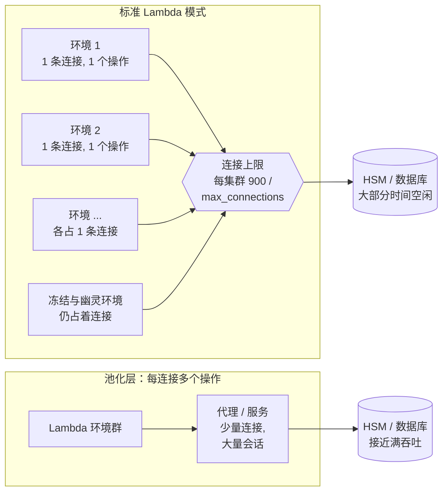
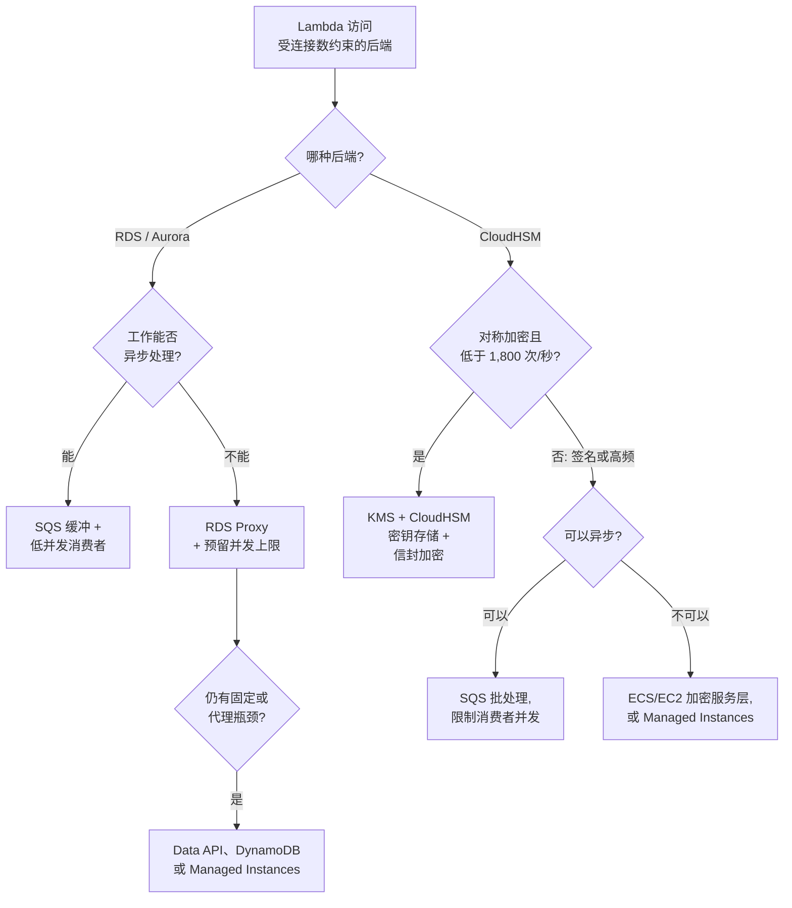

# 05.7 —— 深入：受连接数约束的后端（CloudHSM、关系型数据库）

> **你在这里：** 第 5 阶段，深入 7 / 7。这是示例的一个"假设"扩展：`checkout` 在 CloudHSM 上签名支付令牌，并把订单写入 Aurora。涉及第 **5** 步（v8 提升到 100%）、第 **6** 步（PC 扩到 400）、第 **9** 步（800 个环境的峰值）。
> **读完本文你将知道：** 为什么 Lambda 远在用满后端处理能力之前就耗尽了它的连接数上限；CloudHSM 与数据库的硬性数字；以及两条出路——让每条连接承载更多工作，或者干脆不需要持久连接。

**缩写对照表**

| 缩写 | 英文全称 | 中文 |
|---|---|---|
| HSM | Hardware Security Module | 硬件安全模块 |
| KMS | Key Management Service | 密钥管理服务 |
| RDS | Relational Database Service | 关系型数据库服务 |
| SDK | Software Development Kit | 软件开发工具包 |
| PKCS#11 | Public-Key Cryptography Standards #11 | 公钥密码标准第 11 号（HSM 客户端接口） |
| ESM | Event Source Mapping | 事件源映射 |
| SQS | Simple Queue Service | 简单队列服务 |
| ECS / EC2 | Elastic Container Service / Elastic Compute Cloud | 弹性容器服务 / 弹性计算云 |
| PC | Provisioned Concurrency | 预置并发 |
| RPS | Requests Per Second | 每秒请求数 |

---

## 1. 角色回顾

**它不是 Lambda 的组件**——这里是两个组件，**执行环境**（05.6）与**并发**（05.4），撞上一个按*连接数*配给资源的后端。这样的后端很多：关系型数据库（`max_connections`）、CloudHSM（每集群 900 个客户端连接）、Redis、传统消息中间件。**出现在：** 第 5、6、9 步的"假设"版本中。

## 2. 内部设计——为什么连接数先耗尽

### 2.1 规则：每个环境一条连接，而不是每次调用一条

如果客户端在 Init 阶段（handler 之外）创建并复用——正如 05.6 所建议——Lambda **不会**每次调用都新建连接，而是每个**执行环境**一条。但标准模式下一个环境一次只服务一个请求，因此：

> **打开的连接数 ≈ 执行环境数 ≈ 峰值并发**，再加上闲置环境和泄漏的连接。

由此得出三个后果：

1. **连接数跟随并发，而不是跟随工作量。** 并发 = RPS × 时长（05.4）。一个 150 毫秒的请求只花 5 毫秒访问 HSM，却在整整 150 毫秒内占着连接——而且在请求之间环境被**冻结**的几分钟里也一直占着。
2. **每条连接同一时刻只承载一个操作。** CloudHSM 和数据库要靠*少量连接上的大量并发操作*（多线程、多会话、流水线）才能跑满吞吐。单并发的环境永远不会在自己的连接上放超过一个请求。
3. **连接比环境活得更久。** Lambda 回收环境时，进程没有可靠的机会关闭 socket（只有外部扩展能收到 `SHUTDOWN` 事件）。后端会一直保留这个会话直到自己的空闲超时，成为**幽灵连接**。

*图注：连接上限先被触达，而后端大部分时间空闲；池化层改变了"操作数 / 连接数"的比例。*

### 2.2 硬性数字

| 后端 | 限制 |
|---|---|
| CloudHSM 集群 | **每集群最多 900 个并发客户端连接，不可调整。** 使用 Client SDK 5 时，一个*应用进程* = 一条连接，所以**每个 Lambda 环境算一条**。每个应用最多 1,024 个 PKCS#11 会话。 |
| CloudHSM 吞吐（参考） | 6 台 `hsm2m.medium` ≈ 每秒 7,000 次 EC P256 签名或 ≈ 5,000 次 RSA-2048 签名——测试方式是**一台 EC2 实例上的一个多线程 Java 客户端**。 |
| RDS / Aurora | `max_connections`，未显式设置时按实例内存推算；每条连接即使空闲也占用数据库内存。 |
| KMS CloudHSM 密钥存储 | 每个密钥存储每秒 1,800 次请求，不可调整；仅支持对称密钥。 |

AWS 自己的基准测试最能说明这种错配：集群用**一条**连接就能跑满，而 Lambda 环境群可以把 900 条连接全部占满，HSM 却大部分时间空闲。

## 3. 交互——出路

修复手段分两类：**让每条连接承载更多操作**，或者**不再需要持久连接**。

### 3.1 基本功（必要但不充分）

- **在 Init 中连接一次并复用；连接池大小设为 1。** 在标准 Lambda 中，更大的连接池只会让连接数成倍增加。
- **预留并发 = 连接预算**（05.4）：后端上限 − 其他客户端 − 部署重叠的余量。SQS 触发的函数要设置 ESM 的**最大并发**。
- **缩短后端空闲超时**（`wait_timeout`、`idle_session_timeout`），让幽灵连接尽快被回收。
- **PC 会提前打开连接**：每个预置环境都会提前运行 Init（05.3）。

### 3.2 数据库

| 方案 | 作用 | 注意事项 |
|---|---|---|
| **RDS Proxy**（首选） | Lambda 连接代理，代理把大量客户端连接复用到一个受 `MaxConnectionsPercent` 限制的后端连接池上；还能吸收连接风暴和故障切换。 | **固定（pinning）**：会话状态（如 `SET`、临时表）会把客户端绑定到一条后端连接，复用失效——关注 `DatabaseConnectionsCurrentlySessionPinned`。连接池满时请求最多等待 `ConnectionBorrowTimeout`。 |
| **Aurora Data API** | 走 HTTPS 调用，没有持久连接。 | 仅限 Aurora；每次调用有额外开销；结果集大小有限制。 |
| **SQS 缓冲** | 写操作先入队，由低并发的消费者批量写入，连接数不再随前端流量增长。 | 只适用于可异步的工作。 |
| **DynamoDB** | HTTPS API，没有连接数限制。 | 需要改数据模型。 |
| **Lambda Managed Instances**（2025 年推出） | 一个环境并发处理多个请求，一个线程安全的连接池由多个在途请求共享。 | handler 和客户端必须线程安全；计费与容量模型不同。 |

### 3.3 CloudHSM

CloudHSM **没有类似 RDS Proxy 的托管代理**，900 条连接的上限又是固定的——因此架构选择更关键。

| 方案 | 作用 | 注意事项 |
|---|---|---|
| **KMS + CloudHSM 密钥存储** | 密钥仍在你的集群里；Lambda 通过 HTTPS 调用 KMS，**由 KMS 持有 HSM 连接**。 | 仅支持对称密钥；每个密钥存储每秒 1,800 次请求；同时计入账号的 KMS 配额。不能做 RSA/EC 签名。 |
| **加密服务层**（ECS/EC2） | 少量长期运行的进程，每个一条连接、多个会话和线程，与 AWS 基准测试的方式相同。Lambda 通过 HTTPS/gRPC 调用它。能用上集群的**全部**吞吐。 | 你需要运维一个服务（扩缩、mTLS、可用性）。高频非对称签名的正解。 |
| **信封加密 + 数据密钥缓存** | HSM 只负责包装/解包数据密钥，大量加解密在进程内用缓存的密钥完成，HSM 调用量下降几个数量级。 | 只适用于加密，不适用于签名；明文数据密钥会在缓存期内留在内存中。 |
| **SQS 批处理** | 一次调用在同一条连接上签名 N 条数据。 | 只适用于可异步的工作。 |
| **Lambda Managed Instances** | 一条连接同时服务多个并发请求，真正用上客户端的多会话设计。 | 需确认 SDK 绑定支持在单进程内并发使用。 |
| **用令牌密钥，而不是会话密钥** | 令牌密钥在各 HSM 间负载均衡；会话密钥会把吞吐钉死在一台 HSM 上。 | 能分摊操作，但不减少连接数。 |

*图注：按后端类型以及工作能否等待来选择修复方案。*

## 4. ⚓ 回到示例——如果 `checkout` 用了 CloudHSM 和 Aurora？

假设 v8 在每次结账时多做两件事：**在 CloudHSM 上签名支付令牌（约 5 毫秒）**，以及**把订单插入 Aurora**。两个客户端都按 05.6 的建议在 Init 中创建。

| 时刻 | 环境数 | HSM 连接（上限 900） | 出了什么问题 |
|---|---|---|---|
| 周四，第 5 步——v8 提升到 100% | v7 环境转为空闲，但不会立即回收 | v7 和 v8 的环境在一段时间内同时占着连接 | 部署重叠：连接数短暂超过稳态。 |
| 周五 08:30，第 6 步——PC 扩到 400 | 提前运行 400 次 Init | **第一位顾客到来之前就打开了 400 条连接**，并持有一整天 | 只要做过预算就没问题。 |
| 周五 09:06，第 9 步——峰值 | 800（预留并发） | **900 中占了 800** | 一个批量换密钥任务，加上已回收环境留下的幽灵连接，占满剩下的 100 条 → 新环境在 Init 中连接失败。 |

峰值时 `checkout` 的处理量 ≈ 800 / 0.15 秒 ≈ **每秒 5,300 个请求**，也就是每秒约 5,300 次签名——而每条连接每 150 毫秒只忙 5 毫秒（约 3%）。增加 HSM 只是提高了一个够不着的容量；**真正限制吞吐的是连接上限。**

ShopFast 的修复：支付签名是非对称、同步的操作，于是迁到一个小型 **ECS 加密服务**（4 个任务、4 条连接、每条多个会话）；订单写入改走 **RDS Proxy**；预留并发保持 800，因为现在设定上限的是数据库的连接预算，而不是 HSM。

## 5. 失败行为

| 失败 | 症状 | 应对 |
|---|---|---|
| CloudHSM 连接达到上限 | 新环境在 Init 中连接失败 → 调用报错（不是限流） | 做连接预算；用 KMS 或服务层挡在集群前面。 |
| 数据库 `max_connections` 达到上限 | `too many connections` / `remaining connection slots are reserved` 报错 | RDS Proxy；限制预留并发；缩短空闲超时。 |
| RDS Proxy 连接池耗尽 | 请求排队等待，超过 `ConnectionBorrowTimeout` 后失败 | 减少固定；提高 `MaxConnectionsPercent`；限制并发。 |
| 缩容或部署后出现幽灵连接 | 流量很低时连接数依然居高不下 | 缩短后端空闲超时；可选：用扩展在 `SHUTDOWN` 时关闭连接。 |
| KMS CloudHSM 密钥存储被限流 | `ThrottlingException`；`CloudHSMKeyStoreThrottle` 指标上升 | 数据密钥缓存；保持在每秒 1,800 次以下；使用专用集群。 |

## 结论

在标准 Lambda 中，连接数随**并发**增长而不是随工作量增长，且每条连接同一时刻只承载一个操作——所以按连接数配给资源的后端，会在处理能力远未用满时就撞上连接上限。换更大的 HSM 或数据库没用；有效的是**让每条连接承载更多操作**（RDS Proxy、加密服务层、Managed Instances、批处理），或者**不再需要持久连接**（Data API、KMS 密钥存储、DynamoDB）。

*配额数值已于 2026-10-15 对照 AWS 文档核实（CloudHSM 配额与性能、KMS 请求配额、RDS Proxy 连接设置）。*

---

**下一篇 →** [../06-walkthrough.md](../06-walkthrough.md) · **返回** [../03-concept-map.md](../03-concept-map.md)
