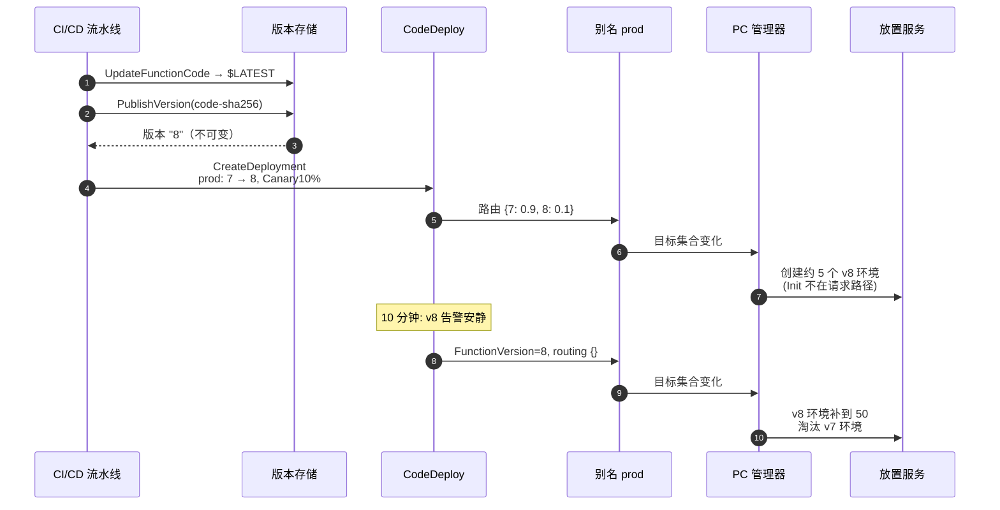
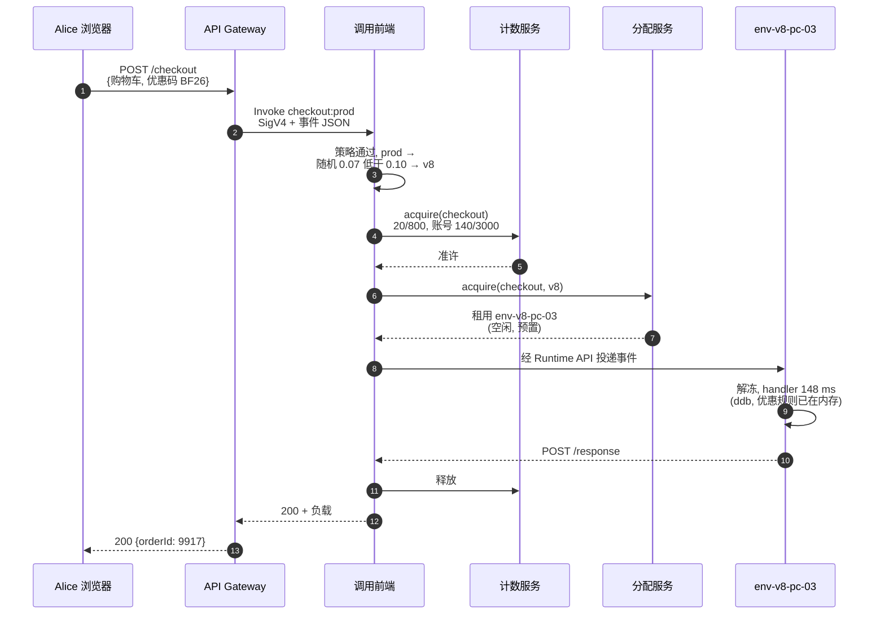
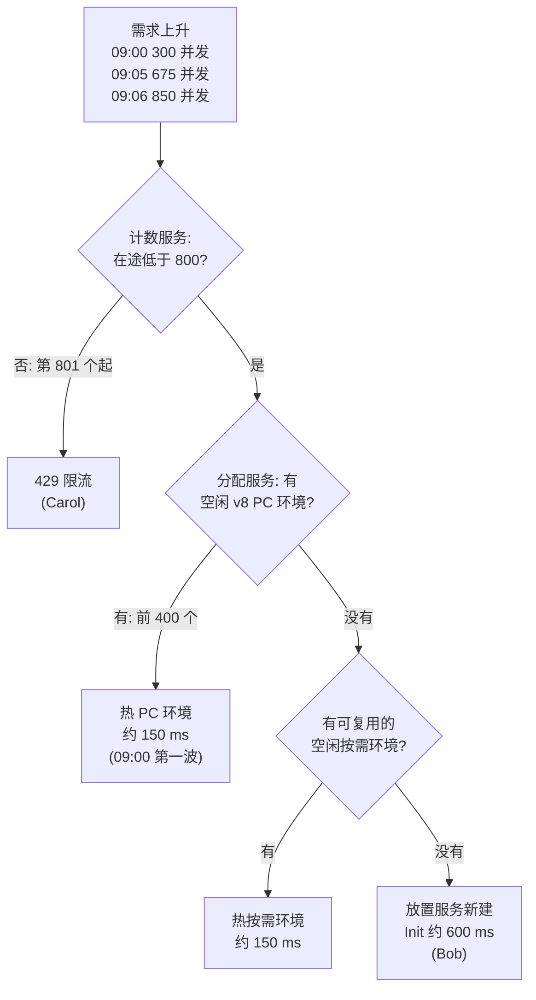
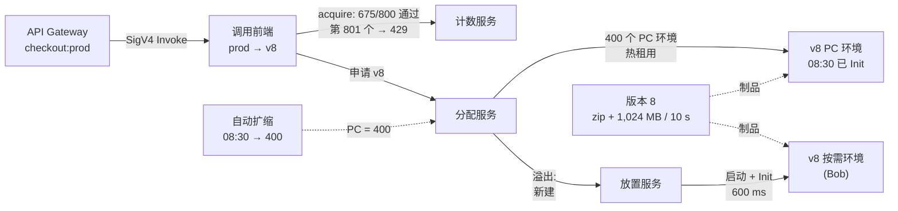

# 06 —— 完整走查：ShopFast 的黑五，端到端完整深度重放

> **你在这里：** 第 6 阶段 / 共 6 阶段（完整走查）。
> **读完本文你将知道：** 把整个贯穿示例作为一个连续故事，在每一跳都看到各组件的内部机制（来自深入篇）。

---

## A 部分——周四：安全地上线 v8

*本图回答：新代码如何在不改动任何调用方的情况下进入生产？*

*图注：部署 = 发布不可变快照，再分步、受守护地移动指针；PC 跟随指针。*

图中缩写：CI/CD（Continuous Integration / Continuous Delivery，持续集成/持续交付）、PC（Provisioned Concurrency，预置并发）。

1. **`$LATEST` → v8**（[05.1](05-deep-dives/01-versions.md)）。`UpdateFunctionCode` 只改变草稿。`PublishVersion` 把代码（按 `CodeSha256`）和完整配置（Node.js 22、1,024 MB、10 秒）冻结为版本 **8**。这个编号永不复用、永不可改。
2. **别名变为加权**（[05.2](05-deep-dives/02-aliases.md)）。`prod` = `{主版本 7, 附加 {8: 0.10}}`。API（Application Programming Interface，应用程序编程接口）Gateway 仍调用 `checkout:prod`。
3. **PC 跟随**（[05.3](05-deep-dives/03-provisioned-concurrency.md)）。`prod` 上的 PC = 50 被重新分配为约 45 个 v7 / 5 个 v8。每个新 v8 环境*现在*就运行 **Init**（`AWS_LAMBDA_INITIALIZATION_TYPE=provisioned-concurrency`），在任何顾客到来前加载好优惠券规则。

## B 部分——周四 14:05：Alice 的热请求（金丝雀期间）

*本图回答：对一个热请求，每个组件做了什么，每一跳传递了什么？*

*图注：一次预置的热调用——没有启动、没有 Init，约 150 毫秒 handler 加几毫秒路由。*

| 跳 | 传递的数据 | 内部发生了什么（来自深入篇） |
|---|---|---|
| G → FE | 已签名的 `Invoke` 请求、事件 JSON | 前端认证，检查资源策略是否允许 `apigateway.amazonaws.com` 调用限定符 `prod`（05.4） |
| FE（别名） | `prod` 记录 | 无状态的单请求掷币 → v8；记为 `ExecutedVersion=8`（05.2） |
| FE → CS | `acquire(checkout)` | 计数器：函数 20/800，账号 140/3,000 → 准许（05.4） |
| FE → AS | `acquire(checkout, v8)` | 找到空闲的预置 v8 条目 → 租出（05.5） |
| FE → E | 经 Runtime API 的事件 | 解冻已冻结的微虚拟机；handler 使用 Init 时的状态运行（05.6） |
| E → FE → G | 响应 ≤ 6 MB | 环境回到`空闲`；释放并发单位；`REPORT` 行没有 `Init Duration` |

图中缩写：SigV4（Signature Version 4，签名版本 4）。

## C 部分——周五：大促

### 08:30——预热

Application Auto Scaling 的计划任务在 `function:checkout:prod` 上设置 `MinCapacity=400`。PC 状态 `IN_PROGRESS`；PC 管理器请放置服务再创建 350 个 v8 环境，分散在三个 AZ（Availability Zone，可用区）。每个工作节点启动一个 Firecracker 微虚拟机、拉取 v8、运行 Init。分配服务把每个环境登记为`空闲（预置）`。约 08:33：`Allocated=400, Status=READY`。

### 09:00–09:06——全景

*本图回答：需求上升时，PC、溢出和限流如何层层叠加？*

*图注：严格顺序的三层——预算（计数服务）、预热池（PC）、然后按需创建。*

**09:00——第一波。** 2,000 RPS（Requests Per Second，每秒请求数）× 0.15 秒 = **300** 并发。计数：300/800，准许。分配：400 个预置环境中 300 个忙碌。利用率 0.75，溢出 0，p99（99th percentile，第 99 百分位）延迟约 180 毫秒。

**09:05——Bob。** 约 4,500 RPS → **675** 并发。

1. 前端把 `prod` 解析为 v8（此时已无权重）。
2. 计数：675/800 → **准许**。它不知道 PC 已满；它只守护预算。
3. 分配：400/400 预置环境忙碌；最近新建的按需环境也忙碌 → 请求**放置服务**。
4. 放置服务选中工作节点 `w-1c-1172`；微虚拟机启动；拉取代码；**Init** 在 Bob 的请求内部运行（`initType=on-demand`，其中优惠券拉取约 400 毫秒）。
5. handler 151 毫秒。Bob 看到约 750 毫秒。`REPORT … Init Duration: 600.47 ms`。指标 `ProvisionedConcurrencySpilloverInvocations` 把他计入。
6. 新环境之后保持`空闲` → 下一位顾客热复用它。目标跟踪看到利用率 1.0，开始把 PC 推向 600——但要几分钟后。

**09:06——Carol。** 冷启动拉长了平均时长，于是所需并发冲到约 850。Carol 的请求到达时已有 800 在途：

- 计数：800/800 → **拒绝**，原因 `ReservedFunctionConcurrentInvocationLimitExceeded`。
- 没有触碰任何环境，不计费。API Gateway 返回错误；Carol 的客户端带抖动重试，300 毫秒后成功。
- 这正是护栏在起作用：`checkout` 背后的支付服务商只能承受约 800 个并行连接，而其他函数也保住了账号 3,000 中属于它们的份额。

### 带标注的架构图

与 [03-concept-map.md §3.3](03-concept-map.md) 相同的协作图，现在在每一跳叠加了示例数据。包含控制面的泳道版本见 [diagrams/lambda-architecture.drawio](diagrams/lambda-architecture.drawio)。

## D 部分——大促之后

- 12:00：计划任务设置 `MinCapacity=50`；PC 环境退役（Shutdown 阶段，扩展刷出遥测数据）。
- 复盘指标：0 错误；约 2% 溢出调用；1 分钟限流（约 0.3% 的请求，均已重试成功）。行动项：明年计划 PC 700；缩短 Init（懒加载优惠券）以降低溢出延迟；保留 RC（Reserved Concurrency，预留并发）800，因为下游限制是真实存在的。
- v7 仍在，原封未动——在团队清理旧版本之前，它一直是回滚目标。

## 回顾：问题已被解决

第 1 阶段的痛点是*必须在需求到来之前决定容量*，以及*通过修改运行中的服务器来部署*。在这次走查中，ShopFast 从未给机群定过规模：计数服务按并发预算准入请求，分配服务复用热环境，放置服务只在需要时创建新的 Firecracker 微虚拟机。在冷启动不可接受的地方，预置并发把 Init 挪到了 08:30。而部署从未触碰任何运行中的服务器或调用方：v8 是一个不可变版本，生产通过移动 `prod` 别名切换过去——带着十分钟的金丝雀，以及随时可用的一条命令回滚。

---

**下一篇 →** [07-next-steps.md](07-next-steps.md) · **返回** [03-concept-map.md](03-concept-map.md)
