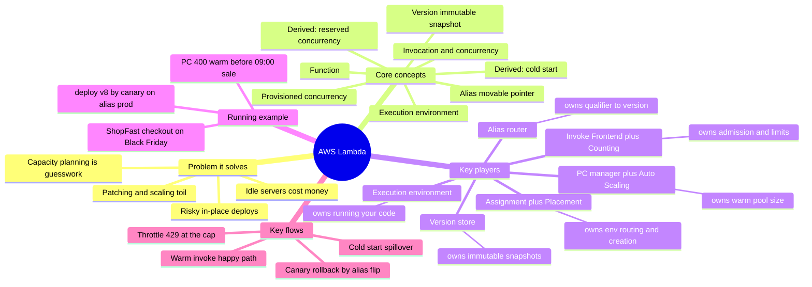

# AWS Lambda — A Mental-Model Guide

> **Where you are:** the entry point of the guide pack.
> **After this file you will know:** the whole territory at a glance, how the pack is organized, and which file to read next.

This pack explains AWS (Amazon Web Services) Lambda from first principles — why it exists, how a single invocation actually travels through the service, and how **versions**, **aliases**, and **provisioned concurrency** fit into that picture. It follows one path: **Why → What → Concept map → Running example → Depth dives → Full walkthrough**, all held together by a single running example: the `checkout` function of an online shop, **ShopFast**, during Black Friday week.

---

## Abbreviation glossary

| Abbreviation | Full name | Meaning in this guide |
|---|---|---|
| AWS | Amazon Web Services | Amazon's cloud platform |
| API | Application Programming Interface | e.g. the Lambda `Invoke` API, the Runtime API |
| ARN | Amazon Resource Name | globally unique identifier of an AWS resource |
| PC | Provisioned Concurrency | pre-initialized Lambda execution environments |
| RC | Reserved Concurrency | a per-function concurrency floor + ceiling |
| VM | Virtual Machine | isolated guest operating system |
| microVM | micro Virtual Machine | minimal, fast-booting VM (Firecracker) |
| KVM | Kernel-based Virtual Machine | Linux kernel hypervisor that Firecracker uses |
| AZ | Availability Zone | isolated data-center group inside a Region |
| RPS | Requests Per Second | request rate |
| GB-s | Gigabyte-second | Lambda billing unit = memory (GB) × duration (s) |
| IAM | Identity and Access Management | AWS permission system |
| SQS | Simple Queue Service | AWS message queue |
| S3 | Simple Storage Service | AWS object storage |
| ECR | Elastic Container Registry | AWS container image registry |
| CLI | Command Line Interface | the `aws` command |
| SAM | Serverless Application Model | AWS's CloudFormation extension for serverless |
| CDK | Cloud Development Kit | infrastructure-as-code in general-purpose languages |
| CI/CD | Continuous Integration / Continuous Delivery | automated build-and-deploy pipelines |
| ESM | Event Source Mapping | Lambda-managed poller for queues/streams |
| VPC | Virtual Private Cloud | private network in AWS |
| ENI | Elastic Network Interface | virtual network card in a VPC |
| EC2 | Elastic Compute Cloud | AWS virtual servers |
| SLA | Service Level Agreement | contractual availability/latency target |
| p99 | 99th percentile | latency that 99% of requests beat |

---

## The whole territory in one picture (mandatory mindmap)

*Question it answers: what are all the moving parts of Lambda, and how do they group?*

---

## How the pack is organized

```mermaid
flowchart LR
    A[01 Why] --> B[02 What]
    B --> C[03 Concept map]
    C --> D[04 Running example]
    D --> E1[05.1 Versions]
    E1 --> E2[05.2 Aliases]
    E2 --> E3[05.3 Provisioned<br/>concurrency]
    E3 --> E4[05.4 Invoke Frontend<br/>and Counting]
    E4 --> E5[05.5 Assignment<br/>and Placement]
    E5 --> E6[05.6 Execution<br/>environment]
    E6 --> F[06 Walkthrough]
    F --> G[07 Next steps]
```

*Caption: the reading order — breadth first (01–04), then one dive per key player in the order they appear in the example (05.x), then the full replay (06).*

| # | File | Stage | What you get |
|---|---|---|---|
| 01 | [01-why.md](01-why.md) | Why | The pain of servers, capacity planning, and in-place deploys |
| 02 | [02-what.md](02-what.md) | What | One-sentence definition, boundaries, ecosystem position |
| 03 | [03-concept-map.md](03-concept-map.md) | Concept map | 6 core concepts, 6 key players, coordination diagram |
| 04 | [04-running-example.md](04-running-example.md) | Running example | ShopFast `checkout` through Black Friday week, traced shallowly |
| 05.1 | [05-deep-dives/01-versions.md](05-deep-dives/01-versions.md) | Depth | Immutable snapshots, `$LATEST`, qualified ARNs |
| 05.2 | [05-deep-dives/02-aliases.md](05-deep-dives/02-aliases.md) | Depth | Pointers, weighted routing, canary & rollback |
| 05.3 | [05-deep-dives/03-provisioned-concurrency.md](05-deep-dives/03-provisioned-concurrency.md) | Depth | Warm pools, spillover, Auto Scaling, cost |
| 05.4 | [05-deep-dives/04-invoke-frontend-and-concurrency.md](05-deep-dives/04-invoke-frontend-and-concurrency.md) | Depth | Admission, concurrency math, reserved concurrency, throttling |
| 05.5 | [05-deep-dives/05-assignment-and-placement.md](05-deep-dives/05-assignment-and-placement.md) | Depth | Finding a warm environment or creating a new one |
| 05.6 | [05-deep-dives/06-execution-environment.md](05-deep-dives/06-execution-environment.md) | Depth | Firecracker microVM, Init/Invoke/Shutdown, freeze/thaw |
| 06 | [06-walkthrough.md](06-walkthrough.md) | Walkthrough | The example end to end at full depth |
| 07 | [07-next-steps.md](07-next-steps.md) | Practice | Exercises, a hands-on lab script, further reading |

Supporting diagram source: [diagrams/lambda-architecture.drawio](diagrams/lambda-architecture.drawio) — the full control-plane + data-plane picture with swim lanes (open in draw.io / diagrams.net).

> **A note on internals.** Names such as *Frontend Invoke service*, *Counting service*, *Assignment service* and *Placement service* come from AWS's public architecture talks (re:Invent "A closer look at AWS Lambda" sessions) and the Firecracker paper. They are a faithful mental model, not a public API contract; AWS can and does evolve them. Everything you configure (versions, aliases, PC, reserved concurrency) is public API and documented.

---

**Next →** [01-why.md](01-why.md)
