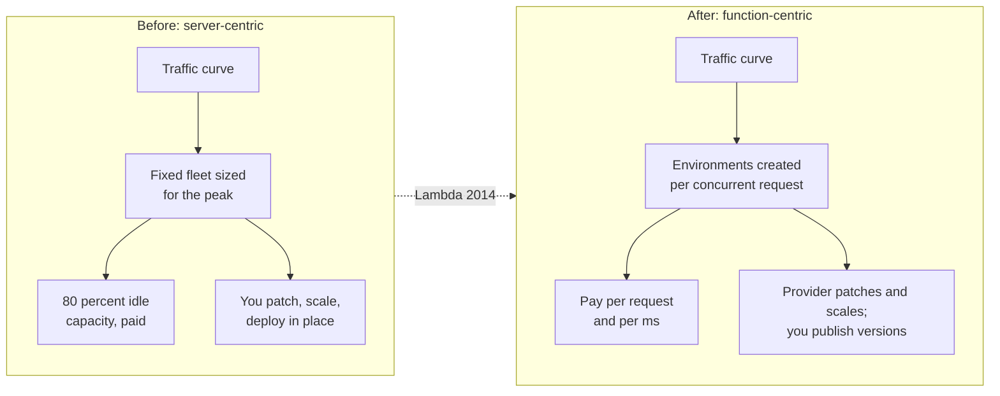

# 01 — Why: The Problem Lambda Solves

> **Where you are:** Stage 1 of 6 (Why).
> **After this file you will know:** what hurt before Lambda, why VMs and containers did not fully cure it, and which constraints shaped Lambda's design — including why versions, aliases and provisioned concurrency had to exist.

---

## 1. The world before: you rent a server, you own its problems

Imagine ShopFast in 2012. Its checkout service runs on four EC2 (Elastic Compute Cloud) virtual machines behind a load balancer.

| Pain | What it looks like concretely |
|---|---|
| **Paying for idle** | Traffic at 03:00 is 2% of peak, but all four VMs (Virtual Machines) bill 24 × 7. Typical utilization: 10–20%. |
| **Capacity guesswork** | Black Friday needs 20× capacity for 6 hours. Provision too little → checkout falls over; too much → money burned for weeks of lead time. |
| **Slow elasticity** | An auto-scaling group boots a new VM in *minutes*. A traffic spike that peaks in 30 seconds is over before help arrives. |
| **Undifferentiated toil** | Kernel patches, OS (Operating System) upgrades, log agents, disk-full pages at 02:00 — none of it is checkout logic. |
| **Risky deploys** | Deploying = SSH-ing (Secure Shell) or rolling new code *in place* over running servers. Rollback means re-deploying the old artifact and hoping it still builds. |

*Caption: the shift Lambda made — from sizing a fleet to letting capacity follow concurrent requests.*

## 2. Why the existing answers were not enough

| Predecessor | What it fixed | What it left broken |
|---|---|---|
| **Physical servers** | — | Everything above, plus weeks of procurement. |
| **VMs (EC2) + Auto Scaling** | Minutes instead of weeks; pay by the hour/second | Still pay for idle; still patch an OS; scale-out takes minutes; scaling unit is a whole VM. |
| **Containers (ECS/Kubernetes)** | Faster start, denser packing, immutable images | You still operate a cluster (nodes, control plane, autoscalers); scale-to-zero is not native; capacity planning moves to the node pool. |
| **PaaS (Platform as a Service, e.g. Heroku/Elastic Beanstalk)** | No OS patching | Still sized in long-running instances ("dynos"); idle instances still bill. |

The common limitation: **the unit of capacity is a long-running server**, so somebody must decide how many to keep running *before* demand arrives.

## 3. The constraints that shaped Lambda

To make "run code only when an event happens" a reality, a design must satisfy several constraints at once — and each constraint explains a piece of Lambda you will meet later:

| Constraint | Consequence in Lambda's design | Where you meet it |
|---|---|---|
| **Scale to zero, scale to thousands, per request** | Capacity unit = one *execution environment* serving **one request at a time**; concurrency is the scaling metric. | [05.4](05-deep-dives/04-invoke-frontend-and-concurrency.md) |
| **Strong multi-tenant isolation at high density** | Each environment is a Firecracker microVM (micro Virtual Machine) — VM-grade isolation with container-like startup. | [05.6](05-deep-dives/06-execution-environment.md) |
| **Creating environments on demand costs latency** | The *cold start* exists. Some workloads cannot tolerate it → **provisioned concurrency** (pre-warmed environments). | [05.3](05-deep-dives/03-provisioned-concurrency.md) |
| **The provider runs your code, so code must be reproducible** | Deployments become **immutable versions**: an exact, frozen snapshot of code + configuration. | [05.1](05-deep-dives/01-versions.md) |
| **Callers must not change every time you deploy** | A stable name that can be re-pointed → **aliases**, which also enable canary traffic shifting and instant rollback. | [05.2](05-deep-dives/02-aliases.md) |
| **A runaway function must not take down its neighbors** | Account-level and per-function **concurrency limits**, throttling with HTTP (Hypertext Transfer Protocol) 429. | [05.4](05-deep-dives/04-invoke-frontend-and-concurrency.md) |
| **Pay only for what runs** | Billing in GB-s (Gigabyte-seconds) at 1 ms granularity, plus per request. | [02-what.md](02-what.md) |

## 4. The "someone would have to invent it" test

If Lambda did not exist and you had to build "run my code on every event, pay nothing when idle", you would be forced to invent:

1. a **router** that receives an event and decides whether it is allowed to run (limits),
2. a **pool of isolated sandboxes** that can be found warm or created cold,
3. a **way to freeze what code runs** so the provider can create identical sandboxes at any time (versions),
4. a **stable name** callers use while the code behind it changes (aliases), and
5. a **knob to pre-create sandboxes** for latency-sensitive paths (provisioned concurrency).

That list *is* the concept map of [03-concept-map.md](03-concept-map.md).

## Conclusion

The pain was never "servers are hard" in the abstract; it was that **capacity had to be decided before demand arrived** and **deploys mutated live servers**. Lambda answers the first with per-request, concurrency-based scaling in microVMs, and the second with immutable versions behind movable aliases. Cold starts are the price of the first answer; provisioned concurrency is the escape hatch.

---

**Next →** [02-what.md](02-what.md) · **Back to** [00-overview.md](00-overview.md)
