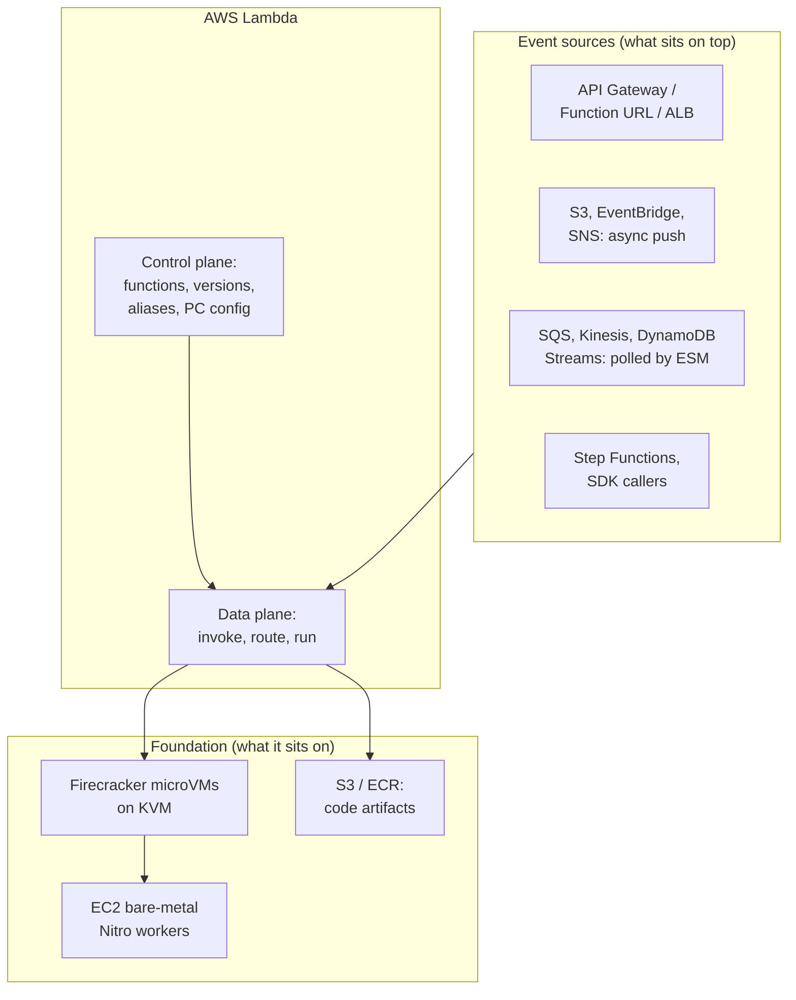

# 02 — What: Definition, Boundaries, Ecosystem

> **Where you are:** Stage 2 of 6 (What).
> **After this file you will know:** a precise one-sentence definition of Lambda, what it deliberately does *not* do, and where it sits among AWS (Amazon Web Services) compute options.

---

## 1. One-sentence definition

> **AWS Lambda is an event-driven compute service that runs your code only when an event arrives, without you provisioning or managing servers, by routing each concurrent request to an isolated, reusable *execution environment* that Lambda creates, scales, and retires for you — with *versions* freezing exactly which code runs, *aliases* naming which version callers get, and *provisioned concurrency* keeping environments warm ahead of demand.**

Shorter form for a whiteboard: *"Lambda turns 'how many servers?' into 'how many requests are in flight right now?' and answers it automatically."*

## 2. Key numbers to calibrate intuition

| Dimension | Value (current documented defaults) |
|---|---|
| Memory | 128 MB – 10,240 MB; CPU (Central Processing Unit) scales proportionally (≈1 vCPU per 1,769 MB, up to 6 vCPUs) |
| Max duration per invocation | 900 s (15 min) |
| Ephemeral `/tmp` storage | 512 MB – 10,240 MB |
| Sync payload | 6 MB request / 6 MB response (streaming responses can go larger) |
| Default account concurrency | 1,000 per Region (soft quota, raisable; new accounts may start lower) |
| Scaling rate | per function: +1,000 execution environments every 10 s |
| Init phase limit | 10 s on-demand; up to 15 min for provisioned concurrency / SnapStart |
| Billing | per request + GB-s (Gigabyte-seconds) at 1 ms granularity; Init phase is billed |

## 3. Boundaries — what Lambda is **not**

| Lambda is not… | Why it matters | Use instead |
|---|---|---|
| A long-running server | 15-minute cap; environments are frozen between requests and recycled after hours | ECS (Elastic Container Service)/Fargate, EC2 (Elastic Compute Cloud) |
| A place to keep state | Memory and `/tmp` survive only while an environment lives, and you don't control which environment you get | DynamoDB, S3 (Simple Storage Service), ElastiCache |
| Multi-request-per-sandbox (standard mode) | One environment = one in-flight request. 100 concurrent requests ⇒ 100 environments. | (Lambda Managed Instances, launched 2025, relaxes this — out of scope here) |
| Zero-latency by default | New environments pay a cold start (≈100 ms – several s) | Provisioned concurrency, SnapStart |
| Infinitely, instantly elastic | Bounded by account concurrency and the per-function scaling rate | Reserve / raise quotas, pre-warm with PC (Provisioned Concurrency) |
| A deployment pipeline | Versions and aliases are *primitives*; orchestration (canary timing, alarms) is done by CodeDeploy, SAM (Serverless Application Model), CDK (Cloud Development Kit), or your CI/CD (Continuous Integration / Continuous Delivery) | CodeDeploy, SAM `DeploymentPreference` |

## 4. Position in the ecosystem

*Question it answers: what is underneath Lambda, what sits on top of it, and what are its neighbors?*

*Caption: Lambda is a router plus a fleet of microVMs, fed by many event sources and built on EC2 bare metal.*

Neighbors, one line each:

| Neighbor | How it differs from Lambda |
|---|---|
| **AWS Fargate / ECS** | You define long-running tasks/containers; better for steady traffic, long jobs, or many concurrent requests per process; no 15-min cap. |
| **EC2** | Full control of the machine; you own patching and scaling. |
| **App Runner** | Long-running web containers with request-based autoscaling; minimum instances stay warm. |
| **Cloudflare Workers / Lambda@Edge** | V8 isolates or edge-located functions — lower cold start, tighter runtime limits. |
| **Google Cloud Run functions / Azure Functions** | Same category; differ in concurrency model (Cloud Run allows many requests per instance). |

## Conclusion

Lambda is classified as *event-driven, request-scaled compute*. It is relevant whenever work arrives as discrete events and idle cost or scaling toil matter more than per-request latency guarantees — and when latency does matter, PC exists to buy it back. The next file maps the problem onto Lambda's concepts.

---

**Next →** [03-concept-map.md](03-concept-map.md) · **Back to** [00-overview.md](00-overview.md)
