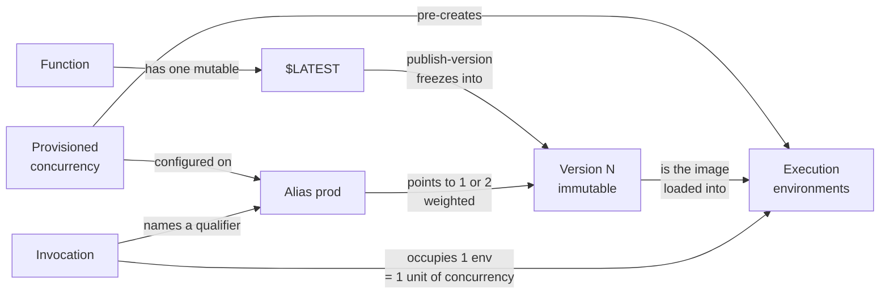
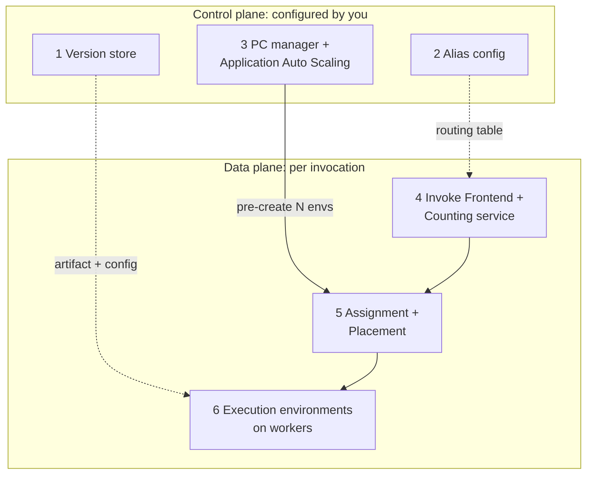
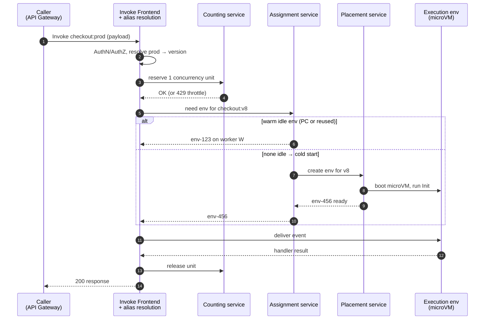

# 03 — Concept Map: The Whole Territory, Breadth First

> **Where you are:** Stage 3 of 6 (Concept map).
> **After this file you will know:** Lambda's 6 core concepts (in dependency order), its 6 key player components (owns / knows / does not do), and how they coordinate on one diagram. No internals yet — those come in the depth dives.

---

## 3.1 Domain mapping — from problem to concepts

Introduced in dependency order: each concept only uses the ones above it.

| # | Real-world problem element | Lambda concept | One-line definition | Why this abstraction |
|---|---|---|---|---|
| 1 | "A piece of business logic triggered by an event" | **Function** | A named unit of code + configuration (runtime, handler, memory, timeout, env vars, IAM (Identity and Access Management) role). | The unit you deploy and pay for — no server in the abstraction. |
| 2 | "A server to run that logic on" | **Execution environment** | An isolated Firecracker microVM (micro Virtual Machine) holding one copy of the function, serving **one request at a time**, reused across requests, then retired. | Replaces the long-lived server with a disposable, request-sized sandbox. |
| 3 | "How much load there is right now" | **Invocation & concurrency** | An *invocation* is one execution of the handler; *concurrency* is the number of invocations in flight = number of busy environments. ≈ RPS (Requests Per Second) × average duration. | Turns capacity planning into one number the platform can measure and limit. |
| 4 | "A release" | **Version** | An **immutable**, numbered snapshot of the function's code + configuration (`1`, `2`, … ). `$LATEST` is the one mutable draft. | Lambda must recreate identical environments at any time; it needs a frozen artifact to do so. |
| 5 | "The release that production uses" | **Alias** | A **mutable named pointer** (`prod`, `staging`) to one version, or to two versions with traffic weights. | Callers bind to a stable name; deploys and rollbacks become pointer flips. |
| 6 | "Servers already booted before the rush" | **Provisioned concurrency (PC)** | A number of execution environments Lambda keeps **initialized in advance** for a specific version or alias. | Removes cold starts from the request path for latency-critical code. |

**Derived concepts** (built from the core six, defined in the dives):

- **Cold start** = an invocation that had to create + initialize an environment (concepts 2 + 3). → [05.6](05-deep-dives/06-execution-environment.md)
- **Reserved concurrency** = a per-function floor *and* ceiling carved out of the account's concurrency pool (concept 3). → [05.4](05-deep-dives/04-invoke-frontend-and-concurrency.md)
- **Qualifier / qualified ARN (Amazon Resource Name)** = `function:checkout:7` or `function:checkout:prod` (concepts 4 + 5). → [05.1](05-deep-dives/01-versions.md)
- **Spillover** = an invocation that exceeded PC and ran on-demand (concepts 3 + 6). → [05.3](05-deep-dives/03-provisioned-concurrency.md)

How the concepts relate:

*Caption: how a request reaches running code — invocation → alias → version → environment, with PC pre-creating environments.*

## 3.2 Key players — from concepts to components

Two of the players are **control-plane** artifacts you manage (versions, aliases, PC config); the rest are **data-plane** services that serve each invocation. This table is the table of contents for Stage 5.

| # | Key player | Owns | Knows | Does **not** do |
|---|---|---|---|---|
| 1 | **Version store** (`PublishVersion`) | Freezing `$LATEST` into immutable, numbered snapshots | Code hash (`CodeSha256`), full config per version, the monotonically increasing version counter | Never lets you edit a published version; never reuses a number; doesn't decide which version gets traffic |
| 2 | **Alias router** | Resolving a stable name to a concrete version per request (incl. weighted coin-flip) | Alias → primary version + optional second version and weight | Doesn't hold code, doesn't run anything, doesn't health-check (CodeDeploy/alarms do) |
| 3 | **PC manager** (+ Application Auto Scaling) | Keeping *N* initialized environments ready for a version/alias | Requested vs. allocated PC, status (`IN_PROGRESS`/`READY`/`FAILED`), utilization | Doesn't cap traffic (overflow spills to on-demand); doesn't auto-scale by itself — Application Auto Scaling does |
| 4 | **Invoke Frontend + Counting service** | Admitting each request: authenticate, authorize, resolve qualifier, check concurrency limits | Function metadata cache, current concurrency per function/account, reserved concurrency | Doesn't run code; doesn't choose a specific environment |
| 5 | **Assignment + Placement services** | Matching a request to a warm idle environment — or getting a new one created on a worker | Every environment's state (idle/busy/initializing) and lease; worker capacity | Doesn't decide limits (Counting did); doesn't execute code |
| 6 | **Execution environment** (Firecracker microVM on a worker) | Running Init once and then the handler, one request at a time | Your process memory, `/tmp`, runtime, extensions | Doesn't handle two requests at once; doesn't persist anything beyond its own lifetime |

*Architecture layers — question it answers: which player lives in which plane?*

## 3.3 Coordination at a glance

*Question it answers: how does one synchronous request become a response, end to end?*

*Caption: the happy path — admit, resolve, find-or-create an environment, run, release.*

Important non-happy flows (mechanics in the dives):

- **Throttle** — Counting service refuses: account or reserved concurrency exhausted, or the scaling rate is exceeded → `429 TooManyRequestsException`. → [05.4](05-deep-dives/04-invoke-frontend-and-concurrency.md)
- **Spillover cold start** — PC pool fully busy → on-demand environment created via Placement. → [05.3](05-deep-dives/03-provisioned-concurrency.md), [05.5](05-deep-dives/05-assignment-and-placement.md)
- **Canary rollback** — alias weight set back to 0 for the bad version. → [05.2](05-deep-dives/02-aliases.md)

## Conclusion

Six concepts — function, environment, concurrency, version, alias, PC — and six players are the whole map. Control-plane players decide *what* runs (version), *under which name* (alias), and *how much is pre-warmed* (PC); data-plane players decide *whether* a request may run (Counting), *where* (Assignment/Placement), and actually *run it* (environment).

---

**Next →** [04-running-example.md](04-running-example.md) · **Back to** [00-overview.md](00-overview.md)
