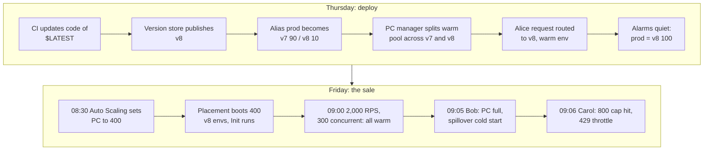

# 04 — Running Example: ShopFast `checkout` Through Black Friday Week

> **Where you are:** Stage 4 of 6 (Running example).
> **After this file you will know:** the one scenario every later file refers back to, and which component is on stage at each step — still without internals.

---

## The scenario in three sentences

1. On **Thursday 2026-11-26**, ShopFast's team ships coupon support as **version 8** of the `checkout` function, shifting the `prod` **alias** from v7 to v8 by canary (10% for 10 minutes, then 100%).
2. Before the sale opens on **Friday 09:00**, they raise **provisioned concurrency** on `prod` from 50 to 400 so the first wave of shoppers never sees a cold start.
3. At 09:05 a viral post pushes traffic beyond the warm pool: extra requests **spill over** to cold on-demand environments, and at the very top a few are **throttled** by the function's reserved concurrency cap.

## The cast (fixed facts used everywhere)

| Item | Value |
|---|---|
| Account / Region | `111122223333` / `us-east-1` |
| Function | `checkout`, Node.js 22 runtime, 1,024 MB memory, 10 s timeout |
| Caller | API (Application Programming Interface) Gateway REST API, integration ARN (Amazon Resource Name) `arn:aws:lambda:us-east-1:111122223333:function:checkout:prod` |
| Versions | v7 (current), v8 (new, coupons) |
| Alias | `prod` → v7, PC (Provisioned Concurrency) = 50 |
| Reserved concurrency | 800 (so `checkout` can never starve other functions, nor be starved) |
| Average duration | 150 ms warm; cold Init ≈ 600 ms |
| Account concurrency quota | 3,000 |

Three named requests we follow:

| Request | When | Fate |
|---|---|---|
| **Alice's checkout** | Thu 14:05, during the canary | Lands on v8 (the 10%), served by a warm PC environment |
| **Bob's checkout** | Fri 09:05, the viral spike | PC pool full → spillover → cold start on a new v8 environment |
| **Carol's checkout** | Fri 09:06, the very peak | Reserved concurrency of 800 reached → `429` throttle; API Gateway returns an error, the client retries |

## The scenario traced shallowly

*Question it answers: in what order do the players appear across the week?*

*Caption: the week in ten steps — the spine every depth dive anchors to.*

### Thursday — deploying v8

1. **(T1–T2)** The CI/CD (Continuous Integration / Continuous Delivery) pipeline uploads the new zip to the **function**'s `$LATEST`, then calls `PublishVersion`. The **Version store** freezes code + config as **version 8**.
2. **(T3)** CodeDeploy updates the **alias** `prod`: primary v7, additional version v8 with weight 0.10. API Gateway's integration still says `checkout:prod` — nothing on the caller side changes.
3. **(T4)** Because **provisioned concurrency** is configured on `prod`, the **PC manager** now keeps warm environments for *both* versions, roughly in proportion to the weights.
4. **(T5)** **Alice** clicks "Pay". API Gateway invokes `checkout:prod`. The **Invoke Frontend** authenticates the call, the **alias router** rolls the weighted dice → v8. The **Counting service** confirms `checkout` is under its limits. The **Assignment service** finds an idle, pre-initialized v8 **execution environment** and the handler runs in ~150 ms. No cold start.
5. **(T6)** Ten quiet minutes later CodeDeploy sets `prod` → v8 at 100%. (Had errors spiked, it would have set the weight back to 0 — a rollback in seconds.)

### Friday — the sale

6. **(F1–F2)** At 08:30 a scheduled action in **Application Auto Scaling** raises PC on `prod` to 400. The **PC manager** asks **Placement** for 400 v8 environments; each runs its **Init** phase now, not during a request.
7. **(F3)** At 09:00, 2,000 RPS (Requests Per Second) × 0.15 s ≈ **300 concurrent** invocations. Every one lands on a warm PC environment.
8. **(F4)** At 09:05 traffic jumps to ~4,500 RPS → ~675 needed. The 400 PC environments are busy; **Bob**'s request is admitted by Counting (675 < 800) but the Assignment service has no idle environment, so **Placement** creates a new on-demand v8 environment. Bob waits ~600 ms extra: a **cold start** (a *spillover* invocation).
9. **(F5)** At 09:06 demand briefly needs ~850. **Carol**'s request is the 801st concurrent one; the **Counting service** rejects it with **429**.

## What each step touches

| Concept / player | Steps |
|---|---|
| Function / `$LATEST` | 1 |
| Version (Version store) | 1, and every later step runs "v8" |
| Alias (alias router) | 2, 4, 5 |
| Provisioned concurrency (PC manager + Auto Scaling) | 3, 6, 7, 8 |
| Invocation & concurrency (Frontend + Counting) | 4, 7, 8, 9 |
| Assignment + Placement | 4, 6, 8 |
| Execution environment | 4, 6, 7, 8 |

**Test yourself:** without scrolling up, who rejects Carol, and why isn't that the PC manager's job? (Answer: the Counting service, because PC never caps traffic — it only pre-warms.)

---

**Next →** [05-deep-dives/01-versions.md](05-deep-dives/01-versions.md) · **Back to** [03-concept-map.md](03-concept-map.md)
