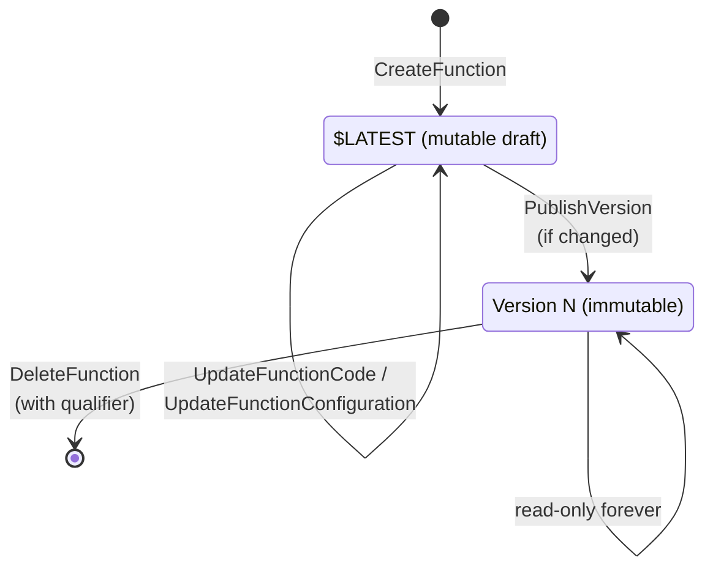

# 05.1 — Deep Dive: Versions (the Version Store)

> **Where you are:** Stage 5, dive 1 of 7. Example steps **1** (publish v8) and every later step that "runs v8".
> **After this file you will know:** exactly what a version freezes, how `$LATEST` differs, how qualified ARNs (Amazon Resource Names) work, and how versioning fails.

---

## 1. Role recap

**Owns:** turning the mutable draft `$LATEST` into an immutable, numbered snapshot. **Appears in:** step 1 of the example (`PublishVersion` → v8); every environment created afterwards boots from that snapshot.

## 2. Internal design

### 2.1 `$LATEST` vs. published versions


*Caption: the lifecycle — only `$LATEST` changes; publishing copies it into a frozen version.*

| | `$LATEST` | Version `N` |
|---|---|---|
| Mutable? | Yes — every code/config update lands here | No — never changes after publish |
| Identifier | `checkout:$LATEST` or the unqualified ARN | `checkout:8` |
| Can host provisioned concurrency? | **No** | Yes |
| Can be a weighted-alias target? | No | Yes |
| Safe for production callers? | No — a deploy changes it under them | Yes |

### 2.2 What a version freezes

A version is the complete recipe for creating an execution environment:

- **Code**: the zip in an internal S3 (Simple Storage Service) location, or the container image *digest* in ECR (Elastic Container Registry) — the digest, not the tag, so the image can't drift.
- **Configuration**: runtime, handler, memory, timeout, environment variables, layers (by version ARN), execution role, VPC (Virtual Private Cloud) config, architecture (x86_64/arm64), ephemeral storage, SnapStart setting.

Not frozen — these are function-level or per-qualifier settings that can still change: reserved concurrency (function level), provisioned concurrency (per alias/version), resource-based policy statements, event source mappings, async invoke config.

### 2.3 Numbering and idempotency

- Numbers start at 1 and increase monotonically. **Deleted numbers are never reused**: delete v3 and the next publish is still v9, not v3. This makes "v8" a permanent, unambiguous name in logs and dashboards.
- `PublishVersion` only creates a version if `$LATEST` changed since the last one (compared via `CodeSha256` + config). Otherwise it returns the existing latest version — safe to call twice in a pipeline.
- Optimistic concurrency: pass `--code-sha256` or `--revision-id` to fail the publish if someone else changed `$LATEST` in between.

### 2.4 ARN forms

```
arn:aws:lambda:us-east-1:111122223333:function:checkout          # unqualified → $LATEST
arn:aws:lambda:us-east-1:111122223333:function:checkout:$LATEST  # explicit draft
arn:aws:lambda:us-east-1:111122223333:function:checkout:8        # version-qualified
arn:aws:lambda:us-east-1:111122223333:function:checkout:prod     # alias-qualified (05.2)
```

The trailing part is called the **qualifier**. Every invocation resolves to exactly one version before running.

## 3. Interactions

| Neighbor | Contract |
|---|---|
| CI/CD (Continuous Integration / Continuous Delivery) pipeline | Calls `UpdateFunctionCode` → waits for `LastUpdateStatus=Successful` → `PublishVersion`. |
| Alias router (05.2) | Aliases reference version numbers; a version referenced by an alias cannot be deleted. |
| PC manager (05.3) | PC is attached to a version (directly or via an alias); `$LATEST` is rejected. |
| Placement / environments (05.5, 05.6) | Each environment is built from exactly one version's artifact + config. Environments of v7 and v8 never mix. |

## 4. ⚓ Back to the example — step 1, Thursday 14:00

The pipeline runs:

```bash
# 1. Update the draft
aws lambda update-function-code \
  --function-name checkout \
  --zip-file fileb://checkout-v8.zip

aws lambda wait function-updated-v2 --function-name checkout

# 2. Freeze it. --code-sha256 guards against a concurrent edit of $LATEST
aws lambda publish-version \
  --function-name checkout \
  --description "coupons (git a1b2c3d)" \
  --code-sha256 "Y2hlY2tvdXQtdjgtc2hhMjU2LWV4YW1wbGU="
```

Response (trimmed):

```json
{
  "FunctionArn": "arn:aws:lambda:us-east-1:111122223333:function:checkout:8",
  "Version": "8",
  "CodeSha256": "Y2hlY2tvdXQtdjgtc2hhMjU2LWV4YW1wbGU=",
  "Runtime": "nodejs22.x",
  "MemorySize": 1024,
  "Timeout": 10,
  "State": "Active"
}
```

From this moment, "v8" is fixed. When on Friday Placement boots 400 environments (step 6), and when Bob's cold start happens (step 8), every one of them is built from this exact zip and this exact 1,024 MB / 10 s config — even if someone edits `$LATEST` on Friday morning. Inside the code, `process.env.AWS_LAMBDA_FUNCTION_VERSION` reads `"8"`.

## 5. Failure behavior

| Failure | What happens | Design response |
|---|---|---|
| Publishing while an update is in progress | `ResourceConflictException` | Wait for `function-updated-v2` first. |
| Bad code published as v8 | v8 exists forever, but takes traffic only if an alias points to it | Keep the alias on v7; publish a fixed v9. Versions are cheap; mutating is impossible by design. |
| Too many old versions | All versions count toward the per-Region code storage quota (75 GB by default) | Prune versions not referenced by aliases (e.g. keep last 10). |
| Someone invokes `$LATEST` in production | They get untested draft code | Grant callers permission only on the alias ARN (resource policy with `Qualifier`). |

---

**Next →** [02-aliases.md](02-aliases.md) · **Back to** [../03-concept-map.md](../03-concept-map.md)
