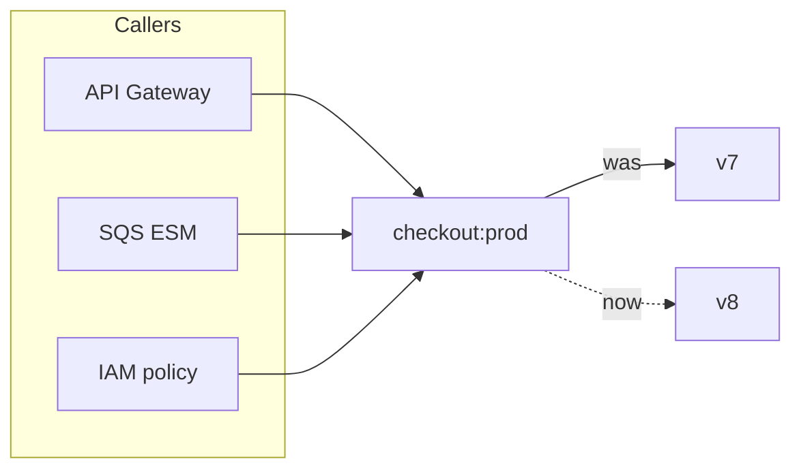
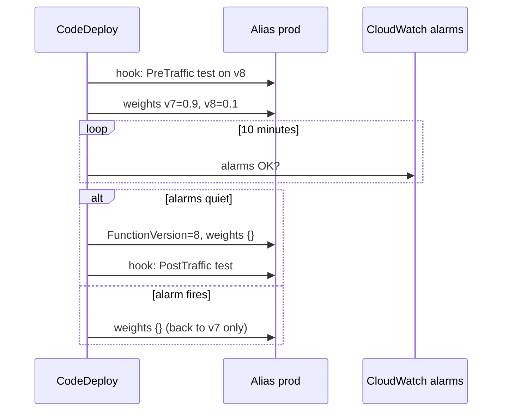

# 05.2 — Deep Dive: Aliases (the Alias Router)

> **Where you are:** Stage 5, dive 2 of 6. Example steps **2** (canary 90/10), **4** (Alice's request routed to v8) and **5** (promote to 100%).
> **After this file you will know:** what an alias is, how weighted routing picks a version per request, how canary/linear deploys and rollbacks are built on it, and its limits.

---

## 1. Role recap

**Owns:** mapping a stable name (`prod`) to a concrete version for each invocation. **Appears in:** step 2 (CodeDeploy sets weights), step 4 (Alice's coin flip lands on v8), step 5 (promotion to v8 at 100%).

## 2. Internal design

### 2.1 An alias is a tiny, mutable record

```json
{
  "Name": "prod",
  "AliasArn": "arn:aws:lambda:us-east-1:111122223333:function:checkout:prod",
  "FunctionVersion": "7",
  "RoutingConfig": { "AdditionalVersionWeights": { "8": 0.10 } },
  "RevisionId": "4f1d..."
}
```

- `FunctionVersion` = **primary** version; it receives `1 − Σ weights`.
- `AdditionalVersionWeights` = **at most one** extra version with a weight in `[0, 1)`.
- An alias has its **own ARN** — and therefore can have its own resource-based policy, its own event source mappings, its own async-invoke config, and its own **provisioned concurrency**.

### 2.2 Why indirection is the whole point


*Caption: callers are configured once against the alias; deploys change only the alias's target.*

Without aliases every deploy would rewrite API Gateway integrations, ESM (Event Source Mapping) targets, IAM (Identity and Access Management) permissions and dashboards — and a rollback would rewrite them all again.

### 2.3 Weighted routing: a per-request coin flip

For each invocation of `checkout:prod`, the data plane draws a random number and picks v8 with probability 0.10. Properties that follow from this simple, stateless design:

- **No stickiness.** The same user can hit v7 then v8. If v8 changes a data format, v7 must tolerate it (expand/contract migrations).
- **High variance at low traffic.** With 20 requests, "10%" may be 0 or 5. AWS documents this explicitly; judge canaries on enough traffic.
- **Observability per version.** CloudWatch publishes alias metrics with an `ExecutedVersion` dimension, and the handler can read `AWS_LAMBDA_FUNCTION_VERSION`, so you can compare error rates of v7 vs. v8 inside the same alias.

Rules for weighted aliases: both versions must be **published** (not `$LATEST`), and must share the same execution role and the same dead-letter-queue configuration (or none).

### 2.4 Deployment strategies are just weight schedules


*Caption: a canary deploy (`Canary10Percent10Minutes`) is a timed sequence of alias updates guarded by alarms.*

| CodeDeploy preset family | Weight schedule |
|---|---|
| `Canary10Percent5Minutes` / `…10Minutes` / `…15Minutes` / `…30Minutes` | 10% → wait → 100% |
| `Linear10PercentEvery1Minute` / `…2Minutes` / `…3Minutes` / `…10Minutes` | +10% every interval |
| `AllAtOnce` | 100% immediately |

### 2.5 Aliases and provisioned concurrency

PC configured on an alias follows the alias's target(s). With a weighted alias, Lambda distributes the PC across both versions, and the *allocated* value fluctuates as weights change. Because routing is probabilistic, one version can briefly receive more than its share and spill over — AWS's guidance is to raise PC while a weighted shift is active. Details in [05.3](03-provisioned-concurrency.md).

Constraints: an alias pointing at `$LATEST` cannot have PC, and you cannot configure PC on both an alias and the version it points to.

## 3. Interactions

| Neighbor | Contract |
|---|---|
| Version store (05.1) | References published version numbers; a referenced version cannot be deleted. |
| Invoke Frontend (05.4) | Resolves `checkout:prod` to a version on every request, using a cached copy of the alias record (alias updates propagate within seconds). |
| PC manager (05.3) | Reallocates warm environments when the alias's target or weights change. |
| CodeDeploy / SAM (Serverless Application Model) / CDK (Cloud Development Kit) | Drive the weight schedule; Lambda itself never decides to shift traffic. |

## 4. ⚓ Back to the example — steps 2, 4, 5

**Step 2 — Thursday 14:01**, CodeDeploy (or you, by hand) starts the canary:

```bash
aws lambda update-alias \
  --function-name checkout --name prod \
  --function-version 7 \
  --routing-config 'AdditionalVersionWeights={"8"=0.10}'
```

API Gateway's integration URI still ends in `function:checkout:prod/invocations`. Nothing on the caller side was touched.

**Step 4 — Thursday 14:05, Alice clicks "Pay".** The Invoke Frontend receives `Invoke(checkout:prod)`, looks up `prod` → `{primary: 7, extra: {8: 0.10}}`, draws `0.07 < 0.10` → **v8**. From this point the request is a "v8 request" for every other component: Counting counts it against `checkout`, Assignment looks for an idle **v8** environment. Her log line in CloudWatch reads:

```
START RequestId: 6f0c... Version: 8
```

and the alias's `Invocations` metric records it under `ExecutedVersion=8`.

**Step 5 — Thursday 14:11**, alarms on `Errors` and `Duration p99` for `ExecutedVersion=8` stayed quiet, so CodeDeploy promotes:

```bash
aws lambda update-alias --function-name checkout --name prod \
  --function-version 8 --routing-config '{}'
```

Had v8 errored, rollback would have been `--routing-config '{}'` with `--function-version 7` — effective in seconds, no redeploy, no rebuild, because v7 was never changed (05.1).

## 5. Failure behavior

| Failure | What happens | Design response |
|---|---|---|
| Bad version gets weight | Only the weighted share of traffic fails | Alarms on `ExecutedVersion`; automatic rollback by CodeDeploy. |
| Incompatible v7/v8 behavior | Users bounce between versions (no stickiness) | Backward-compatible changes; feature flags for user-sticky rollouts. |
| Low traffic canary | Weight noise; canary may see zero errors by chance | Longer canary windows or synthetic `PreTraffic` hook tests. |
| PC during shift | New version under-provisioned → spillover cold starts | Over-provision PC for the shift window; verify `Status=READY` before promoting. |
| Alias update race between two pipelines | Last writer wins | Pass `--revision-id` for optimistic locking. |

---

**Next →** [03-provisioned-concurrency.md](03-provisioned-concurrency.md) · **Back to** [../03-concept-map.md](../03-concept-map.md)
