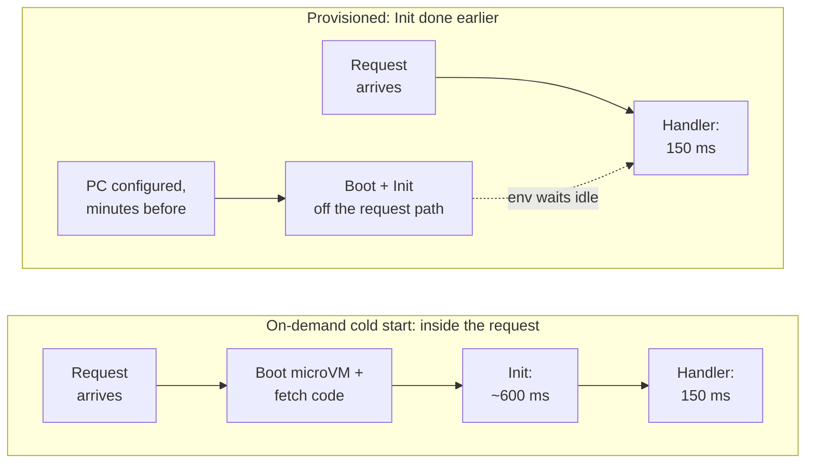
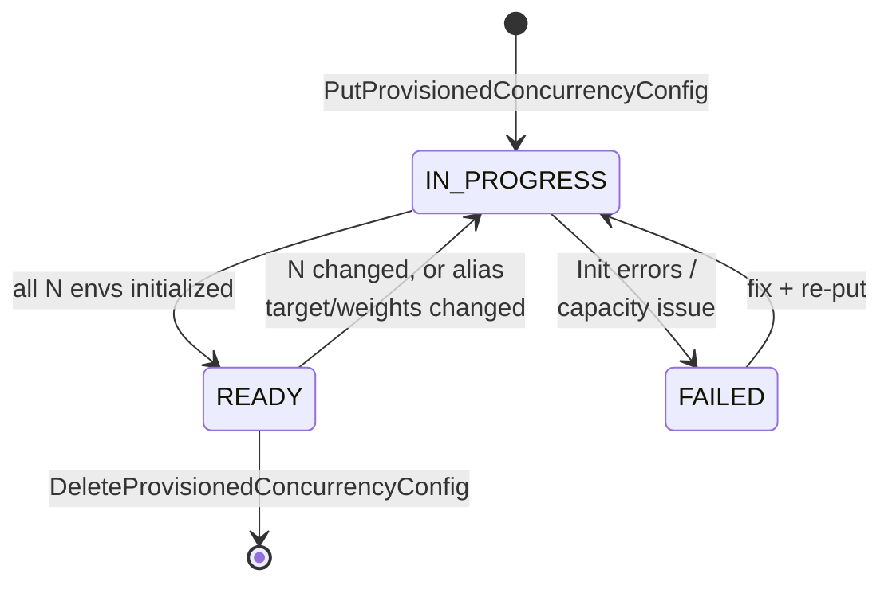
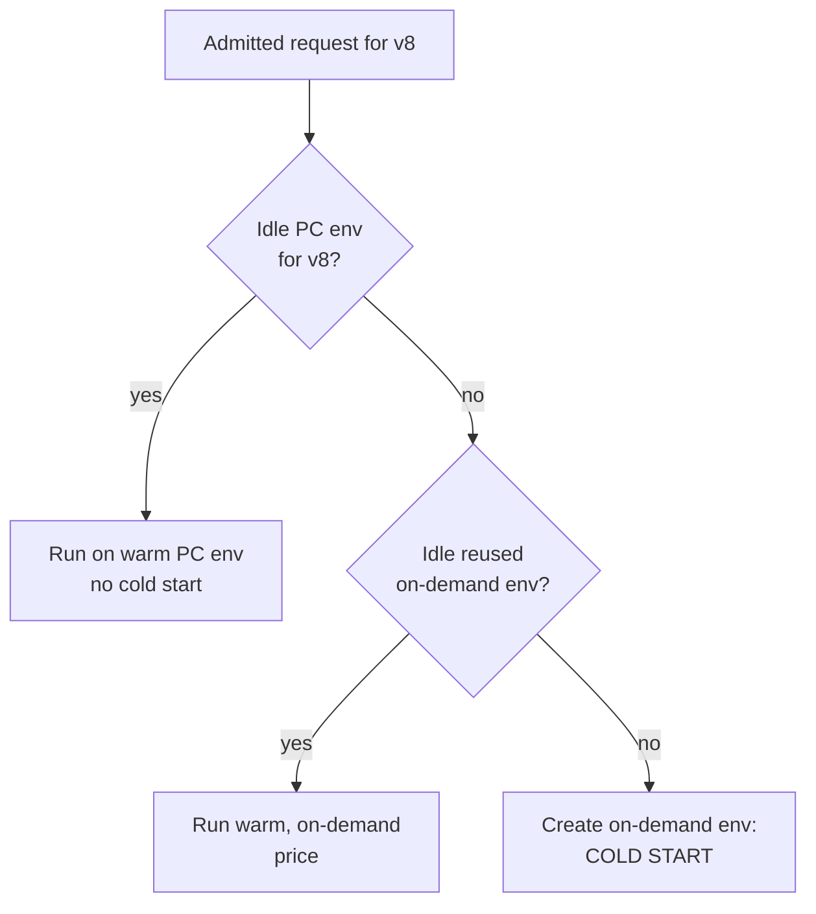

# 05.3 — Deep Dive: Provisioned Concurrency (PC Manager + Application Auto Scaling)

> **Where you are:** Stage 5, dive 3 of 7. Example steps **3** (warm pool split during canary), **6** (scale PC to 400), **7** (all-warm 09:00 wave) and **8** (Bob spills over).
> **After this file you will know:** what PC (Provisioned Concurrency) really pre-creates, its lifecycle, how spillover works, how to scale it, what it costs, and how it fails.

---

## 1. Role recap

**Owns:** keeping *N* initialized execution environments ready for one version or alias. **Appears in:** step 3 (pool follows the weighted alias), step 6 (08:30 scale to 400), step 7 (09:00 wave served warm), step 8 (pool exhausted → Bob spills over).

## 2. Internal design

### 2.1 What "provisioned" means precisely

On-demand environments run the **Init** phase (start extensions, bootstrap runtime, run your top-level code) *inside* the first request. PC moves Init **ahead of time**:


*Caption: PC does not make code faster — it moves boot + Init out of the request's latency.*

Key consequences:

- **Init timing differs.** For PC, Init may run minutes or hours before the first invocation, and the 10 s Init limit is lifted (up to 15 min). Never compute "request start time" or fetch short-lived tokens in Init assuming a request is imminent.
- **Your code can tell.** `AWS_LAMBDA_INITIALIZATION_TYPE` is `provisioned-concurrency` (vs. `on-demand` or `snap-start`).
- **Environments are still recycled.** Lambda periodically replaces PC environments (like any environment) and pre-initializes the replacement *before* retiring the old one, so Init runs again — keep it idempotent.
- **One request per environment** still holds: PC = 400 means 400 *simultaneous* warm invocations, not 400 RPS (Requests Per Second).

### 2.2 Where PC can live

| Target | Allowed? |
|---|---|
| Published version (`checkout:8`) | Yes |
| Alias (`checkout:prod`) | Yes — follows the alias; split across 2 versions if weighted |
| `$LATEST`, or an alias pointing to `$LATEST` | No |
| Both an alias *and* the version it points to | No (conflict) |

PC is carved out of concurrency limits: it counts toward the function's **reserved concurrency** (PC ≤ RC (Reserved Concurrency) if RC is set) and the account quota (always leaving 100 unreserved).

### 2.3 Lifecycle


*Caption: PC is asynchronous — you request N, Lambda reports `Allocated` climbing toward N, then `READY`.*

Allocation typically takes a minute or a few minutes for hundreds of environments; it is subject to the same per-function scaling rate as on-demand (1,000 new environments per 10 s).

### 2.4 Spillover: PC is a floor, never a ceiling


*Caption: when PC is exhausted, requests spill to on-demand rather than fail — throttling is a separate decision made earlier by the Counting service (05.4).*

Metrics to watch (use the `Maximum` statistic):

| Metric | Meaning |
|---|---|
| `ProvisionedConcurrentExecutions` | PC environments busy right now |
| `ProvisionedConcurrencyUtilization` | busy ÷ allocated (0–1) |
| `ProvisionedConcurrencyInvocations` | invocations served by PC |
| `ProvisionedConcurrencySpilloverInvocations` | invocations that **didn't** get a PC environment |

### 2.5 Scaling PC with Application Auto Scaling

PC itself is a static number. **Application Auto Scaling** changes that number for you:

- **Scheduled scaling** — for known events (Black Friday, 09:00 market open). Reliable, because it acts before demand.
- **Target tracking** on `LambdaProvisionedConcurrencyUtilization` (e.g. target 0.7). Reactive: it relies on CloudWatch alarms over several 1-minute datapoints (scale-out after ~3 minutes, scale-in much slower), so it **cannot** catch a 30-second spike. Pair it with scheduled minimums.

### 2.6 Cost model

You pay for PC **while it is configured**, busy or idle, plus a *lower* duration price when it runs. Illustrative `us-east-1` x86 prices (check the pricing page; they change):

| Charge | On-demand | With PC |
|---|---|---|
| Keeping env warm (per GB-s (Gigabyte-second) configured) | — | ≈ $0.0000041667 |
| Duration (per GB-s executed) | ≈ $0.0000166667 | ≈ $0.0000097222 |
| Requests | $0.20 per million | same |

Rule of thumb: PC becomes cheaper than on-demand when utilization stays above ~60%; below that, you are buying latency, not savings. **SnapStart** (Java, Python, .NET) is the no-idle-cost alternative: it snapshots an initialized environment at publish time and restores it on cold start — faster, but not zero, cold starts.

## 3. Interactions

| Neighbor | Contract |
|---|---|
| Alias router (05.2) | PC on an alias tracks its version(s); weight changes trigger reallocation. |
| Counting service (05.4) | PC counts toward reserved/account concurrency; PC does not admit or reject requests. |
| Assignment + Placement (05.5) | PC manager asks Placement to create N environments and registers them with Assignment as "provisioned, idle". |
| Execution environment (05.6) | Init runs at allocation time; handler runs at request time. |
| Application Auto Scaling | Owns changing N over time; Lambda only enforces the latest N. |

## 4. ⚓ Back to the example — steps 3, 6, 7, 8

**Before Thursday,** `prod` had PC 50, all on v7:

```bash
aws lambda put-provisioned-concurrency-config \
  --function-name checkout --qualifier prod \
  --provisioned-concurrent-executions 50
```

**Step 3 — Thursday 14:01**, the alias becomes v7 90% / v8 10%. The PC manager reallocates so roughly 45 warm environments serve v7 and 5 serve v8 (`AllocatedProvisionedConcurrentExecutions` fluctuates during the shift). Alice's request (step 4) finds one of the 5 warm v8 environments. Because Thursday afternoon traffic is ~20 concurrent, 5 is plenty; on a busier day the team would raise PC for the canary window.

**Step 6 — Friday 08:30**, a scheduled action registered on Monday fires:

```bash
aws application-autoscaling register-scalable-target \
  --service-namespace lambda \
  --resource-id function:checkout:prod \
  --scalable-dimension lambda:function:ProvisionedConcurrency \
  --min-capacity 50 --max-capacity 600

aws application-autoscaling put-scheduled-action \
  --service-namespace lambda \
  --resource-id function:checkout:prod \
  --scalable-dimension lambda:function:ProvisionedConcurrency \
  --scheduled-action-name black-friday-open \
  --schedule "at(2026-11-27T08:30:00)" \
  --scalable-target-action MinCapacity=400,MaxCapacity=600

aws application-autoscaling put-scaling-policy \
  --service-namespace lambda \
  --resource-id function:checkout:prod \
  --scalable-dimension lambda:function:ProvisionedConcurrency \
  --policy-name pc-utilization-70 --policy-type TargetTrackingScaling \
  --target-tracking-scaling-policy-configuration \
   '{"TargetValue":0.7,"PredefinedMetricSpecification":{"PredefinedMetricType":"LambdaProvisionedConcurrencyUtilization"}}'
```

PC on `prod` goes `IN_PROGRESS`; Placement creates 350 more v8 environments, each logging an Init with `AWS_LAMBDA_INITIALIZATION_TYPE=provisioned-concurrency`. By ~08:33:

```bash
aws lambda get-provisioned-concurrency-config --function-name checkout --qualifier prod
# { "RequestedProvisionedConcurrentExecutions": 400,
#   "AllocatedProvisionedConcurrentExecutions": 400,
#   "AvailableProvisionedConcurrentExecutions": 400, "Status": "READY" }
```

**Step 7 — 09:00**: 2,000 RPS × 0.15 s ≈ 300 concurrent. Utilization = 300/400 = 0.75; spillover = 0. Every shopper gets ~150 ms.

**Step 8 — 09:05**: demand ~675 concurrent. 400 run on PC; ~275 are `ProvisionedConcurrencySpilloverInvocations`. **Bob**'s request is one of them → cold on-demand environment, ~600 ms extra. Target tracking sees utilization 1.0 and raises PC toward 600 — but its alarms need minutes, so the spike's first wave still pays cold starts. Lesson recorded for next year: schedule 700.

## 5. Failure behavior

| Failure | Symptom | Response |
|---|---|---|
| Init throws in PC envs | Status `FAILED`; deploys fail with "Invalid alias configuration for provisioned concurrency" | Roll alias back to the last good version; fix Init; publish a new version. |
| PC exhausted | Spillover → cold starts (not errors) | Scheduled scaling ahead of known peaks; alarm on spillover. |
| PC > reserved concurrency or account headroom | `put-provisioned-concurrency-config` rejected | Raise RC / account quota first. |
| Alias shifted before new version's PC is `READY` | New version cold-starts | Wait for `READY`; over-provision during weighted shifts. |
| Forgot to scale back down | Paying for idle 600 envs all weekend | Scheduled scale-in action; budget alarms. |

---

**Next →** [04-invoke-frontend-and-concurrency.md](04-invoke-frontend-and-concurrency.md) · **Back to** [../03-concept-map.md](../03-concept-map.md)
