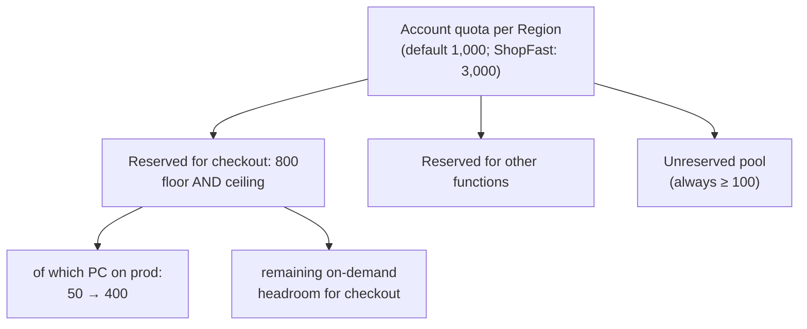
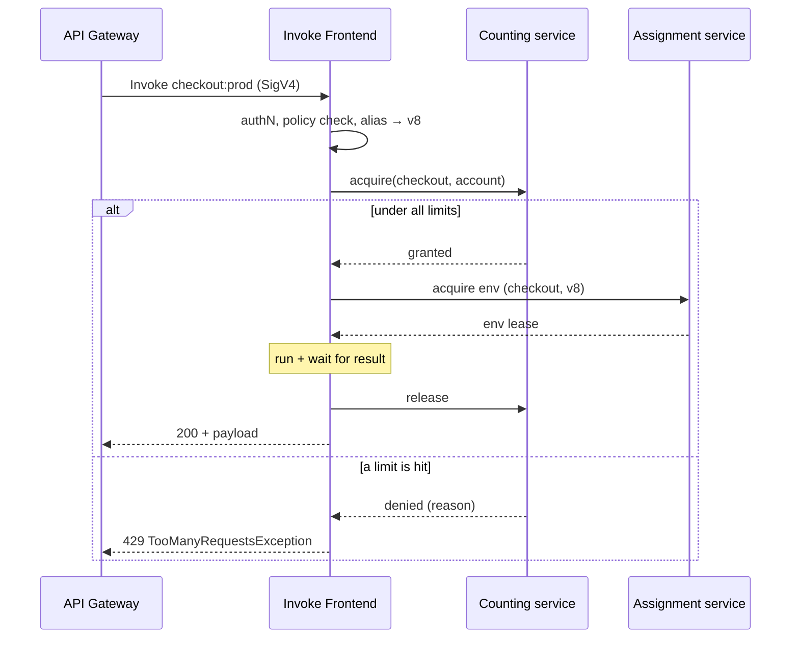

# 05.4 — Deep Dive: Invoke Frontend + Counting Service (Admission & Concurrency)

> **Where you are:** Stage 5, dive 4 of 6. Example steps **4** (Alice admitted), **7** (09:00 wave), **8** (Bob admitted though PC is full) and **9** (Carol throttled).
> **After this file you will know:** what happens to a request before any code runs, the concurrency math, how account vs. reserved concurrency and the scaling rate limit work, and what a throttle really is.

---

## 1. Role recap

**Owns:** the admission decision — is this caller allowed, which version is meant, and is there concurrency left? **Appears in:** steps 4, 7, 8 (admitted) and 9 (rejected with 429).

## 2. Internal design

### 2.1 The Invoke Frontend

A fleet of stateless, multi-AZ (Availability Zone) request handlers behind the regional Lambda endpoint. For each `Invoke` it:

1. **Authenticates** the SigV4 (Signature Version 4) signature (API Gateway signs with its service principal).
2. **Authorizes** against the function's resource-based policy (`lambda:InvokeFunction`, optionally restricted to a `Qualifier`).
3. **Loads metadata** for the function/qualifier from a cache: resolves the alias to a version (05.2), memory size, limits.
4. **Asks the Counting service** for a concurrency unit.
5. **Asks the Assignment service** for an environment (05.5), streams the payload to it, waits for the result.
6. **Releases** the unit and returns the response.

Invocation types change *who waits*, not the core path:

| Type | Caller experience | Path |
|---|---|---|
| **Synchronous** (`RequestResponse`) — API Gateway, Function URLs, SDK (Software Development Kit) | Waits for the result; sees 429 directly on throttle | Frontend → environment, as above |
| **Asynchronous** (`Event`) — S3 (Simple Storage Service), SNS (Simple Notification Service), EventBridge | Gets `202` immediately | Frontend enqueues into an internal queue; internal pollers invoke synchronously later, retrying (default 2 retries) and backing off on throttles |
| **Poll-based** (ESM (Event Source Mapping)) — SQS (Simple Queue Service), Kinesis, DynamoDB Streams | No direct caller | Lambda-managed pollers read batches and invoke synchronously |

### 2.2 Concurrency — the one number Lambda scales on

> **Concurrency = number of invocations in flight = number of busy environments ≈ RPS (Requests Per Second) × average duration (s).**

| Traffic | Avg duration | Concurrency |
|---|---|---|
| 2,000 RPS | 150 ms | 300 |
| 4,500 RPS | 150 ms | 675 |
| 4,500 RPS | 600 ms (cold starts inflate duration) | 2,700 |

The last row is the trap: **slow code or cold starts multiply concurrency.** Shaving duration is a capacity optimization.

### 2.3 The limits the Counting service enforces


*Caption: how concurrency is carved up — reserved concurrency is a private slice; PC lives inside it.*

| Limit | Scope | Effect when hit |
|---|---|---|
| **Account concurrency quota** | All functions in a Region | Functions without reserved concurrency share what's left; extra requests → 429 |
| **Reserved concurrency (RC)** | One function | Guarantees *and caps* that function. RC = 0 means "always throttle" (an emergency off-switch). |
| **Scaling rate** | One function | At most +1,000 new environments per 10 s (refilled continuously, not accrued) |
| **RPS limit** | One function | 10 × available concurrency (stops extremely short invocations from overwhelming the system) |

The Counting service is a low-latency, replicated counter per function and per account: increment on admit, decrement on completion. Because it must answer in well under a millisecond for every invoke in the Region, it is partitioned and kept in memory, trading perfect global precision for speed — limits are enforced closely but not to the exact unit at every instant.

### 2.4 What a throttle is (and isn't)

A throttle is the Counting service saying **no capacity budget** — not "no machines". It surfaces as `429 TooManyRequestsException` with a reason such as `ReservedFunctionConcurrentInvocationLimitExceeded` or `ConcurrentInvocationLimitExceeded`. It is cheap and immediate: no environment was touched, nothing was billed.

## 3. Interactions


*Caption: the admission handshake — Counting decides "may it run?", Assignment decides "where?".*

## 4. ⚓ Back to the example — steps 4, 7, 8, 9

**Step 4 (Alice, Thu 14:05).** The Frontend verifies API Gateway's signature, finds a policy statement allowing `apigateway.amazonaws.com` to invoke `checkout:prod`, resolves the alias → v8, and asks Counting: `checkout` is at 20/800, the account at 140/3,000 → granted.

**Step 7 (Fri 09:00).** 2,000 RPS, 300 in flight. Counting: 300/800 → all granted. These 300 requests occupy 300 of the 400 PC environments.

**Step 8 (Bob, 09:05).** 675 in flight. Counting: 675/800 → **granted**. Note that Counting does not know or care that PC is full; it only checks budgets. Whether Bob gets a warm or a cold environment is the Assignment service's business (05.5). The 275 spillover environments are new on-demand ones — within the scaling rate (+1,000 per 10 s), so none are throttled for scaling.

**Step 9 (Carol, 09:06).** Demand momentarily needs ~850. Bob's cold start and others have inflated average duration, pushing concurrency up. When Carol's request arrives, `checkout` already has 800 in flight:

```json
{
  "Type": "User",
  "message": "Rate Exceeded.",
  "Reason": "ReservedFunctionConcurrentInvocationLimitExceeded"
}
```

API Gateway maps the Lambda 429 to an error to Carol's browser, whose client retries with jitter 300 ms later and succeeds. CloudWatch shows `Throttles` > 0 for one minute. Why does ShopFast accept this? Because RC = 800 is a deliberate guardrail: it protects the payment provider downstream (which allows ~800 parallel connections) and guarantees other functions keep their share of the account's 3,000.

## 5. Failure behavior

| Failure | Behavior | Design response |
|---|---|---|
| Account quota exhausted by a noisy function | Every unreserved function throttles | Reserved concurrency for critical functions; RC caps for noisy ones. |
| Burst faster than the scaling rate | 429s with a stair-step `ConcurrentExecutions` graph | PC for the burst; or smooth the burst with a queue (SQS). |
| Duration regresses (slow dependency) | Concurrency explodes at the same RPS → throttles | Timeouts on downstream calls; alarm on `Duration` and `ConcurrentExecutions`. |
| Frontend host dies mid-request | Sync caller sees an error/timeout; async events are retried from the internal queue | Make handlers idempotent (async and ESM delivery is at-least-once). |

---

**Next →** [05-assignment-and-placement.md](05-assignment-and-placement.md) · **Back to** [../03-concept-map.md](../03-concept-map.md)
