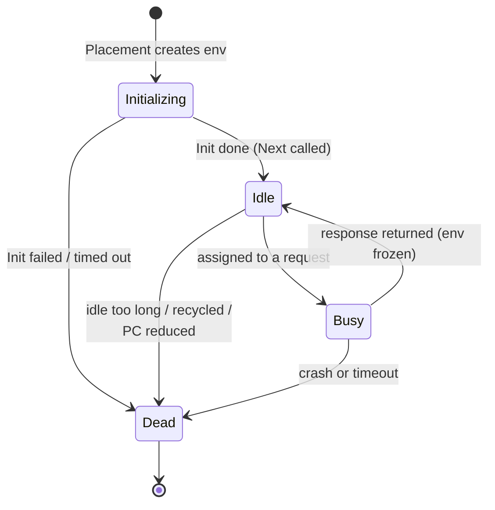
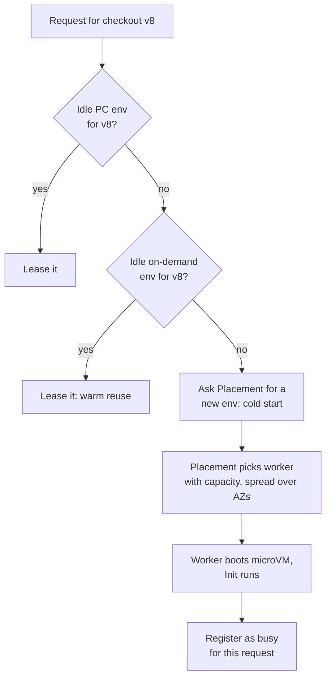

# 05.5 — Deep Dive: Assignment + Placement Services (Finding or Creating an Environment)

> **Where you are:** Stage 5, dive 5 of 6. Example steps **4** (Alice gets a warm PC environment), **6** (400 PC environments created) and **8** (Bob's environment created on demand).
> **After this file you will know:** how Lambda decides *which* environment serves a request, how a new one gets onto a machine, and why warm reuse is the norm.

> These are internal services, described from AWS's public re:Invent architecture talks. Treat them as a mental model; names and details evolve.

---

## 1. Role recap

**Owns:** matching an admitted request to an idle environment of the right version — or getting a new one created on a worker with spare capacity. **Appears in:** step 4 (warm match), step 6 (bulk creation for PC), step 8 (cold creation for Bob).

## 2. Internal design

### 2.1 Two services, two questions

| Service | Question it answers | State it holds |
|---|---|---|
| **Assignment service** | "Which *existing* environment should this request use?" | For every environment: function + version, state (initializing / idle / busy / dead), worker address, whether it is PC or on-demand, lease owner |
| **Placement service** | "On *which worker* should a *new* environment be created?" | Worker fleet capacity, current packing, health |

Separating them keeps the hot path (Assignment, called on every request) small and fast, and keeps the slow, capacity-aware decision (Placement, called only on cold starts and PC allocation) out of that path.

### 2.2 Environment states inside Assignment

*Caption: the lifecycle as the Assignment service tracks it — "warm" simply means an `Idle` entry exists for the right version.*

Assignment is a partitioned, replicated service spread across AZs (Availability Zones); each partition owns a set of functions' environments and replicates its state so a host failure doesn't forget which environments exist. Leases ensure an environment is handed to only one request at a time.

### 2.3 Selection policy (simplified)

*Caption: warm first (PC, then reused on-demand), cold only as a last resort.*

Why warm reuse is the common case: after a response, the environment is frozen, not destroyed, and stays `Idle` for a while (typically minutes; not guaranteed). At steady traffic, almost every request finds one — cold starts concentrate at scale-up moments, after deploys (new version = no warm envs yet), and after idle periods.

### 2.4 Placement

Placement chooses a worker (an EC2 (Elastic Compute Cloud) bare-metal Nitro host running many Firecracker microVMs) by:

- **capacity** — memory/CPU (Central Processing Unit) headroom for a 1,024 MB slot;
- **spread** — environments of one function across AZs and hosts, so one host loss hurts little;
- **packing** — mixing workloads from different customers/functions to use hosts efficiently (safe because of microVM isolation, 05.6);
- **code locality** — the worker fetches the version's artifact (zip from S3, or container image chunks with caching), so warm caches help.

## 3. Interactions

| Neighbor | Contract |
|---|---|
| Invoke Frontend (05.4) | Calls `acquire(function, version)`; receives an environment lease and address; returns it on completion. |
| PC manager (05.3) | Requests *N* environments in advance; they register as `Idle`, flagged provisioned, and are never reclaimed for idleness. |
| Version store (05.1) | Placement/worker fetches the exact artifact + config of that version. |
| Execution environment (05.6) | Created by the worker on Placement's request; reports Init completion and each invoke's completion. |

## 4. ⚓ Back to the example — steps 4, 6, 8

**Step 4 (Alice, Thu 14:05).** Frontend asks `acquire(checkout, v8)`. Assignment's partition for `checkout` lists 5 provisioned v8 environments, 4 idle. It leases `env-v8-pc-03` on worker `w-1a-0419` and returns its address. The Frontend sends Alice's event; ~150 ms later the environment is `Idle` again.

**Step 6 (Fri 08:30).** The PC manager asks for 350 more v8 environments. Placement spreads them across the three AZs (≈117 each) and many workers; each worker boots a microVM, fetches `checkout` v8, runs Init. As each finishes, Assignment records it `Idle (provisioned)`. `Allocated` rises 50 → 400.

**Step 8 (Bob, 09:05).** Frontend asks `acquire(checkout, v8)`. All 400 provisioned entries are `Busy`; the few on-demand v8 environments created in the last minute are also busy. Assignment asks **Placement** for one more. Placement picks worker `w-1c-1172`; the microVM boots (~tens of ms), the code is fetched, Init runs (~600 ms), and Assignment hands the new environment to Bob's request directly. Bob's response arrives at ~750 ms instead of ~150 ms. When Bob's request finishes, this on-demand environment stays `Idle` and serves the next shopper warm.

## 5. Failure behavior

| Failure | Behavior | Design response |
|---|---|---|
| Worker host dies | Its environments go `Dead`; in-flight sync requests fail; next requests get other envs or new ones | Spread across hosts/AZs; caller retries; idempotent handlers. |
| Assignment partition host dies | A replica takes over the partition's state | Replicated state, so environments aren't "forgotten" (which would cause a wave of cold starts). |
| Init fails on a new env | Env marked `Dead`; for on-demand, the request gets an `Init` error | Fix Init; for PC, status goes `FAILED` (05.3). |
| Placement capacity tight in an AZ | Placement uses other AZs | Multi-AZ by default; nothing to configure. |

---

**Next →** [06-execution-environment.md](06-execution-environment.md) · **Back to** [../03-concept-map.md](../03-concept-map.md)
