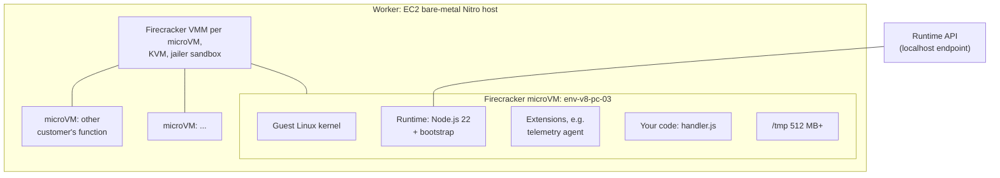
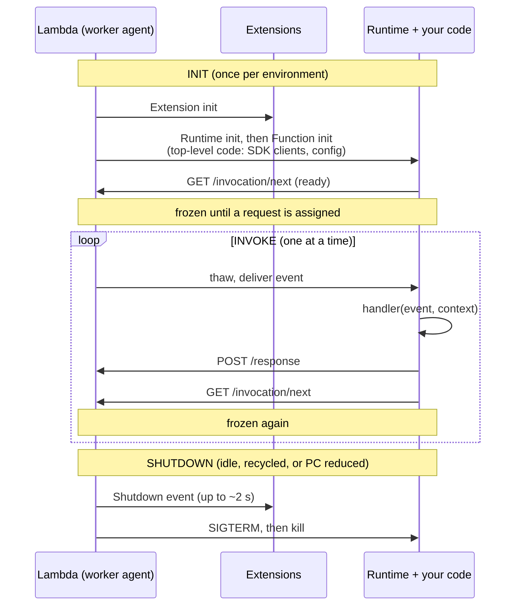

# 05.6 — Deep Dive: The Execution Environment (Firecracker microVM)

> **Where you are:** Stage 5, dive 6 of 6. Example steps **4** (Alice's handler runs warm), **6** (400 Inits ahead of time), **7** (the warm wave) and **8** (Bob's cold Init).
> **After this file you will know:** what an environment physically is, its Init/Invoke/Shutdown lifecycle, freeze/thaw and reuse, and how to write code that exploits it.

---

## 1. Role recap

**Owns:** actually running your code — Init once, then one invocation at a time until retired. **Appears in:** steps 4, 6, 7, 8.

## 2. Internal design

### 2.1 Physical anatomy


*Caption: one environment = one microVM with its own kernel; thousands share a host safely.*

- **Firecracker** is an open-source VMM (Virtual Machine Monitor) built by AWS on Linux KVM (Kernel-based Virtual Machine). It boots a minimal microVM in ~125 ms with a few MB of overhead, giving **hardware-virtualization isolation** with container-like density. This is what allows Placement to pack different customers' functions on one host.
- Inside: a guest kernel, the language runtime, optional extensions, and your code. Memory is what you configured (1,024 MB); CPU share scales with memory.
- The runtime talks to Lambda through the **Runtime API**, a local HTTP (Hypertext Transfer Protocol) endpoint: `GET /2018-06-01/runtime/invocation/next` blocks until an event arrives; `POST …/invocation/{id}/response` returns the result.

### 2.2 Lifecycle: Init → Invoke × N → Shutdown


*Caption: Init runs once; each invoke thaws, runs, and refreezes the same process.*

| Phase | Time limit | Billed? | Notes |
|---|---|---|---|
| **Init** | 10 s on-demand (else retried at first invoke under the function timeout); up to 15 min for PC / SnapStart | Yes (standardized since Aug 2025) | Extension init → runtime init → function init |
| **Invoke** | Function timeout (≤ 900 s) | Yes, per ms | One event at a time |
| **Shutdown** | ~0.5–2 s | No | Extensions flush telemetry |

### 2.3 Freeze / thaw and what survives between invocations

Between invocations the microVM's processes are **frozen** (no CPU). On the next request they are thawed with memory intact. Therefore, in the same environment:

| Survives across invocations | Does not |
|---|---|
| Global variables, SDK (Software Development Kit) clients, DB (Database) connection pools, in-memory caches | Background work after the response (it is frozen mid-flight; may resume on the next invoke or never) |
| Files in `/tmp` | Anything after the environment is retired (lifetime: minutes idle to a few hours, never guaranteed) |

Design rules that follow:

1. **Do expensive setup in Init** (outside the handler): clients, config fetch, connection warm-up. It is paid once per environment — and for PC, off the request path.
2. **Never rely on state being there**: caches must be optional; durable state goes to DynamoDB/S3.
3. **Never leave work running after returning** — flush before responding.
4. **Assume concurrency = many separate processes**: 400 environments = 400 connection pools to your database (use RDS Proxy (Relational Database Service Proxy) or HTTP-based data APIs if that is too many).

## 3. Interactions

| Neighbor | Contract |
|---|---|
| Placement / worker (05.5) | Creates the microVM, mounts the version's code, starts Init. |
| Assignment (05.5) | Learns `Idle` when the runtime calls `/invocation/next`; `Busy` while an event is outstanding. |
| Invoke Frontend (05.4) | Receives the response payload (≤ 6 MB sync) and the error type if the handler threw or timed out. |
| CloudWatch Logs | `START`, `END`, `REPORT` lines per invocation; `Init Duration` appears only on cold starts. |

## 4. ⚓ Back to the example — steps 4, 6, 7, 8

ShopFast's `checkout` v8 code, structured for the lifecycle:

```javascript
// handler.js — Node.js 22, ES module ("type": "module" in package.json, enables top-level await)
import { DynamoDBClient } from "@aws-sdk/client-dynamodb";
import { loadCouponRules } from "./coupons.js";

// ---- INIT: runs once per environment (at 08:30 for PC envs, inside Bob's request for his) ----
const ddb = new DynamoDBClient({});           // connection reuse across invokes
const couponRules = await loadCouponRules();   // ~400 ms fetch, cached in memory
const initType = process.env.AWS_LAMBDA_INITIALIZATION_TYPE; // "provisioned-concurrency" | "on-demand"
console.log(JSON.stringify({ msg: "init", initType, version: process.env.AWS_LAMBDA_FUNCTION_VERSION }));

// ---- INVOKE: runs once per request ----
export const handler = async (event) => {
  const order = JSON.parse(event.body);
  const total = applyCoupons(order, couponRules);
  await chargeAndSave(ddb, order, total);      // finish all work BEFORE returning
  return { statusCode: 200, body: JSON.stringify({ orderId: order.id, total }) };
};
```

**Step 6 (Fri 08:30) — PC Init.** Each of the 350 new environments logs `{"msg":"init","initType":"provisioned-concurrency","version":"8"}`; the coupon fetch happens now, while no shopper waits.

**Step 4 / 7 — warm invokes (Alice; the 09:00 wave).** The environment is thawed, the handler runs with `ddb` and `couponRules` already in memory:

```
START RequestId: 6f0c1d2e-... Version: 8
END RequestId: 6f0c1d2e-...
REPORT RequestId: 6f0c1d2e-...  Duration: 148.21 ms  Billed Duration: 149 ms  Memory Size: 1024 MB  Max Memory Used: 182 MB
```

No `Init Duration` field — this was not a cold start.

**Step 8 — Bob's cold start.** A brand-new on-demand microVM: boot, fetch code, then Init *inside* Bob's request (`initType` = `on-demand`):

```
INIT_START Runtime Version: nodejs:22.v15  Runtime Version ARN: arn:aws:lambda:us-east-1::runtime:...
START RequestId: 9a77e0b4-... Version: 8
END RequestId: 9a77e0b4-...
REPORT RequestId: 9a77e0b4-...  Duration: 151.03 ms  Billed Duration: 752 ms  Memory Size: 1024 MB  Max Memory Used: 176 MB  Init Duration: 600.47 ms
```

Bob paid ~600 ms of Init (the coupon fetch dominates). Two cheap improvements the team notes: lazy-load coupon rules from a smaller endpoint, and raise PC schedule for next year.

## 5. Failure behavior

| Failure | Behavior | Design response |
|---|---|---|
| Handler throws | Error returned to Frontend; environment usually reused | Return structured errors; idempotency for retries. |
| Timeout (10 s) | Invocation killed; environment is reset (process restarted, Init runs again) | Timeouts on downstream calls shorter than the function timeout. |
| Out of memory | Runtime crashes; environment recycled | Watch `Max Memory Used` in `REPORT`; raise memory (also gives more CPU). |
| Init exceeds 10 s (on-demand) | Init retried within the first invocation under the function timeout | Move slow work out of Init, or use PC/SnapStart. |
| Leaked state between requests (e.g. global mutable user data) | Request B sees request A's data in the same environment | Keep per-request state inside the handler. |

---

**Next →** [../06-walkthrough.md](../06-walkthrough.md) · **Back to** [../03-concept-map.md](../03-concept-map.md)
