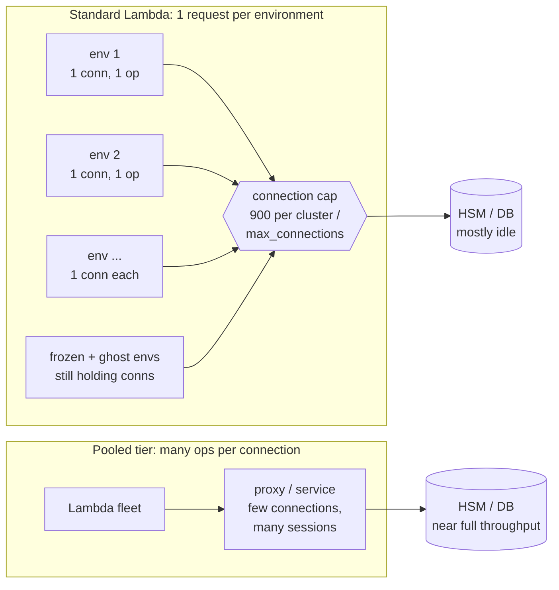
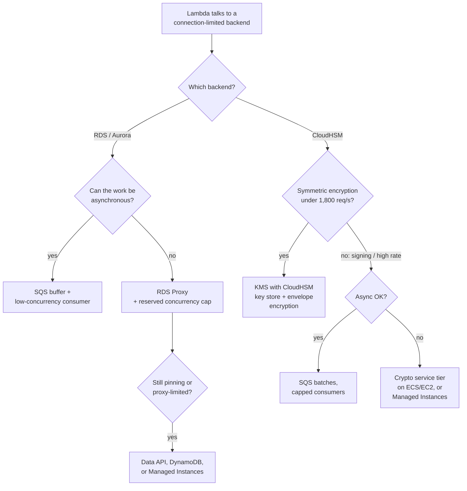

# 05.7 — Deep Dive: Connection-Bound Backends (CloudHSM, Relational Databases)

> **Where you are:** Stage 5, dive 7 of 7. A "what-if" extension of the example: `checkout` signs a payment token on CloudHSM and writes the order to Aurora. It touches steps **5** (promote v8), **6** (PC to 400) and **9** (the 800-environment peak).
> **After this file you will know:** why Lambda fills a backend's connection limit long before it uses the backend's capacity, the hard numbers for CloudHSM and databases, and the two ways out: more work per connection, or no persistent connection at all.

| Abbreviation | Full name |
|---|---|
| HSM | Hardware Security Module |
| KMS | Key Management Service |
| RDS | Relational Database Service |
| SDK | Software Development Kit |
| PKCS#11 | Public-Key Cryptography Standards #11 (the HSM client API) |
| ESM | Event Source Mapping |
| SQS | Simple Queue Service |
| ECS / EC2 | Elastic Container Service / Elastic Compute Cloud |
| PC | Provisioned Concurrency |
| RPS | Requests Per Second |

---

## 1. Role recap

**Not a Lambda component** — this is where two of them, the **execution environment** (05.6) and **concurrency** (05.4), meet a backend that rations *connections*. Many backends do: relational databases (`max_connections`), CloudHSM (900 client connections per cluster), Redis, legacy message brokers. **Appears in:** the what-if version of steps 5, 6 and 9.

## 2. Internal design — why connections run out first

### 2.1 The rule: one connection per environment, not per invocation

If the client is created in Init (outside the handler) and reused — as 05.6 recommends — Lambda does **not** open a connection per invocation. It opens one per **execution environment**. But a standard environment serves exactly one request at a time, so:

> **Open connections ≈ execution environments ≈ peak concurrency**, plus idle environments and leaked ones.

Three consequences follow:

1. **Connections follow concurrency, not work.** Concurrency = RPS × duration (05.4). A 150 ms request that spends 5 ms on the HSM still holds its connection for all 150 ms — and keeps holding it while the environment is **frozen** between requests, which can last minutes.
2. **Each connection carries one operation at a time.** CloudHSM and databases reach full throughput with *many concurrent operations over few connections* (threads, sessions, pipelining). A single-concurrency environment never puts more than one request on its connection.
3. **Connections outlive their environment.** When Lambda reclaims an environment, the process gets no reliable chance to close sockets (only an external extension receives `SHUTDOWN`). The backend keeps the session until its own idle timeout, as a **ghost connection**.

*Caption: the connection cap is reached while the backend sits mostly idle; a pooling tier changes the ratio of operations to connections.*

### 2.2 The hard numbers

| Backend | Limit |
|---|---|
| CloudHSM cluster | **900 concurrent client connections per cluster, not adjustable.** With Client SDK 5, one *application process* = one connection, so **each Lambda environment counts as one**. Up to 1,024 PKCS#11 sessions per application. |
| CloudHSM throughput (reference) | 6 × `hsm2m.medium` ≈ 7,000 EC P256 signs/s or ≈ 5,000 RSA-2048 signs/s — measured with **one multi-threaded Java client on one EC2 instance**. |
| RDS / Aurora | `max_connections`, derived from instance memory unless set; every connection costs database memory even when idle. |
| KMS CloudHSM key store | 1,800 requests/s per key store, not adjustable; symmetric keys only. |

AWS's own benchmark is the clearest statement of the mismatch: the cluster reaches full speed from **one** connection, while a Lambda fleet can use up all 900 connections with the HSMs mostly idle.

## 3. Interactions — the ways out

There are two families of fix: **put more operations on each connection**, or **stop needing a persistent connection**.

### 3.1 Hygiene (necessary, not sufficient)

- **Connect once in Init, reuse; pool size 1.** A bigger pool in standard Lambda only multiplies connections.
- **Reserved concurrency = connection budget** (05.4): backend limit − other clients − headroom for deploy overlap. For SQS triggers, set the ESM's **maximum concurrency**.
- **Short backend idle timeouts** (`wait_timeout`, `idle_session_timeout`) so ghost connections are reaped quickly.
- **PC pre-opens connections**: every provisioned environment runs Init ahead of time (05.3).

### 3.2 Databases

| Option | How it helps | Caveats |
|---|---|---|
| **RDS Proxy** (first choice) | Lambda connects to the proxy; it multiplexes many client connections onto a back-end pool capped by `MaxConnectionsPercent`. Absorbs connection storms and failovers. | **Pinning** (session state such as `SET`, temp tables) ties a client to one back-end connection — watch `DatabaseConnectionsCurrentlySessionPinned`. A full pool makes requests wait up to `ConnectionBorrowTimeout`. |
| **Aurora Data API** | HTTPS calls, no persistent connection. | Aurora only; per-call overhead; result-size limits. |
| **SQS buffer** | Writes are queued; a low-concurrency consumer writes in batches, so connections no longer follow front-end traffic. | Asynchronous work only. |
| **DynamoDB** | HTTPS API with no connection limit. | A data-model change. |
| **Lambda Managed Instances** (2025) | One environment serves many requests concurrently, so one thread-safe pool is shared by many in-flight requests. | Handler and clients must be thread-safe; different pricing and capacity model. |

### 3.3 CloudHSM

CloudHSM has **no managed proxy like RDS Proxy**, and its 900-connection cap is fixed — so architecture matters more.

| Option | How it helps | Caveats |
|---|---|---|
| **KMS with a CloudHSM key store** | Keys stay in your cluster; Lambda calls KMS over HTTPS and **KMS holds the HSM connections**. | Symmetric keys only; 1,800 req/s per key store; also counts toward the account KMS quota. Cannot do RSA/EC signing. |
| **Crypto service tier** (ECS/EC2) | A few long-running processes, each with one connection and many sessions/threads, like AWS's benchmark. Lambda calls it over HTTPS/gRPC. Unlocks the cluster's **full** throughput. | You operate a service (scaling, mTLS, availability). The right answer for high-rate asymmetric signing. |
| **Envelope encryption + data-key caching** | The HSM only wraps and unwraps data keys; bulk crypto happens in-process with cached keys. HSM calls fall by orders of magnitude. | Encryption only, not signing; plaintext data keys stay in memory for the cache lifetime. |
| **SQS batches** | One invocation signs N items over its single connection. | Asynchronous only. |
| **Lambda Managed Instances** | One connection now serves many concurrent requests, using the client's multi-session design. | Check that the SDK binding supports concurrent use in one process. |
| **Token keys, not session keys** | Token keys are load-balanced across HSMs; session keys pin throughput to one HSM. | Spreads operations; doesn't reduce connections. |

*Caption: choosing a fix by backend and by whether the work can wait.*

## 4. ⚓ Back to the example — what if `checkout` used CloudHSM and Aurora?

Suppose v8 adds two calls per checkout: **sign a payment token on CloudHSM (~5 ms)** and **insert the order into Aurora**. Both clients are created in Init, as 05.6 recommends.

| Moment | Environments | HSM connections (cap 900) | What goes wrong |
|---|---|---|---|
| Thu, step 5 — promote v8 to 100% | v7 environments go idle but are not reclaimed at once | v7 + v8 environments both hold connections for a while | Deploy overlap: the count briefly exceeds the steady state. |
| Fri 08:30, step 6 — PC to 400 | 400 Inits run ahead of time | **400 connections opened before a single customer arrives**, held all day | Fine — if budgeted. |
| Fri 09:06, step 9 — the peak | 800 (reserved concurrency) | **800 of 900** | A batch re-keying job plus ghost connections from reclaimed environments fill the last 100 → new environments fail in Init. |

At the peak, `checkout` runs ≈ 800 / 0.15 s ≈ **5,300 requests/s**, so ≈ 5,300 signs/s — and each connection is busy only 5 ms out of every 150 ms (≈ 3%). Adding HSMs raises capacity that cannot be reached; **the connection cap is what limits throughput.**

ShopFast's fix: payment signing is asymmetric and synchronous, so it moves to a small **crypto service on ECS** (4 tasks, 4 connections, many sessions each); order writes go through **RDS Proxy**; and reserved concurrency stays at 800 because the database budget, not the HSM, now sets the limit.

## 5. Failure behavior

| Failure | Symptom | Design response |
|---|---|---|
| CloudHSM connection cap reached | New environments fail to connect in Init → invocation errors (not throttles) | Budget connections; front the cluster with KMS or a service tier. |
| Database `max_connections` reached | `too many connections` / `remaining connection slots are reserved` errors | RDS Proxy; reserved concurrency cap; short idle timeouts. |
| RDS Proxy pool exhausted | Requests wait, then fail after `ConnectionBorrowTimeout` | Reduce pinning; raise `MaxConnectionsPercent`; cap concurrency. |
| Ghost connections after scale-in or deploy | Connection count stays high with low traffic | Short backend idle timeout; optional extension that closes on `SHUTDOWN`. |
| KMS CloudHSM key store throttled | `ThrottlingException`; `CloudHSMKeyStoreThrottle` metric rises | Data-key caching; stay under 1,800 req/s; dedicated cluster. |

## Conclusion

In standard Lambda, connections scale with **concurrency**, not with work, and each connection carries one operation at a time — so connection-rationed backends hit their connection limit while their capacity sits unused. Bigger HSMs or databases don't help; **more operations per connection** (RDS Proxy, a crypto service tier, Managed Instances, batching) or **no persistent connection** (Data API, KMS key store, DynamoDB) do.

*Quota values checked against AWS documentation on 2026-10-15 (CloudHSM quotas and performance, KMS request quotas, RDS Proxy connection settings).*

---

**Next →** [../06-walkthrough.md](../06-walkthrough.md) · **Back to** [../03-concept-map.md](../03-concept-map.md)
