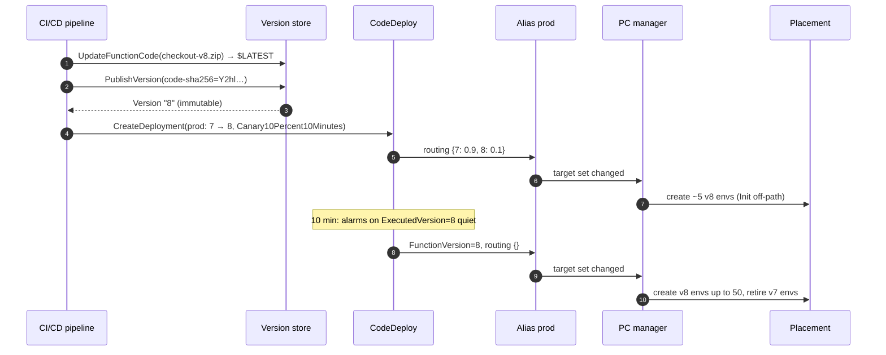
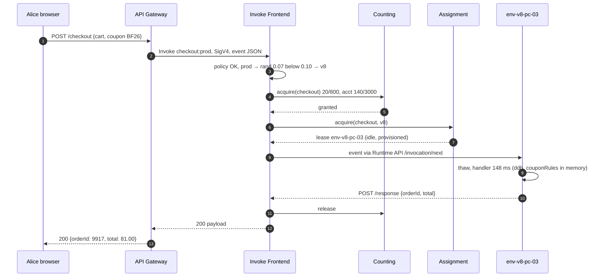
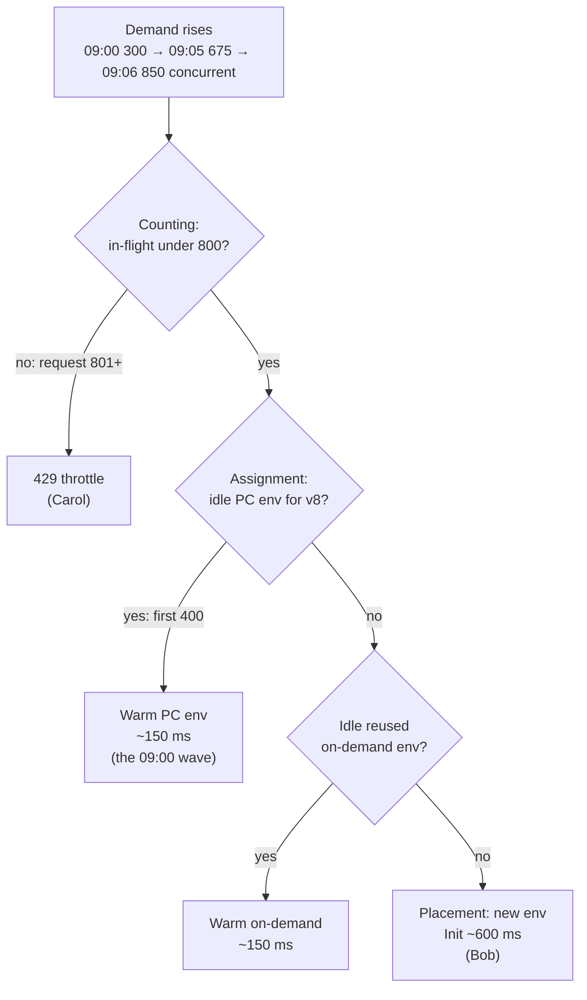
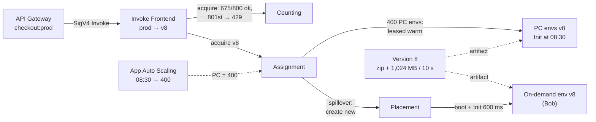

# 06 — Full Walkthrough: ShopFast's Black Friday, End to End at Full Depth

> **Where you are:** Stage 6 of 6 (Walkthrough).
> **After this file you will know:** the whole running example as one continuous story, with every component's internals (from the dives) visible at each hop.

---

## Part A — Thursday: shipping v8 safely

*Question it answers: how does new code reach production without changing a single caller?*

*Caption: deploy = publish an immutable snapshot, then move a pointer in guarded steps; PC follows the pointer.*

1. **`$LATEST` → v8** ([05.1](05-deep-dives/01-versions.md)). `UpdateFunctionCode` changes only the draft. `PublishVersion` freezes code (by `CodeSha256`) and full configuration (Node.js 22, 1,024 MB, 10 s) as version **8**. The number will never be reused or edited.
2. **Alias goes weighted** ([05.2](05-deep-dives/02-aliases.md)). `prod` = `{primary 7, additional {8: 0.10}}`. API (Application Programming Interface) Gateway still calls `checkout:prod`.
3. **PC follows** ([05.3](05-deep-dives/03-provisioned-concurrency.md)). PC = 50 on `prod` is redistributed ≈ 45 v7 / 5 v8. Each new v8 environment runs **Init** now (`AWS_LAMBDA_INITIALIZATION_TYPE=provisioned-concurrency`), loading coupon rules before any shopper arrives.

## Part B — Thursday 14:05: Alice's warm request (during the canary)

*Question it answers: what does each component do for one warm request, and what crosses each hop?*

*Caption: a warm, provisioned invocation — no boot, no Init, ~150 ms of handler plus a few ms of routing.*

| Hop | Data crossing it | What happens inside (from the dives) |
|---|---|---|
| G → FE | Signed `Invoke` request, event JSON | Frontend authenticates, checks resource policy for `apigateway.amazonaws.com` on qualifier `prod` (05.4) |
| FE (alias) | `prod` record | Stateless per-request coin flip → v8; recorded as `ExecutedVersion=8` (05.2) |
| FE → CS | `acquire(checkout)` | Counters: function 20/800, account 140/3,000 → granted (05.4) |
| FE → AS | `acquire(checkout, v8)` | Idle provisioned v8 entry found → leased (05.5) |
| FE → E | Event over the Runtime API | Thaw frozen microVM; handler runs with Init-time state (05.6) |
| E → FE → G | Response ≤ 6 MB | Env back to `Idle`; unit released; `REPORT` line without `Init Duration` |

## Part C — Friday: the sale

### 08:30 — pre-warming

Application Auto Scaling's scheduled action sets `MinCapacity=400` on `function:checkout:prod`. PC status `IN_PROGRESS`; the PC manager asks Placement for 350 more v8 environments, spread over three AZs (Availability Zones). Each worker boots a Firecracker microVM, fetches v8, runs Init. Assignment registers each as `Idle (provisioned)`. ~08:33: `Allocated=400, Status=READY`.

### 09:00–09:06 — the full picture

*Question it answers: how do PC, spillover and throttling layer on each other as demand rises?*

*Caption: three layers in strict order — budget (Counting), warm pool (PC), then on-demand creation.*

**09:00 — the first wave.** 2,000 RPS (Requests Per Second) × 0.15 s = **300** concurrent. Counting: 300/800, granted. Assignment: 300 of 400 provisioned envs busy. Utilization 0.75, spillover 0, p99 (99th percentile) latency ≈ 180 ms.

**09:05 — Bob.** ~4,500 RPS → **675** concurrent.

1. Frontend resolves `prod` → v8 (no weights now).
2. Counting: 675/800 → **granted**. It doesn't know PC is full; it only guards budgets.
3. Assignment: 400/400 provisioned busy; recently created on-demand envs busy → asks **Placement**.
4. Placement picks worker `w-1c-1172`; microVM boots; code fetched; **Init** runs inside Bob's request (`initType=on-demand`, coupon fetch ~400 ms of it).
5. Handler 151 ms. Bob sees ~750 ms. `REPORT … Init Duration: 600.47 ms`. Metric `ProvisionedConcurrencySpilloverInvocations` counts him.
6. The new env stays `Idle` afterwards → the next shopper gets it warm. Target tracking sees utilization 1.0 and starts raising PC toward 600 — minutes later.

**09:06 — Carol.** Cold starts inflated average duration, so concurrency overshoots to ~850 needed. Carol's request arrives with 800 in flight:

- Counting: 800/800 → **denied**, reason `ReservedFunctionConcurrentInvocationLimitExceeded`.
- No environment touched, nothing billed. API Gateway returns an error; Carol's client retries with jitter and succeeds 300 ms later.
- This is the guardrail working: the payment provider behind `checkout` tolerates ~800 parallel connections, and other functions keep their slice of the account's 3,000.

### Annotated architecture

The same coordination diagram as [03-concept-map.md §3.3](03-concept-map.md), now with the example's data on each hop. A swim-lane version including the control plane is in [diagrams/lambda-architecture.drawio](diagrams/lambda-architecture.drawio).

## Part D — after the sale

- 12:00: scheduled action sets `MinCapacity=50`; PC environments retire (Shutdown phase, extensions flush telemetry).
- Post-mortem metrics: 0 errors; ~2% spillover invocations; 1 minute of throttles (≈ 0.3% of requests, all retried). Action items: schedule PC 700 next year; shrink Init (lazy coupon load) to cut spillover latency; keep RC 800 because the downstream limit is real.
- v7 is still there, untouched — a rollback target until the team prunes old versions.

## Recap: the problem, solved

The Stage-1 pain was *deciding capacity before demand arrives* and *deploying by mutating live servers*. In this walkthrough, ShopFast never sized a fleet: the Counting service admitted requests against a concurrency budget, Assignment reused warm environments, and Placement created new Firecracker microVMs only when needed. Where cold starts were unacceptable, provisioned concurrency moved Init to 08:30. And the deploy never touched a running server or a caller: v8 was an immutable version, and production switched to it by moving the `prod` alias — with a ten-minute canary and a one-command rollback always available.

---

**Next →** [07-next-steps.md](07-next-steps.md) · **Back to** [03-concept-map.md](03-concept-map.md)
